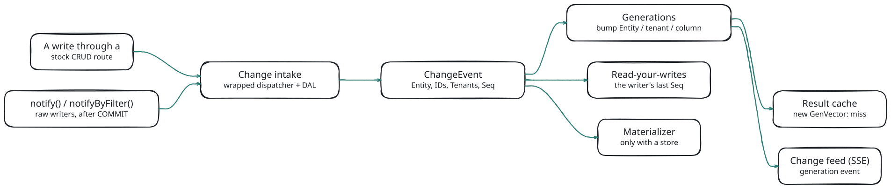
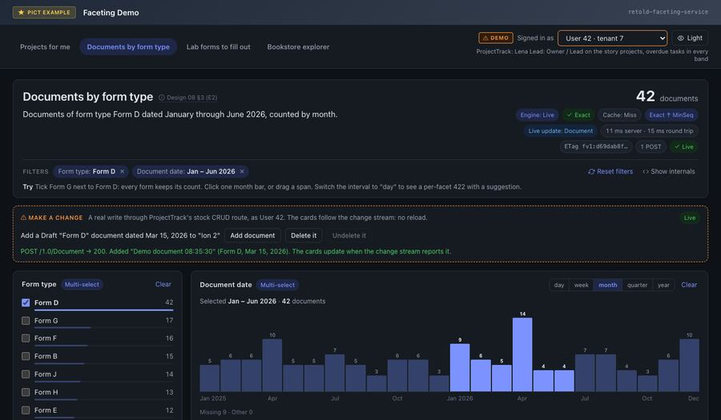

# Caching and Invalidation

The faceting service can keep whole answers in an in-process result cache and answer `If-None-Match` with `304 Not Modified` before any SQL runs. The cache is **off by default**. Change capture, generations and the change feed run either way: they never change an answer, they only tell the service (and your pages) when an answer may have moved.

This page explains how a write becomes an invalidation, how the cache decides that an answer is still current, and what the freshness modes `Exact`, `Bounded` and `Fast` mean. The wire format of the change feed is in [The Change Feed (SSE)](#/page/api/Change_Feed); every option named here is listed with its default in [Configuration](#/page/Configuration).

## Why the Cache Is Opt-In

A cached answer is only as good as the service's knowledge of writes. The faceting service learns about writes in the process it runs in: through the stock meadow-endpoints CRUD routes, which it captures automatically, and through `notify()` calls your own code makes. It does not see a write made by another process, a DAL call from an importer, or raw SQL, unless that code calls `notify()`.

So turn the cache on only when every writer of the faceted tables either goes through the stock CRUD routes **in this process** or reports its change with `notify()` after it commits. With several application processes, one process never sees another's writes until `Cache.MaxAgeMS` expires the entry. In that layout leave the cache off.

```javascript
libRetoldFacetingService.installOnRetoldDataService(_Fable.RetoldDataService,
	{
		Scope: { Policy: { Column: 'IDCustomer', SessionField: 'CustomerID' }, Guard: 'Strict' },
		// Every write of the faceted tables reaches this process: the cache, the generation
		// ETag and the 304 short-circuit are safe to turn on.
		Cache: { Enabled: true }
	},
	(pError) =>
	{
		// Facets, Records, Count and Keys are served under /1.0/Facet/
	});
```

With the cache off, every Query is computed fresh. The envelope still carries `DependsOn`, and the change feed still signals writes, so pages can refetch when the data moves.

## From a Write to an Invalidation

<!-- bespoke diagram: edit diagrams/change-flow.mmd or .hints.json, then: npx pict-renderer-graph build modules/meadow/retold-faceting-service/docs -->


Every change source feeds one **change intake**. The intake turns each write into a `ChangeEvent`, stamps it with a sequence number (`Seq`) and hands it, synchronously and in order, to its subscribers:

1. **Generations** bump the counters the event touches (see *Generations* below). A cached answer that read one of those counters no longer matches.
2. **Read-your-writes** remembers the writer's last `Seq`, so the writer's next reads are exact.
3. The **materializer** queues the changed IDs for the ClickHouse mirror, when a store is configured (see [The ClickHouse Store](#/page/ClickHouse_Store)).

The change feed listens to the generation bumps and pushes a `generation` event to every open stream that may see the entity.

Subscribers do no I/O and never throw into the write. A write is never failed or delayed by faceting; by the time the client receives its `2xx`, the generations are already bumped.

## The Change Intake

### What It Captures

At attach, and again after every model reload, the intake wraps two things on each facetable entity's route-bound controller: the behavior **dispatcher** (`BehaviorInjection.runBehavior`) and the DAL's write methods (`doCreate`, `doUpdate`, `doDelete`, `doUndelete`). It never takes over a behavior slot, so your own `setBehavior` calls keep working and cannot remove the capture.

That covers every write path of the stock CRUD routes:

| Write | Routes |
|---|---|
| Create | `POST /1.0/<Entity>`, bulk `POST /1.0/<Entity>s` |
| Update | `PUT /1.0/<Entity>`, `PUT` or `PATCH /1.0/<Entity>/:IDRecord`, bulk `PUT /1.0/<Entity>s` |
| Upsert | the Upsert and Upserts routes (each record becomes a create or an update) |
| Delete | `DELETE /1.0/<Entity>` and `DELETE /1.0/<Entity>/:IDRecord` |
| Undelete | `GET /1.0/<Entity>/Undelete/:IDRecord` |

The change is taken at the start of the `PostOperation` step, after the row is committed and before your own PostOperation behaviors run. The "before" image is copied when the `PreOperation` step starts, so a PreOperation behavior that edits the record cannot hide the real change.

### When the Precise Change Is Unknown

Some writes commit without reaching a PostOperation: a `PUT { Deleted: 1 }`, an update that moves a row out of an `Update-QueryConfiguration` filter, a re-read that fails. The DAL wrapper then sends a **conservative** event: the old image and the submitted record, with every column marked changed.

A change that cannot be derived at all **fails closed**: the intake sends an "anything in this entity may have changed" event for every tenant. Extra invalidation is always safe; a missed one never happens silently.

### A Captured ChangeEvent

This is a real event, captured from a `PUT /1.0/Review` that changed one review's rating in tenant 1 (Bookstore-Tenant fixture, as user 7):

<!-- docs-check: skip captured ChangeEvent, not a request body -->
```json
{
	"ChangeID": "ch:000001",
	"Source": "Interim",
	"Entity": "Review",
	"Operation": "Update",
	"IDs":
	[
		5
	],
	"Tenants":
	[
		1
	],
	"Owners": null,
	"ChangedColumns":
	[
		"Rating",
		"UpdateDate",
		"UpdatingIDUser"
	],
	"KeyImages":
	{
		"5":
		{
			"B":
			{
				"IDTenant": 1
			},
			"A":
			{
				"IDTenant": 1
			}
		}
	},
	"Filter": null,
	"Actor":
	{
		"PrincipalKey": "pk:0cf33edb2f35dc0b",
		"UserID": 7,
		"Verb": "Update"
	},
	"Timestamp": 1791646147329,
	"Epoch": "e:acc3bd9f",
	"Seq": "e:acc3bd9f:1"
}
```

- `Tenants` (and `Owners`, for an entity with a personal scope) come from the row images before and after the write, never from the writer's session. A row that moves between tenants names both.
- `KeyImages` hold only the policy columns of each row, before (`B`) and after (`A`). No other row data ever travels on an event.
- `Seq` is `<NodeEpoch>:<n>`. The epoch changes when the process restarts, so a `Seq` only compares with another of the same epoch.

### What It Cannot See

The intake cannot see DAL calls from your own code, importers, raw SQL, direct provider calls, writes on a controller that is not the route-bound one, or writes made by another process. Those writers must call `notify()`.

An entity whose writes no source can see is never cached. If your code reports every write of such an entity, name it in `ChangeCapture.NotifyManaged` (or set it to `true`) so its answers become cacheable.

## Reporting Your Own Writes

Call `notify()` (or its alias `notifyChanged()`) **after your transaction commits**. It returns the event's `Seq`, or `null` when it refuses the change (the reason is logged). It never throws: your commit already happened.

```javascript
// After the importer's transaction committed:
let tmpSeq = _Fable.RetoldFacetingService.notify('Project',
	{
		Operation: 'Update',
		IDs: [ 16 ],
		Tenants: [ 1 ],
		ChangedColumns: [ 'Status' ]
	});
// tmpSeq is the event's Seq (captured: "e:c45544db:3"); null when the change was refused
```

The change object takes `Operation` (`Create`, `Update`, `Delete`, `Undelete`, `Touch` or `EntityDirty`; default `Update`), `IDs`, `Records` (the rows after the write; IDs, tenants and owners are read from them), `Before` (the rows before, for moves), `Tenants`, `Owners`, `ChangedColumns`, and `Principal` or `PrincipalKey` (so the writer gets read-your-writes).

When you only know a filter, use `notifyByFilter()` with the **pre-write** predicate:

```javascript
_Fable.RetoldFacetingService.notifyByFilter('Project', 'FBV~IDClient~EQ~3', { Tenants: [ 1 ] });
```

**Always pass `Tenants`.** A notify that names no tenant, and carries no row with the tenant column, means "every tenant may have changed": every tenant's answers over that entity are invalidated and every tenant's streams are signalled. The service counts such calls and warns about them; `ChangeCapture.RequireNotifyTenants: true` refuses them instead.

Each notify is delivered a second time after `ChangeCapture.NotifySettleMS` (1000 ms by default), so a notify sent a moment before its commit became visible cannot leave an entry computed from the old row. Settles are coalesced per entity and operation.

## Generations

A **generation** is a counter per `(Entity, tenant key, column)`. A write bumps exactly the keys it touches:

- **Tenant keys.** A tenant-scoped entity's write bumps its tenants' keys. A write to an entity with a personal scope also bumps owner-qualified keys, so one user's private rows do not invalidate a colleague's answers. A write to a global lookup, or a write whose tenant is unknown, bumps the `'*'` key that every answer over the entity reads.
- **Columns.** An update bumps the columns it changed. A create, delete or undelete, or an update that moves the delete, tenant, owner or identity column, bumps a whole-row key instead (the row entered or left a scope). An update whose changed columns are unknown bumps an all-columns key.

So a `Title` edit does not invalidate a facet over `Status`, while editing the label column of a foreign-key target does invalidate the facets labelled from it. `Cache.GenerationGranularity: 'Entity'` trades that precision for fewer keys.

Before a Query executes, the service reads a **GenVector**: the current ticks of every key the answer depends on (the counted entity, every hop, and every label target the principal can read). The cached entry stores that vector. A write that lands during execution leaves the stored vector older than the live one, so the entry is stale from birth and is never served as exact.

The generation table is bounded (`Cache.MaxGenerationKeys`). Eviction removes whole (entity, tenant) groups and raises a floor for them, so an evicted key can only ever invalidate more, never revive an old answer.

## The Result Cache

The cache holds whole envelopes, at most one per **key**. The key covers:

- the normalized request and its canonical filter conjuncts (including each clause's `Hash`);
- each dependent entity's **captured scope**, taken by running that entity's own list behaviors as this principal;
- the bound values (`$CurrentUser.*`, `$Param.*`, the floored `$Now`);
- the principal's role set and the `ModelVersion` (which covers the model, the definitions and the scope policy).

The key never contains a session ID, a cookie or a header. Two principals share an entry only when their captured scopes, bound values and role sets are equal. Colleagues in one tenant share answers over tenant-scoped entities; a `$CurrentUser` binding, an owner-scoped entity or a different tenant gives a different key. `Freshness` is never part of the key.

A lookup compares the stored GenVector with the current one. Concurrent misses for the same key and vector share one execution (single flight). The cache is bounded by `MaxEntries`, `MaxBytes` and `MaxEntryBytes`, and entries expire after `MaxAgeMS`.

### What Is Never Cached

Records, Count and Keys requests never use the cache: they are always computed, and their `pMeta` has no `Cache` block.

Some Query answers are computed but never stored. In-process callers see the reason in `pMeta.Cache.Reason`.

| Reason | When |
|---|---|
| `ForceEngine` | an in-process request forced onto the Reference engine or a store |
| `PlanErrors`, `Errors` | the plan or the answer has a per-facet error |
| `NoChangeSource` | an entity the answer reads has no change source and is not `NotifyManaged` |
| `ModelReload` | the model reloaded while the request was planned |
| `TooManyEntities` | more dependent entities than `Limits.MaxRelationsPerRequest` |
| `ProbeError`, `Opaque` | an entity's scope could not be captured, or its behaviors are opaque |
| `RecordsPostOperation` | the body asks for `Records` and the counted entity has read-side behaviors |
| `NotCacheable` | a host behavior set `FacetCacheable = false` on the request state |
| `Staged` | a hop ran as a staged key set |
| `ScopeChanged` | a behavior appended a different scope during execution than during the probe |
| `Store` | a facet was answered by the ClickHouse store |
| `TooLarge` | the entry is larger than `Cache.MaxEntryBytes` (the answer keeps its generation ETag) |

A `MinSeq` this process cannot prove applied (from another epoch, or ahead of the local counter) skips the cache and the 304 path entirely; that answer is computed, stored, and sent with the representation ETag.

## Freshness Modes

A Query may say how fresh its answer must be. The default (`Freshness.DefaultMode`) is `Exact`.

<!-- docs-check: request Fixture=ProjectTrack Entity=Project Tenant=1 User=1 -->
```json
{
	"Facets": [ { "Key": "Status", "Facet": "Project.Status" } ],
	"Total": true,
	"Freshness": { "Mode": "Bounded", "MaxLagMS": 5000 }
}
```

With the cache on, the modes decide which entries a lookup may serve:

| Situation | `Exact` | `Bounded` | `Fast` |
|---|---|---|---|
| no entry, or the entry expired | compute | compute | compute |
| the entry's GenVector equals the current one | serve (hit) | serve (hit) | serve (hit) |
| the vector differs, entry age ≤ `MaxLagMS` | compute | serve, `Stale: true` | serve, `Stale: true` |
| the vector differs, `MaxLagMS` < age ≤ `Cache.MaxAgeMS` | compute | compute | serve, `Stale: true` |

An `Exact` request never receives a stale answer. A stale serve reports `LagMS` as the entry's age, an upper bound on how stale it is, and starts one background refresh for the key (at most `Cache.MaxConcurrentRefreshes` at a time). The same modes decide whether the ClickHouse store may answer a facet; see [The ClickHouse Store](#/page/ClickHouse_Store).

### Read-Your-Writes and MinSeq

A principal's `Bounded` and `Fast` reads are upgraded to `Exact` for `Freshness.ReadYourWritesMS` (10 seconds by default) after that principal's own write, so a user always sees what they just saved. A request that carries `Freshness.MinSeq` (or the `X-Retold-Facet-MinSeq` header) is also treated as `Exact`.

### A Captured Stale Serve

Captured on the ProjectTrack fixture with `Cache: { Enabled: true, ExposeStatus: true }`. Lead (tenant 1, user 1) asks the `Bounded` body above; a colleague (user 2) then changes one project's status through `PUT /1.0/Project`; Lead asks again at once. The envelope fields besides `Facets` (abridged: `ContractVersion`, `ModelVersion`, `ElapsedMS`, `TotalCountMode`, `IncludesDeleted`, `Filter`, `Errors` and `Warnings` removed):

<!-- docs-check: skip captured envelope, abridged -->
```json
{
	"Entity": "Project",
	"Version": "fv1:6ad35a0e45b02e3c",
	"Engine": "Live",
	"Exact": false,
	"AsOf": "2026-10-10T15:26:15.259Z",
	"LagMS": 15,
	"Stale": true,
	"Cached": true,
	"Total": 57,
	"DependsOn": [ "Project" ]
}
```

The same request asked `Exact` right after answered `Cached: false` with a new ETag (`fv1:a7ba0aee686162a3`). The colleague's own `Bounded` read went out with `X-Retold-Facet-Freshness: Exact; upgraded=ReadYourWrites`.

## ETags and 304

Every Query answer carries a weak `ETag` of the form `W/"fv1:<16 hex>"`. Which value it holds depends on the cache:

| Answer | ETag | `If-None-Match` |
|---|---|---|
| cache on, answer cacheable | the **generation** version: a hash of the key and the GenVector | matched **before execution**, after authorization: `304` with no SQL run |
| a stale serve | the entry's own generation version | never a 304 (the stage compares only the current version) |
| cache off, or the answer was not cacheable | a digest of the computed answer | matched after execution, as before |

A 304 is decided only after the principal is resolved, the entities are gated and the plan is built, so authorization errors (401, 403, 404) always win over a 304. The generation version changes only when a key the answer depends on is bumped: another tenant's write to a tenant-scoped entity does not change it.

## What the Envelope and Headers Say

Every Query envelope, and each facet result in it, carries `Cached`, `Stale`, `LagMS`, `Exact` and `AsOf`. The envelope also carries `DependsOn`: the sorted list of entities the answer reads (label targets only when the principal can read them). A page uses it to decide which cards to refetch when a change event arrives. Field details are in [The Response Envelope](#/page/api/Envelope).

A hit on an entry another principal computed reports `Cached: false`, so the envelope never tells a user that a colleague ran the same query. `Cache.ExposeStatus: true` (an operator or demo switch) makes `Cached` truthful and adds two headers:

| Header | Value |
|---|---|
| `X-Retold-Facet-Cache` | `Off`, `Bypass`, `Miss`, `Hit`, `Stale` or `NotModified` |
| `X-Retold-Facet-Freshness` | the effective mode, plus `; upgraded=ReadYourWrites` or `; upgraded=MinSeq` |

`X-Retold-Facet-Seq` carries the `Seq` the answer covers. It is sent when `Freshness.SeqHeader` is `true`, or with its default `'Auto'` only on a host **without** a scope policy: the `Seq` is a node-wide counter, so on a multi-tenant host it would reveal other tenants' write volume.

## The Change Feed

`GET /1.0/Facet/Changes` is a server-sent event stream that tells a page when to refetch:

- Each `generation` event names only an entity and an opaque generation token, and goes only to streams whose principal can see that tenant (and owner).
- It is mounted by default only on a host with a scope policy (`SSE.Enabled: 'Auto'`); a single-tenant host opts in with `true`.
- A page subscribes once, and refetches the cards whose `DependsOn` names the entity.

Authentication, limits, coalescing and event payloads are in [The Change Feed (SSE)](#/page/api/Change_Feed).

## What It Looks Like End to End

`node debug/m4-smoke.js` boots the ProjectTrack fixture with the cache on and walks the whole loop as user 42 in tenant 7. Captured output, abridged (the warnings, and the `DependsOn` field at the end of each answer line, are cut):

```text
ok   1. GET /1.0/Facet/Changes as user 42 / tenant 7: the stream opens  ready {"NodeEpoch":"e:6da72703","Seq":"e:6da72703:0","CoalesceMS":100,"HeartbeatMS":15000,"Reset":false}
ok   2. E1: a miss  200 Miss  ETag W/"fv1:bac8cf0f344ec695"  Seq e:6da72703:0  Total 6  Status[Active=4 AtRisk=2 OnHold=1]  Cached false
ok   3. E1 again: a hit with the same ETag  200 Hit  ETag W/"fv1:bac8cf0f344ec695"  Seq e:6da72703:0  Total 6  Status[Active=4 AtRisk=2 OnHold=1]  Cached true
ok   4. E1 with If-None-Match: a 304 decided before execution  304 NotModified  ETag W/"fv1:bac8cf0f344ec695"  Seq e:6da72703:0
ok   5. PUT /1.0/Project { IDProject: 16, Status: 'AtRisk' } through the stock CRUD route  → 200
ok   6. the SSE generation event for Project  {"Entity":"Project","Generation":"g:b2e08f9962b1","Seq":"e:6da72703:1"}
ok   7. E1 with the old ETag after the write: a miss with a new ETag  200 Miss  ETag W/"fv1:bbfc35b215380974"  Seq e:6da72703:1  Total 6  Status[Active=3 AtRisk=3 OnHold=1]  Cached false
ok   8. E1 again: a hit with the new ETag  200 Hit  ETag W/"fv1:bbfc35b215380974"  Seq e:6da72703:1  Total 6  Status[Active=3 AtRisk=3 OnHold=1]  Cached true
ok   9. the write undone (Status 'Active')  → 200
```

The smoke script turns on `ExposeStatus`, `SeqHeader` and `SSE.IncludeSeq` so the cache status and the `Seq` are visible; a multi-tenant deployment keeps their defaults.

The demo shows the same loop in the browser. After "Add document" writes through the stock route, the change stream reports the Document change and the card refetches by itself, upgraded to `Exact` by its `MinSeq`:



## Monitoring

`RetoldFacetingService.status()` returns counters only, never tenant data. The cache-related blocks:

| Block | What it counts |
|---|---|
| `Cache` | `Enabled`, entries and bytes, `Hits`, `StaleHits`, `Misses`, `Stores`, `Evictions`, `Expired`, `Refreshes`, `NotModified`, and `Bypass` counts per reason |
| `Generations` | keys, groups, floors, bumps and evictions |
| `Changes` | the intake source (`Interim`, `Bus` or `None`), entities covered, events per source and operation, wrapper and subscriber errors, unknown-tenant notifies, `LastSeq` |
| `SSE` | open connections, principals, tenants, refusals per limit, events sent |
| `ReadYourWrites` | tracked principals, writes, upgrades |

Describe reports `Cache: { Enabled }`, `Freshness: { DefaultMode, MaxLagMS, ReadYourWritesMS }` and `Changes: { Intake, Stream }` (the stream route, or `null` when the change feed is off).

## Planned

> **Planned.** An upstream meadow change bus (an adapter seam exists today) that sees DAL-direct writes, after which the cache can be on by default.

> **Planned.** Caching answers the ClickHouse store gave, bound to the store's applied state.

> **Planned.** A shared cache and a durable change log across several processes.

## Related

- [The Change Feed (SSE)](#/page/api/Change_Feed): the stream's wire format
- [The Response Envelope](#/page/api/Envelope): `Cached`, `Stale`, `LagMS`, `Exact`, `AsOf`, `DependsOn`
- [Configuration](#/page/Configuration): `Cache`, `Freshness`, `ChangeCapture` and `SSE` options
- [Security and Tenancy](#/page/Security_And_Tenancy): why a shared entry never leaks between principals
- [The ClickHouse Store](#/page/ClickHouse_Store): freshness for store answers
