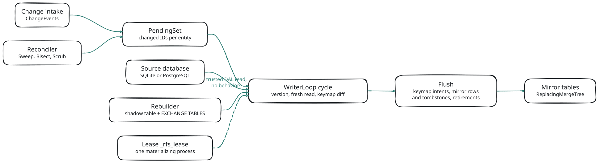
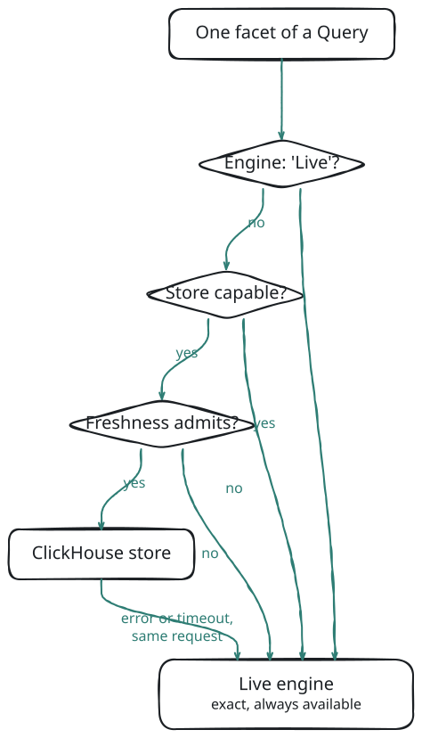

# The ClickHouse Store

The ClickHouse store is an optional mirror of your faceted tables in ClickHouse. When a store is configured, each facet of a Query is answered by ClickHouse if the store can compute it and is current enough for the request; every other facet, and every Records, Count and Keys request, is answered Live from the source database as before.

The store never changes a number. A facet it cannot answer exactly, or not fresh enough, goes to the Live engine in the same request, and the envelope says which engine answered each facet and why.

## When to Use It

The Live engine runs `GROUP BY` statements against your SQL database through each entity's Scoped Relations. That is exact and needs nothing extra, and on small and medium tables it is fast. A store pays off when facet statements over large tables take too long for an interactive page: ClickHouse scans and groups column data much faster than a row store.

Leave the store out when the tables are small, when most requests filter on soft-deleted rows (`Show deleted`), or when you cannot run one ClickHouse database per deployment. The service boots and answers Live whether or not the store is reachable, so you can add it later without changing a client.

Under a steady stream of writes, clients must ask for `Freshness: { "Mode": "Bounded" }` or `"Fast"` to benefit. The default mode, `Exact`, sends a facet Live whenever any change to an entity it reads is not yet applied to the mirror (see *Per-Facet Routing* below).

## Quick Start

The store is tested against **ClickHouse 24.8** (`clickhouse/clickhouse-server:24.8`). It talks to the HTTP interface only.

**1. Run a server for development.** A local container on the HTTP port, with a user that may manage other users:

```bash
docker run -d --name facets-clickhouse \
	-p 127.0.0.1:8123:8123 \
	-e CLICKHOUSE_USER=facets_admin -e CLICKHOUSE_PASSWORD=change-me \
	-e CLICKHOUSE_DEFAULT_ACCESS_MANAGEMENT=1 \
	--ulimit nofile=262144:262144 \
	clickhouse/clickhouse-server:24.8
```

**2. Create the two users.** The writer (the materializer) creates the database on its first start (`CREATE DATABASE IF NOT EXISTS … ENGINE = Atomic`), then creates, alters, exchanges, renames and drops its own tables, inserts rows, and reads them back and `system.tables` / `system.columns` / `system.parts` for its database. The reader runs request reads only:

```sql
CREATE USER facets_writer IDENTIFIED WITH sha256_password BY '<writer password>';
GRANT SELECT, INSERT, ALTER, CREATE, DROP ON facets_main.* TO facets_writer;

CREATE USER facets_reader IDENTIFIED WITH sha256_password BY '<reader password>';
GRANT SELECT ON facets_main.* TO facets_reader;
```

These grants follow from the statements the store runs; the test suites run with a single administrative user, so check them against your server's access rules. Do not pre-create the database unless your writer may not create databases; an existing one is used as it is.

**3. Configure the store and declare what to mirror**, as *Configuring the Store* below shows (`Database: 'facets_main'`, the writer as `User` / `UserEnv`, the reader as `ReaderUser` / `ReaderUserEnv`).

**4. Check it is working.** Each mirrored entity starts `Absent` and moves through `Building` (the backfill) to `Live`. In process:

```javascript
let tmpStore = _Fable.RetoldFacetingService.status().Stores.Stores.ClickHouse;
// tmpStore.Available === true, tmpStore.Leader === true on the materializing process,
// tmpStore.Entities.BookStoreSale.State === 'Live' once the backfill is done
```

Then send a Query on a mirrored entity. Its envelope's `Store.Facets` entries read `{ "Engine": "ClickHouse", "Reason": null }` (see *What the Envelope Says* below). An entry with `Engine: 'Live'` names the reason the store was not used.

## Configuring the Store

Two option sections turn the store on: `Stores.ClickHouse` says where ClickHouse is, and `Materialize` says which entities it mirrors.

```javascript
libRetoldFacetingService.installOnRetoldDataService(_Fable.RetoldDataService,
	{
		Scope: { Policy: { Column: 'IDCustomer', SessionField: 'CustomerID' }, Guard: 'Strict' },
		Stores:
			{
				ClickHouse:
					{
						// 'http(s)://host:port', with no credentials in it
						URLEnv: 'FACET_CLICKHOUSE_URL',
						// Secrets by environment variable name (or by value from code); never logged.
						UserEnv: 'FACET_CLICKHOUSE_USER',
						PasswordEnv: 'FACET_CLICKHOUSE_PASSWORD',
						// Required: an explicit Database, or a non-default InstanceID.
						Database: 'facets_main',
						// Optional least-privilege credential for request reads.
						ReaderUserEnv: 'FACET_CLICKHOUSE_READER',
						ReaderPasswordEnv: 'FACET_CLICKHOUSE_READER_PASSWORD'
					}
			},
		Materialize:
			{
				Project: { Store: [ 'ClickHouse' ] },
				Task: { Store: [ 'ClickHouse' ], Watermark: 'UpdateDate' },
				ProjectMembership: { Store: [ 'ClickHouse' ] }
			}
	},
	(pError) =>
	{
		// The service answers Live at once; the store is used per facet once its backfill is done.
	});
```

The full list of `Stores.ClickHouse` keys and their defaults is in [Configuration](#/page/Configuration). The ones that matter first:

- **The database.** Set `Database`, or give the deployment a non-default `InstanceID` (the database name is then derived from it: `rfs_<InstanceID>`, with unsafe characters replaced and a hash suffix added when needed). With neither, the store is `Misconfigured` and unused: every deployment left at the defaults would otherwise share one database.
- **Credentials.** Pass secrets by environment variable name (`URLEnv`, `UserEnv`, `PasswordEnv`) or by value from code; they are sent as headers, never in a URL, and never logged. The writer needs `SELECT`, `INSERT`, `ALTER`, `CREATE` and `DROP` on its database only (see *Quick Start* above). A separate reader credential (`ReaderUser` / `ReaderUserEnv`) needs only `SELECT`; every request read runs with `readonly = 2` either way.
- **Transport.** An `https://` URL takes `CA`, `Cert`, `Key` (PEM text) and `RejectUnauthorized`. Plain `http://` to a host that is not loopback is logged as insecure unless `AllowInsecure: true`. Query parameter values travel in the request URI, so a proxy in front of ClickHouse must not log query strings.

### The Materialize Declaration

Each key of `Materialize` is an entity; each value says how to mirror it:

| Key | Meaning |
|---|---|
| `Store` | required: the stores that mirror the entity (`[ 'ClickHouse' ]`) |
| `Columns` | `'Auto'` (default), or an explicit column list; scope, identity, delete, `UpdateDate` and join columns are always added |
| `IncludeColumns` | columns to add to `'Auto'` (a GUID, or a String longer than 256 characters that a filter needs) |
| `ExcludeColumns` | columns to remove from `'Auto'` (never a scope, identity or delete column) |
| `SortKey` | `'Auto'` only |
| `Watermark` | `'Auto'`, `'UpdateDate'` or `false`: the column the Sweep pages by (see *Keeping the Mirror Right*) |
| `Mutability` | `'Mutable'` (default); `'AppendOnly'` is accepted with a warning and treated as `'Mutable'` |

`PathColumns`, `RelationFields`, `Rollups`, `Aggregates` and `Dictionary` are accepted with an `Unsupported:<Key>` warning and ignored. An invalid entry disables that entity in that store (logged as `FACET_DEFINITION_INVALID`); the other entities still load.

`Materialize: 'All'` declares every facetable entity of the catalog, and is re-declared after each model reload. The tests and the demo use it.

### What Gets Mirrored

With `Columns: 'Auto'` an entity's mirror holds its identity, its policy columns (tenant, owner, every `Required` column), its delete column, `CreateDate` and `UpdateDate`, every join column, and every filterable column whose type maps exactly: never `Text`, `JSON`, a GUID or a String longer than 256, and never a Sensitive column. Every row is mirrored as it is in the source; nothing is precomputed.

A facet goes to the store only when **every** entity it reads is mirrored with **every** column it reads (the closure rule). The service does not add entities on its own. `RetoldFacetingMirrorSpec.warnings()` lists the declared facets and named scopes whose entities are not all mirrored (`ClosureIncomplete`); those stay Live.

| Source type | Mirror type | Values the mirror cannot reproduce |
|---|---|---|
| identity | `Int64` | a non-integer identity: the row is skipped |
| `ForeignKey`, integer `Numeric` | `Nullable(Int64)` | non-integer or non-numeric text (SQLite allows it) |
| `Decimal`, other `Numeric` | `Nullable(Float64)` | more than 15 significant digits, non-numeric text |
| `String` | `Nullable(String)` | none |
| `DateTime` | `Nullable(DateTime64(3, 'UTC'))` | unparseable dates, dates outside 1900–2299; on SQLite, text that is not the canonical `YYYY-MM-DD HH:mm:ss` form compares differently |
| `Boolean` | `Nullable(UInt8)` | anything but 0 / 1 (on SQLite, the words `true` / `false`) |
| `Text`, `JSON` | not mirrored | |

A value the mirror cannot reproduce marks its column **lossy**. A `Value`-lossy column makes every facet that reads it Live; a `Compare`-lossy column (the value buckets the same but compares differently, such as a non-canonical SQLite date) makes Live only the facets that **filter** on it. A source row whose tenant value is unset is never mirrored (it is **quarantined**); no principal can see it Live either.

## How the Mirror Stays Current

<!-- bespoke diagram: edit diagrams/store-materializer.mmd or .hints.json, then: npx pict-renderer-graph build modules/meadow/retold-faceting-service/docs -->


The **materializer** subscribes to the same change intake the cache uses (see [Caching and Invalidation](#/page/Caching_And_Invalidation)). For each changed ID it queues a hint; it never copies data from the event.

Each cycle of an entity's writer loop then:

1. takes a new version from the store's clock **before** it reads;
2. reads the changed rows fresh from the source through the entity's DAL, with **no behaviors** and with soft-deleted rows included (a trusted read: its output only ever goes into the mirror);
3. compares them with the entity's **keymap**, the record of the scope keys (tenant, owner) each ID is currently written under in the mirror;
4. writes, per flush: keymap intents, then one mirror insert carrying the new rows **and** tombstones for rows that were deleted or moved, then keymap retirements.

Because the version is taken before the read and the mirror keeps the highest version per row, the latest read always wins: duplicate and out-of-order hints only cause harmless re-reads. The insert order keeps the keymap a superset of the mirror, so a crash between two inserts can leave a spare tombstone but never a row that no later cycle removes. Inserts carry deduplication tokens, so a retried insert that already landed is a no-op.

A steady write stream costs about one source read, one keymap read and one insert set per flush interval (`Materializer.FlushIntervalMS`, 1000 ms by default) per entity, and the store lags by about one interval.

### The Tables

The mirror lives in its own database: one `ReplacingMergeTree` table per entity, a keymap table `_rfs_keys_<Entity>`, a state table `_rfs_entity_state`, a lease table `_rfs_lease` and an owner marker `_rfs_owner`. Captured with `SHOW CREATE TABLE` from a test database for the LabTrack `LabForm` entity, which is scoped by tenant (`IDCustomer`) and by owner (`OwnerIDUser`):

```sql
CREATE TABLE rfs_95321_1.LabForm
(
    `IDLabForm` Int64,
    `IDCustomer` Int64,
    `OwnerIDUser` Nullable(Int64),
    `CreateDate` Nullable(DateTime64(3, 'UTC')),
    `CreatingIDUser` Nullable(Int64),
    `UpdateDate` Nullable(DateTime64(3, 'UTC')),
    `UpdatingIDUser` Nullable(Int64),
    `Deleted` Nullable(UInt8),
    `DeleteDate` Nullable(DateTime64(3, 'UTC')),
    `DeletingIDUser` Nullable(Int64),
    `IDMaterialIntake` Nullable(Int64),
    `IDLabFormType` Nullable(Int64),
    `Status` Nullable(String),
    `CompletedDate` Nullable(DateTime64(3, 'UTC')),
    `_Version` UInt64,
    `_IsDeleted` UInt8,
    `_AppliedAt` DateTime64(3, 'UTC') DEFAULT now64(3)
)
ENGINE = ReplacingMergeTree(_Version, _IsDeleted)
ORDER BY (IDCustomer, OwnerIDUser, IDLabForm)
SETTINGS allow_nullable_key = 1, index_granularity = 8192, non_replicated_deduplication_window = 1000
COMMENT 'rfs mirror LabForm spec=ms:4b918da5'
```

The sort key starts with the tenant column (then the owner, then the identity), so every request's scope predicate prunes data. `_Version` decides which copy of a row survives a merge, `_IsDeleted = 1` marks a tombstone, and the `COMMENT` records the spec hash the table was built for. Every read of a mirror uses `FINAL` and `_IsDeleted = 0`.

### One Materializing Process

Exactly one process materializes a store. The first process to start takes a lease (a row in `_rfs_lease`, renewed every `Materializer.Lease.HeartbeatMS`); any other process pointed at the same database leaves the store unused and answers every facet Live (`NotLeader`) until the holder stops. A graceful stop releases the lease, and a successor takes over within a heartbeat.

The database also records which deployment owns it: `_rfs_owner` holds the `InstanceID` and a fingerprint of the source database. Pointing another deployment at it makes the store `Misconfigured`, unless that deployment sets `Owner: 'Adopt'`.

### Backfill and Rebuild

On first enable, an entity is **backfilled**: pages of the source table are written into a shadow table while change hints keep arriving, then the shadow is renamed to the live name. Until that rename the entity is `Building` and never used.

A **rebuild** (an incompatible model change, a divergence the Bisect found, or an operator's request) builds a fresh shadow table while every stream cycle writes to both the live table and the shadow, then swaps them with `EXCHANGE TABLES` between two flushes and drops the old data. A purely additive model change (new columns) is applied with `ALTER TABLE … ADD COLUMN` instead; the new columns read as not mirrored until a full Scrub has filled them.

If the store's database or a table disappears, the materializer confirms the loss and backfills only the entities that lost a table, while Live answers meanwhile.

### Keeping the Mirror Right

The intake cannot see raw SQL or another process's writes. Three reconcile levels repair what nobody reported. They only queue IDs; the writer loop's fresh read and diff do the repair.

| Level | Finds | How | Default cadence |
|---|---|---|---|
| Sweep | rows changed in place with a new `UpdateDate` | pages the source by `(UpdateDate, ID)` from the last watermark | `Reconcile.SweepIntervalMS` (`'Auto'`: 10 minutes with an intake, 1 minute for `RawWriterEntities`) |
| Bisect | inserts and hard deletes | compares per-bucket counts and ID sums of the source and the keymap, then the IDs of differing buckets | `BisectIntervalMS` (daily); hourly for entities without a watermark |
| Scrub | anything, including unstamped in-place updates | re-reads every row by rotation, paced | a full rotation per `ScrubPeriodMS` (daily) |

The Sweep runs only for entities with a watermark: `Watermark: 'UpdateDate'`, or `'Auto'` when the model marks `UpdateDate` as indexed. A Bisect whose divergence is above `Reconcile.RebuildDivergenceRatio` triggers a rebuild.

After a crash (the state row has no clean-shutdown flag), every entity starts `Unverified`: an `Exact` request never uses it until a Bisect and a full Scrub have verified it. A clean restart after more than `Reconcile.BootBisectAfterMS` of downtime also Bisects before the entity serves `Exact` requests.

### Entity States

| State | Meaning | Used by `Exact` | `Bounded` | `Fast` |
|---|---|---|---|---|
| `Absent`, `Building`, `Degraded` | no complete mirror, or writes are failing | no | no | no |
| `CatchingUp` | built, still applying the changes made meanwhile | no | no | yes |
| `Live`, `Lagging` | serving (`Lagging`: behind by more than `Freshness.LagWarnMS`) | only when fully applied | within `MaxLagMS` | yes |
| `Rebuilding` | a rebuild is running | only when fully applied, and not after a divergence | within `MaxLagMS` | yes |
| `Unverified` | started after a crash, or rebuilt after a divergence | no | within `MaxLagMS` | yes |

"Fully applied" means no pending, in-flight or buffered change of the entity, and every write of it is seen by a change source (an entity no source sees is never exact in the store).

## Per-Facet Routing

<!-- bespoke diagram: edit diagrams/freshness-routing.mmd or .hints.json, then: npx pict-renderer-graph build modules/meadow/retold-faceting-service/docs -->


Each facet of a Query (and its Total) is routed on its own:

1. **`Engine: 'Live'` in the body** sends every facet to Live. A client may always ask for the authoritative engine.
2. **Capability.** The store must be available and the materializer running; the facet's fold must be one Live supports; the request must not filter on the delete column (`Show deleted`); every entity and column it reads must be mirrored and not lossy; the read breaker must be closed.
3. **Freshness.** The request's mode must admit the state of every entity the facet reads (the table above). The default mode is `Exact`, so a default request uses the store only when it has applied every observed change. Read-your-writes and `MinSeq` make a request `Exact`.
4. **Capture.** The store runs each entity's own list behaviors, exactly as Live does, and compiles the captured scope into the ClickHouse statement. A capture Live would refuse (401, a ScopeGuard violation) is returned exactly as Live returns it: a store never hides a security error behind a fallback.

Live facets of the same request run alongside the store attempt. The store attempt gets 40 % of the request's remaining deadline, enforced by the client as well as by ClickHouse's `max_execution_time`. If it fails or times out, its facets are answered Live within the same request and the envelope gains the warning `FACET_STORE_FALLBACK`.

A circuit breaker per (engine, entity) opens after `Freshness.BreakerFailures` store faults within `BreakerWindowMS` and stays open for `BreakerOpenMS`; then one probe request is let through. Only store faults count (network errors, server errors, time-outs that had a real budget): a malformed request cannot switch the store off for other tenants. After `UnreachableAfterFailures` network failures the whole store is marked unreachable and every facet answers Live at once, until a background ping succeeds.

Store answers are never cached: their ETag is a digest of the answer. Records, Count and Keys always run Live.

## What the Envelope Says

When a store is configured, every facet result carries `Engine`, `Exact`, `AsOf` and `LagMS` from the engine that answered it, and the envelope carries a `Store` block. Captured on the Bookstore-Tenant fixture with the default store options, as tenant 1:

<!-- docs-check: request Fixture=Bookstore-Tenant Entity=BookStoreSale Tenant=1 User=1 -->
```json
{
	"Facets":
	[
		{ "Key": "ByMethod", "Facet": "BookStoreSale.PaymentMethod" },
		{ "Key": "ByYear", "Facet": "BookStoreSale.SaleDate", "Interval": "year" }
	],
	"Total": true
}
```

The envelope, abridged (`Facets` removed, along with `ContractVersion`, `ModelVersion`, `ElapsedMS`, `TotalCountMode`, `IncludesDeleted`, `Filter`, `Errors` and `Warnings`):

<!-- docs-check: skip captured envelope, abridged -->
```json
{
	"Entity": "BookStoreSale",
	"Version": "fv1:2610abd63af5c442",
	"Engine": "ClickHouse",
	"Exact": true,
	"AsOf": "2026-10-10T15:26:48.209Z",
	"LagMS": 0,
	"Stale": false,
	"Cached": false,
	"Total": 2918,
	"DependsOn": [ "BookStoreSale" ],
	"Store":
	{
		"Name": "ClickHouse",
		"Available": true,
		"Facets":
		{
			"ByMethod": { "Engine": "ClickHouse", "Reason": null },
			"ByYear": { "Engine": "ClickHouse", "Reason": null },
			"#Total": { "Engine": "ClickHouse", "Reason": null }
		},
		"Fallback": null
	}
}
```

The `Store` block's facet entries, captured for other requests on the same fixture:

| Request | `Store.Facets` entry |
|---|---|
| the body above with `"Engine": "Live"` | `{ "Engine": "Live", "Reason": "Requested" }` |
| `FilterString: "FBV~Deleted~EQ~1"` (Show deleted) | `{ "Engine": "Live", "Reason": "DeletedRowsNotMirrored" }` |
| `FilterString: "FBV~SaleDate~GE~2015-01-01"` (SQLite stores some `SaleDate` values in a non-canonical text form) | `{ "Engine": "Live", "Reason": "LossyColumn" }` |
| the body above right after a write, before the flush | `{ "Engine": "Live", "Reason": "Freshness" }` |

The same body with `"Freshness": { "Mode": "Fast" }`, asked right after the write, was answered by the store with `"Exact": false`, `"AsOf": null` and `"LagMS": null`.

<!-- docs-check: request Fixture=Bookstore-Tenant Entity=BookStoreSale Tenant=1 User=1 -->
```json
{
	"Engine": "Live",
	"Facets": [ { "Key": "ByMethod", "Facet": "BookStoreSale.PaymentMethod" } ],
	"Total": true
}
```

### What a Client Is Told

Two switches on `Stores.ClickHouse` decide how much of the store's state reaches clients:

- **`ExposeReasons`** (default `false`): a refusal reason is sent as its class only (`LossyColumn`, `NotMirrored`, …). The full reason names an entity and column (`LossyColumn:BookStoreSale.SaleDate`); it stays in the logs and in the in-process `pMeta.Store`. The demo turns it on.
- **`ExposeFreshness`** (default `'Auto'`): the store's lag is global, so another tenant's write makes it lag. On a host with a scope policy, `'Auto'` hides it: a store answer carries only a coarse `Exact` (`LagMS` and `AsOf` are `null` when it is not exact), and every freshness refusal reads `Freshness`. On a host without a policy, or with `ExposeFreshness: true`, clients see the real `LagMS`, `AsOf` and reasons such as `NotExact`.

The refusal classes a client can see: `Requested`, `StoreUnavailable`, `KindUnsupported`, `DeletedRowsNotMirrored`, `NotMirrored`, `LossyColumn`, `OpaqueScope`, `ScopeMissing`, `OperatorUnsupported`, `OperatorType`, `ValueType`, `DateLiteral`, `LikeCase`, `StringOrder`, `Transformed`, `ShapeUnsupported`, `ParameterSize`, `StoreBusy`, `StoreError`, and the freshness classes `State`, `Unverified`, `NotExact`, `Lagging`, `NoChangeSource` and `Breaker` (shown as `Freshness` when freshness is hidden).

## A Write, as the Store Sees It

`node debug/m5-smoke.js` boots ProjectTrack and LabTrack with the store (inside the `rfs-test-clickhouse` test container; the test support turns `ExposeFreshness` on). Captured output, abridged to the write and what follows it:

```text
ok   4. PUT /1.0/Project { IDProject: 16, Status: 'AtRisk' } as Member
       → 200
ok   5a. Exact while the store has not applied the write: Live (NotExact), the new numbers
       Engine Live  Exact true  AsOf 2026-10-10T15:25:00.319Z  LagMS 0  Total 6  [Status:Live(NotExact) Client:Live(NotExact) Started:Live(NotExact) MyOverdue:Live(NotExact) StatusByClient:Live(NotExact)]
       Status[Active=3 AtRisk=3 OnHold=1] (before: [Active=4 AtRisk=2 OnHold=1])
ok   5b. Fast at the same moment: ClickHouse, Exact false, LagMS > 0, the old numbers
       Engine ClickHouse  Exact false  AsOf 2026-10-10T15:25:00.317Z  LagMS 10  Total 6  [Status:ClickHouse~ Client:ClickHouse~ Started:ClickHouse~ MyOverdue:ClickHouse~ StatusByClient:ClickHouse~]
       Status[Active=4 AtRisk=2 OnHold=1]
ok   6. Fast until the store caught up: LagMS → 0, Exact, the new numbers
       LagMS per poll: 188 371 560 768 964 1164 1363 0✓
       Engine ClickHouse  Exact true  AsOf 2026-10-10T15:25:01.873Z  LagMS 0  Total 6  [Status:ClickHouse Client:ClickHouse Started:ClickHouse MyOverdue:ClickHouse StatusByClient:ClickHouse]
ok   7a. Exact after the flush: ClickHouse again, equal to Live
       Engine ClickHouse  Exact true  AsOf 2026-10-10T15:25:01.900Z  LagMS 0  Total 6  [Status:ClickHouse Client:ClickHouse Started:ClickHouse MyOverdue:ClickHouse StatusByClient:ClickHouse]
```

The smoke script flushes every 1.5 seconds so the lag is visible. An `Exact` request stayed correct throughout: it went Live while the store lagged, and back to the store once the flush landed.

## Operating the Store

### Status and Describe

`status()` reports the store under `Engines.ClickHouse` (`{ Configured, Available, Reason }`), `StoreClickHouse` (connection, database, server version, last error without values) and `Stores` (per entity: `State`, pending and in-flight hints, `LagMS`, cycles, flushes, rows, tombstones, quarantined rows and lossy columns). Captured for `BookStoreSale` on the Bookstore-Tenant fixture, after an admin rebuild:

<!-- docs-check: skip captured status() output -->
```json
{ "State": "Live", "Pending": 0, "InFlight": 0, "Buffered": 0, "LagMS": 0, "AppliedSeq": { "e:4973137b": 1 }, "Cycles": 3, "Flushes": 3, "FlushErrors": 0, "Rows": 6120, "Tombstones": 0, "Quarantined": 1, "Lossy": { "SaleDate": "Compare" }, "Dirty": false, "Epoch": 2 }
```

Describe lists `Engines.ClickHouse` and, per entity, `Store.ClickHouse: { Materialized, Reason, Watermark }`; a facet descriptor lists `Engines: [ "Live", "ClickHouse" ]` when what it reads is mirrored. Per-entity state and lag in Describe go only to principals your `Admin.authorize` approves, unless freshness is exposed.

### Admin Actions

`storeAdmin(pAction, pStore, pEntity, pOptions, fCallback)` runs a rebuild or a reconcile level in process. `pAction` is `Rebuild`, `Sweep`, `Bisect`, `Scrub` (a full pass unless `{ Full: false }`) or `Verify`.

```javascript
_Fable.RetoldFacetingService.storeAdmin('Rebuild', 'ClickHouse', 'BookStoreSale', {},
	(pError, pResult) =>
	{
		// captured: { BuildID: '951a23dd', Reason: 'Admin', Pages: 1, Rows: 3145, ElapsedMS: 80,
		//             State: 'Live', CaughtUp: true, FirstEnable: false }
	});
```

Refusals come back as errors: an unknown action is `400 FACET_REQUEST_INVALID`, an entity the store does not materialize `404 FACET_UNKNOWN_ENTITY`, an unavailable store `503 FACET_ENGINE_UNAVAILABLE`, the same action already running `429 FACET_RATE_LIMITED` (`Limit: 'Admin.InFlight'`), and a second rebuild within `Admin.RebuildCooldownMS` (10 minutes) `429` with `Limit: 'Admin.RebuildCooldownMS'`.

Two HTTP routes trigger the same actions: `POST /1.0/Facet/Admin/Rebuild/:Store/:Entity` and `POST /1.0/Facet/Admin/Reconcile/:Store/:Entity` with a body `{ "Level": "Sweep" | "Bisect" | "Scrub" | "Verify" }`. They are mounted only when `Admin.Routes` is `true`, and every request must pass your `Admin.authorize(pRequest, pPrincipal)` function, which must return exactly `true` (anything else is `403`). A started action answers `202 { Started, Action, Store, Entity }` and runs on in the background.

### Timeouts and Shutdown

A graceful stop (see [Hosting](#/page/Hosting)) drains the writer loops for up to `Materializer.DrainOnStopMS`, flushes, marks each entity that drained cleanly, releases the lease and closes the connections. A hung server is cut off by the client at that deadline; the entities then start `Unverified` next time, which is the safe outcome.

### Float64 Values on ClickHouse 24.8

ClickHouse 24.8 parses Float64 text inexactly: a `{p:Float64}` query parameter, and JSONEachRow input of values such as `5.94` or `7.56`, land one unit in the last place off. The store therefore inserts decimals through `toFloat64(<String>)` with `precise_float_parsing = 1`, and the compiler binds every Float64 value as text. Code that talks to the store's tables directly must do the same.

## Testing with a Store

The ClickHouse suites run against a dedicated throwaway container, `rfs-test-clickhouse` (`npm run test:ch`). See [Testing](#/page/Testing).

## Planned

> **Planned.** Reader-only processes that query a store another process materializes.

> **Planned.** Caching store answers, bound to the store's applied state, and waiting briefly for a `MinSeq` instead of answering Live.

> **Planned.** Derived store data: path columns, dictionaries, rollups and append-only aggregates.

> **Planned.** Per-tenant freshness, so a tenant's admission and lag ignore other tenants' writes.

> **Planned.** Partitioned mirrors, `LowCardinality` and native `Decimal` columns, and Solr and OpenSearch stores.

> **Planned.** Moving the ClickHouse client into its own `meadow-connection-clickhouse` module.

## Related

- [Caching and Invalidation](#/page/Caching_And_Invalidation): the change intake and the freshness modes
- [Configuration](#/page/Configuration): every `Stores.ClickHouse`, `Materialize`, `Materializer` and `Reconcile` option
- [The Response Envelope](#/page/api/Envelope): per-facet `Engine`, `Exact`, `AsOf`, `LagMS` and the `Store` block
- [Fold Kinds](#/page/Fold_Kinds): which kinds the store supports
- [Testing](#/page/Testing): the O3 and O10 oracles
