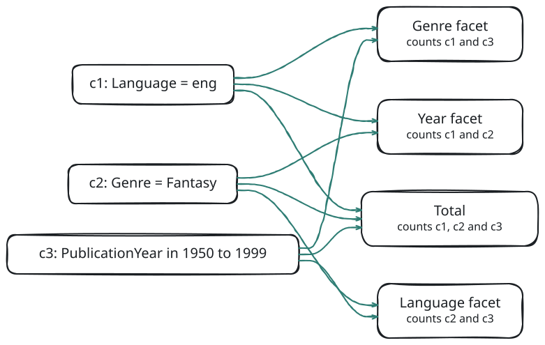
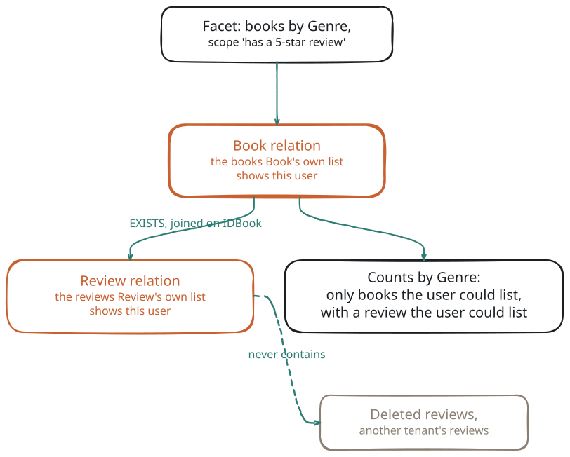

# Concepts

This page explains the vocabulary the rest of the documentation uses, with one small example each. Every example runs on the Bookstore fixture the module's tests use: 1436 live books, their reviews, stores and sales.

If you know [meadow](#/doc/meadow/meadow) and [retold-data-service](#/doc/meadow/retold-data-service), the one idea to hold on to is this: **a facet answers the same question the list answers, for the same principal, broken down by a key.** Everything below is about keeping those two in agreement.

## Facets and Folds

A **facet** is a summary of an entity's rows, computed next to its list: the languages of the books on screen, the sales per month, the total revenue. A facet request names an entity, the same filter the list uses, and the facets to compute. The answer is one **envelope** holding a **facet result** per facet, plus the `Total` the list would report.

A **fold** is the computation a facet performs: Terms, DateHistogram, NumericHistogram, Stats, a pivot, and so on. The service names its fold kinds K1 to K20; [Fold Kinds](#/page/Fold_Kinds) lists them all. The kinds fall into four families:

- A **bucketing dimension** maps each row to a key and counts rows per key (**buckets**). A dimension is **single-valued** when each row has at most one key (a book has one language) and **multi-valued** when it can have several (a book has several authors).
- A **measure** reduces the rows to numbers with no buckets: [Stats](#/page/fold_kinds/005-stats), [DistinctCount](#/page/fold_kinds/006-distinct-count), [Missing](#/page/fold_kinds/007-missing).
- A **predicate** is a filter written in a definitions file (`Exists`, `NotExists`, `Any`, `HavingCount`). It produces no buckets of its own; it changes which rows the facets count.
- A **pivot** counts two dimensions at once ([K14](#/page/fold_kinds/014-pivot)), or counts the key tuples of a declared join ([K18](#/page/fold_kinds/018-tuple-pivot)).

An **engine** computes the facets. By default the **Live engine** renders SQL against your database for every request; an optional ClickHouse store can answer some facets instead (see *Freshness* below).

## FacetIDs

Every facet has a **FacetID**, the name a request uses in `Facets[].Facet`:

| FacetID | Kind of facet |
|---|---|
| `Book.Language` | An **auto facet**: a column of the entity, derived from the [Stricture](#/doc/meadow/stricture) model |
| `BookStoreSale.IDBookStore>BookStore.State` | A **one-hop path facet**: a column of the row a foreign key points to. Each step from one entity to a related one is a **hop**; a **path** is a list of hops (`>` follows a foreign key to one row, `<` follows it back to many rows) |
| `Book.ReviewCount` | A **declared facet** from a definitions file (its name is never a column name) |
| `Review.BookGenre/ByBookType` | A **sibling** of a declared facet: same `Where`, another dimension |
| `[ "BookStoreSale.PaymentMethod", "BookStoreSale.SaleDate" ]` | Two FacetIDs with `Fold: 'Pivot'`: a 2-D pivot |

A FacetID always starts with the entity of the route the request was sent to (`POST /1.0/Facet/Book/Query` takes `Book.…` facets only). The `Key` you give each facet names its result in the envelope; it defaults to the FacetID.

The entity whose rows a facet counts is the **counted entity**, normally the route entity. Some pages and fields call it the **pivot entity** (a definition's `Pivot` field, the `PivotDistinct` count mode). That use of "pivot" is unrelated to the K14 Pivot fold, which counts two dimensions at once.

## Buckets, Missing and Other

A bucketing facet returns **buckets**. Each has a `Key`, a `Label`, a `Count` and, when the facet is selectable, a `Clause` and a `Selection` (below). Range buckets (dates, histogram bands, ranges) also carry `Start`, `End` and `EndExclusive`.

Ranges are **half-open**: `Start` is included, `End` is not, so adjacent buckets never share a row. The only closed bucket is the last band of a NumericHistogram in `Nice` mode (the default mode, which picks round band edges), and it says so with `EndExclusive: false`.

Rows that are in no displayed bucket are not lost. A single-valued facet always satisfies:

```text
SumOfCounts + MissingCount + OtherCount = Total
```

| Field | Rows it holds |
|---|---|
| `SumOfCounts` | Rows in the displayed buckets |
| `MissingCount` | Rows with no value: NULL; non-numeric text in a number column; an unparseable date; a path whose related row is missing or not visible |
| `OtherCount` | Rows with a value outside the displayed buckets: values cut by `Top`, numbers outside declared edges or ranges, and missing rows when the request says `Missing: false` |
| `Total` | Every row the facet counted, computed separately, never summed from buckets |

A multi-valued facet ([K9 BridgeTerms](#/page/fold_kinds/009-bridge-terms)) reports `MultiValued: true` and `OtherCount: null`: a row can sit in several buckets, so `SumOfCounts` may exceed `Total`.

## Count Modes

The **count mode** says what one unit of `Count` is. The facet result reports it as `CountMode`, and the envelope reports the Total's as `TotalCountMode`.

| Count mode | Counts | Used by |
|---|---|---|
| `Rows` | Rows of the entity (each row once per bucket) | Every single-valued kind on an entity |
| `PivotDistinct` | Distinct rows of the entity reached through a to-many path | [K9 BridgeTerms](#/page/fold_kinds/009-bridge-terms), always |
| `KeyDistinct` | Distinct key tuples of a declared join | [K18 TuplePivot](#/page/fold_kinds/018-tuple-pivot), always |

The count mode follows from the shape of the facet; a request cannot choose it (any `CountMode` other than `Rows` in a request is `422 FACET_FOLD_UNSUPPORTED`).

> **Planned.** An approximate count mode (`Approx`) for store engines, reported as `Exact: false`.

## Disjunctive Faceting

Picture a book list with three filters, each set from a facet: language is English, genre is Fantasy, publication year is 1950 to 1999. If every facet counted under all three filters, the Language facet would show English and nothing else, and the user could never see how many French Fantasy books of that era exist. So each facet is counted with **every filter except its own**:

<!-- bespoke diagram: edit diagrams/disjunctive-faceting.mmd or .hints.json, then: npx pict-renderer-graph build modules/meadow/retold-faceting-service/docs -->


The request, with the clauses as [pict-section-recordset](#/doc/pict/pict-section-recordset) sends them (each with a `FilterKey` and a `Hash`):

<!-- docs-check: request Fixture=Bookstore Entity=Book -->
```json
{
	"Clauses":
	[
		{
			"Type": "DistinctSelectedValueList",
			"FilterByColumn": "Language",
			"Values": [ "eng" ],
			"FilterKey": "Language",
			"Hash": "Language-1"
		},
		{
			"Type": "DistinctSelectedValueList",
			"FilterByColumn": "Genre",
			"Values": [ "Fantasy" ],
			"FilterKey": "Genre",
			"Hash": "Genre-1"
		},
		{
			"Type": "NumericRange",
			"FilterByColumn": "PublicationYear",
			"Values": { "Start": 1950, "End": 2000 },
			"EndExclusive": true,
			"FilterKey": "PublicationYear",
			"Hash": "PublicationYear-1"
		}
	],
	"Facets":
	[
		{ "Key": "Language", "Facet": "Book.Language", "Top": 3 },
		{ "Key": "Genre", "Facet": "Book.Genre", "Top": 3 },
		{ "Key": "Year", "Facet": "Book.PublicationYear", "Edges": [ 1900, 1950, 2000, 2020 ] }
	],
	"Total": true
}
```

The captured answer, abridged to the fields that show the idea:

<!-- docs-check: skip captured envelope, abridged -->
```json
{
	"Total": 33,
	"Filter": { "Applied": [ { "Hash": "Language-1" }, { "Hash": "Genre-1" }, { "Hash": "PublicationYear-1" } ], "Warnings": [] },
	"Facets":
	{
		"Language":
		{
			"Key": "Language",
			"Disjunctive": "Exact",
			"Excluded": [ "Language-1" ],
			"Total": 57,
			"Buckets":
			[
				{ "Key": "eng", "Count": 33, "Selected": true },
				{ "Key": "en-US", "Count": 8, "Selected": false },
				{ "Key": "", "Count": 7, "Selected": false }
			]
		},
		"Genre":
		{
			"Key": "Genre",
			"Disjunctive": "Exact",
			"Excluded": [ "Genre-1" ],
			"Total": 396,
			"Buckets":
			[
				{ "Key": "Fiction", "Count": 124, "Selected": false },
				{ "Key": "Mystery", "Count": 65, "Selected": false },
				{ "Key": "Romance", "Count": 40, "Selected": false },
				{ "Key": "Fantasy", "Count": 33, "Selected": true }
			]
		},
		"Year":
		{
			"Key": "Year",
			"Disjunctive": "Exact",
			"Excluded": [ "PublicationYear-1" ],
			"Total": 69,
			"Buckets":
			[
				{ "Key": 0, "Label": "1900–1949", "Count": 0, "Selected": false },
				{ "Key": 1, "Label": "1950–1999", "Count": 33, "Selected": true },
				{ "Key": 2, "Label": "2000–2019", "Count": 35, "Selected": false }
			]
		}
	}
}
```

- The envelope `Total` (33) applies all three filters: it is the list's count.
- The Language facet counts Fantasy books of 1950–1999 (57) and marks `eng` selected; its 33 equals the Total. Genre counts English books of that era (396); Year counts English Fantasy books (69). Each lists the clause it left out in `Excluded`, by the clause's `Hash`.
- Fantasy is not in the Genre facet's top 3 by count, but it is selected, so it is returned anyway, after the top three. A checked box never disappears.

### Which Clauses a Facet Owns

A facet **owns** a clause, and leaves it out, when (in this order) the clause's `Hash` is listed in the facet's `Exclude` array, or the clause's `FilterKey` equals the facet's `FilterKey`, or every column the clause filters is one of the facet's own columns. The facet's `Exclude` policy decides what happens to the clauses it owns:

| `Exclude` | Effect | Default for |
|---|---|---|
| `Self` | Leave out the owned clauses | Terms, DateHistogram, NumericHistogram, Ranges, path Terms |
| `None` | Keep every clause: a drill-down within the filter | Stats, DistinctCount, Missing, Pivot, ChildRollup, ExistsSplit, TuplePivot |
| `[ "<Hash>", … ]` | Leave out exactly these clauses | — |

Some filters are never left out: `RawFilter` clauses, named scopes, a declared facet's own `Where`, and everything the entity's behaviors add (tenancy, soft delete). Exclusion only ever widens what the user chose; it never widens what the user may see.

A clause that filters the facet's column **and** another column cannot be split. A meadow-filter string with an OR across two columns is one such clause:

<!-- docs-check: request Fixture=Bookstore Entity=Book -->
```json
{
	"FilterString": "FBV~Language~EQ~eng~FBVOR~Genre~EQ~Fantasy",
	"Facets": [ { "Key": "Language", "Facet": "Book.Language", "Top": 3 } ]
}
```

The Language facet keeps that clause and says so: `Disjunctive: "Partial"`, `KeptMixed: [ "c1" ]` (the conjunct's id; a filter string has no `Hash`), and its `Total` equals the envelope's, 923. The facet result field `Disjunctive` is `Exact` when the facet left out everything it owns, `Partial` when it had to keep a mixed clause, and `NotApplicable` under `Exclude: 'None'`.

Disjunctive counts do not cost one statement per facet: facets that leave out the same clauses are counted together, and the Live engine can count several filter shapes in one scan. *Plan Forms* in [Architecture](#/page/Faceting_Architecture) explains how.

## Named Scopes

A **named scope** is a filter written once, on the server, in a definitions file, and applied by name: "projects for me", "intakes in my queues", "books with a good review". A client sends `Scopes: [ { "Scope": "<Entity>.<Name>", "Params": { … } } ]`, a `NamedScope` clause, or uses the `/Scope/<name>/` route forms. The client never sees the scope's predicates; it can only pick the scope and the parameters the scope declares.

> **Two meanings of "scope".** A *named scope* is a reusable business filter you write in a definitions file and apply by name. The *scope policy*, *scope capture* and *ScopeGuard* (the `RetoldFaceting.Scope` options) are tenancy enforcement. The two never interact, except that both always apply to every count.

Scope and facet names are global across every loaded definitions file, and two entries with the same name disable each other (`DuplicateName`). The examples on these pages are separate files: several pages show their own version of `Book.WellReviewed`, with and without parameters, so copy one of them, not all.

<!-- docs-check: definitions Id=concepts-good-review Fixture=Bookstore -->
```json
{
	"FormatVersion": 1,
	"Scopes":
	{
		"Book.HasGoodReview":
		{
			"Entity": "Book",
			"Description": "Books with at least one review rated 4 or 5",
			"Where":
			[
				{
					"Exists":
					{
						"Path": [ "<Review.IDBook" ],
						"Where": [ { "Field": "Rating", "Op": "GE", "Value": 4 } ]
					}
				}
			]
		}
	}
}
```

<!-- docs-check: request Fixture=Bookstore Entity=Book Definitions=concepts-good-review -->
```json
{
	"Scopes": [ { "Scope": "Book.HasGoodReview" } ],
	"Clauses":
	[
		{
			"Type": "DistinctSelectedValueList",
			"FilterByColumn": "Language",
			"Values": [ "eng" ],
			"FilterKey": "Language",
			"Hash": "Language-1"
		}
	],
	"Facets": [ { "Key": "Language", "Facet": "Book.Language", "Top": 3 } ]
}
```

<!-- docs-check: skip captured envelope, abridged -->
```json
{
	"Total": 760,
	"Filter": { "Applied": [ { "Hash": "Language-1" }, { "Scope": "Book.HasGoodReview" } ], "Warnings": [] },
	"Facets":
	{
		"Language":
		{
			"Key": "Language",
			"Disjunctive": "Exact",
			"Excluded": [ "Language-1" ],
			"Total": 1250,
			"Buckets":
			[
				{ "Key": "eng", "Count": 760, "Selected": true },
				{ "Key": "en-US", "Count": 231, "Selected": false },
				{ "Key": "", "Count": 94, "Selected": false }
			]
		}
	}
}
```

The Language facet leaves out its own clause (1250 well-reviewed books in all languages) but keeps the scope: **a named scope is never excluded.** Scopes can bind values on the server, from the principal (`$CurrentUser.IDUser`), the clock (`$Now`, `$Today`) or the scope's declared `Params` (`$Param.Roles`). A `$CurrentUser` value that is not set fails the request with `401`, never "matches nothing". The syntax is in [Definitions Files](#/page/Definitions).

## The Bucket Clause Round Trip

Every selectable bucket carries a `Clause`: a standard pict filter clause that selects exactly that bucket. A page that shows a facet writes the clause back into the list's filter when the user clicks the bucket. The service promises that the list then holds **exactly** `Count` rows:

<!-- bespoke diagram: edit diagrams/bucket-round-trip.mmd or .hints.json, then: npx pict-renderer-graph build modules/meadow/retold-faceting-service/docs -->


The `eng` bucket of `Book.Language` (no filter) counts 862 and carries:

<!-- docs-check: skip bucket clause, a fragment of a captured envelope -->
```json
{ "Type": "DistinctSelectedValueList", "FilterByColumn": "Language", "Values": [ "eng" ], "FilterKey": "Language", "ClauseKey": "DistinctSelectedValueList" }
```

`ClauseKey` is pict-section-recordset's clause-type marker (which entry of a filter's available clauses produced the clause). The service does not count by it; copy it as it is.

Posting that clause to the faceting service's own count route gives the same number:

<!-- docs-check: request Fixture=Bookstore Entity=Book Route=Records/Count -->
```json
{
	"Clauses":
	[
		{
			"Type": "DistinctSelectedValueList",
			"FilterByColumn": "Language",
			"Values": [ "eng" ],
			"FilterKey": "Language"
		}
	]
}
```

```text
POST /1.0/Facet/Book/Records/Count                    → { "Count": 862 }
GET  /1.0/Books/Count/FilteredTo/FBV~Language~EQ~eng  → { "Count": 862 }   (the stock meadow-endpoints count)
```

The module's tests check this property through the real list endpoints, on every fixture. Bucket clauses use the standard pict clause types (`DistinctSelectedValueList`, `DateRange`, `NumericRange`, and the `InternalJoin*` / `ExternalJoin*` join clauses for path facets), so a stock pict-section-recordset can apply them without knowing about facets. When no standard clause can select a bucket exactly (a ChildRollup band, an ExistsSplit side, a multi-hop path, a TuplePivot), the bucket gets `Clause: null` and keeps only its `Selection` (`{ Facet, Key }`), the server-side name of the bucket.

## Auto Facets and Declared Facets

**Auto facets** come from the Stricture model: the catalog gives every suitable column a list of folds (short strings and foreign keys get Terms, dates get DateHistogram, numbers get NumericHistogram, and so on; the full table is in [Fold Kinds](#/page/Fold_Kinds)). You get them without writing anything. Sensitive columns (passwords, tokens, emails, phone numbers…) are never facetable or filterable.

**Declared facets** come from JSON definitions files: cross-entity dimensions, facets restricted by a `Where`, pivots over a join. Their results carry `Declared: true`, the `Definition` name and version, and the `Path` they follow. One-hop path facets sit in between: synthesized on demand from a FacetID, reported with `Declared: false`.

Both kinds are listed, per entity and per principal, by `GET /1.0/Facet/Describe`; a page can build its facet panel from it (see [Describe](#/page/api/Describe)).

## Scoped Relations: Why Counts Never Exceed the List

A facet must never count a row the list would not show to the same user. The faceting service guarantees this by never reading a table directly. Every entity a facet touches, the counted entity and every hop, label and child, is read as a **Scoped Relation**: the entity rendered exactly the way its own list endpoint renders it for this principal.

<!-- bespoke diagram: edit diagrams/scoped-relation-concept.mmd or .hints.json, then: npx pict-renderer-graph build modules/meadow/retold-faceting-service/docs -->


In the diagram, a book counts only if Book's own list would show it to this user, and only if a review that Review's own list would show this user matches. A deleted review, or one in another tenant, never makes a book count. [Architecture](#/page/Faceting_Architecture) shows how one relation is built, step by step.

- The entity's own `Reads-QueryConfiguration` behavior runs on the controller its list routes are bound to, so tenancy and any app-specific scoping apply as they do for the list. This is the **scope capture**.
- The **ScopeGuard** then checks that every column the tenancy policy requires is really constrained to the principal's value, and refuses the request if not.
- Soft-deleted rows are excluded with an explicit `Deleted = 0`, so no filter can switch the check off by accident.
- The relations are combined only by alias, inside `EXISTS`, `NOT EXISTS` and joins, never by rewriting one query into another.

So a facet's counts are always a breakdown of rows the principal can see. Path and existence filters mean "visible related row": a review in another tenant, or a deleted one, never makes a book "reviewed". The full story, including the principal, the authorization gate and the policy options, is in [Security and Tenancy](#/page/Security_And_Tenancy).

## Freshness

By default every answer is computed on the spot by the Live engine against the source database, so it is exact as of the request (`Engine: "Live"`, `Exact: true`, `LagMS: 0`). Two optional features can answer faster with an answer that may lag: the result cache, and the ClickHouse store. A request says how much lag it accepts with `Freshness: { "Mode": "Exact" | "Bounded" | "Fast", "MaxLagMS": … }`, and every facet result reports which engine answered it and how current it is (`Engine`, `Exact`, `AsOf`, `LagMS`). See [Caching and Invalidation](#/page/Caching_And_Invalidation) and [The ClickHouse Store](#/page/ClickHouse_Store).

## Glossary

| Term | Meaning |
|---|---|
| bucket | One key of a bucketing facet, with its `Count` and, when selectable, its `Clause` |
| bucket clause | The pict filter clause on a bucket that selects exactly that bucket |
| counted entity | The entity whose rows a facet counts (also called the pivot entity); normally the route entity |
| disjunctive faceting | Counting each facet with every filter except its own |
| engine | What computes a facet: the Live engine (SQL per request) or the ClickHouse store |
| envelope | The whole response to a Query |
| FacetID | A facet's name: `Entity.Column`, a path such as `Entity.Col>Target.Col`, or a declared facet's name |
| fold | The computation a facet performs (K1 to K20) |
| hop, path | A step from one entity to a related one; a path is a list of hops |
| named scope | A reusable business filter written in a definitions file and applied by name |
| principal | Who is asking, resolved from the host's session |
| Scoped Relation | An entity's rows exactly as its own list behaviors return them to the principal |
| scope policy, ScopeGuard | Tenancy enforcement: which columns every scoped read must constrain, and the check that they do |

## Related

- [Architecture](#/page/Faceting_Architecture): how a request flows through the service.
- [Fold Kinds](#/page/Fold_Kinds): every kind, with examples.
- [Definitions Files](#/page/Definitions): declared facets, scopes, paths and predicates.
- [The Request Body](#/page/api/Request) and [The Response Envelope](#/page/api/Envelope): field references.
