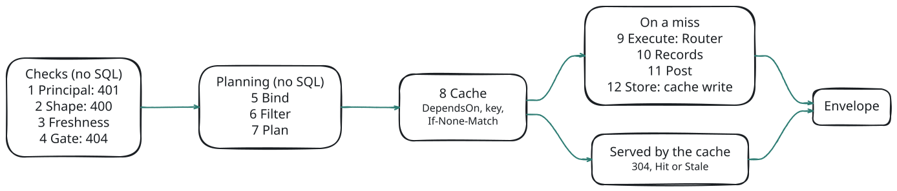
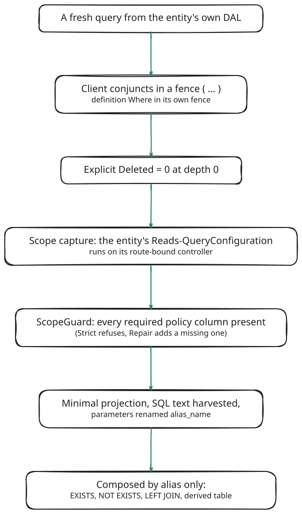
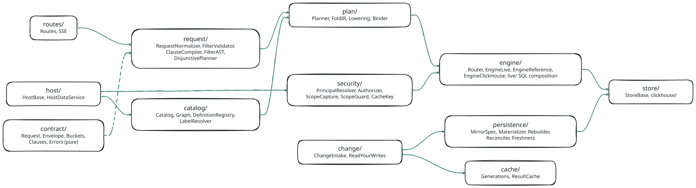

# Architecture

The faceting service is one [fable](#/doc/fable/fable) service, `RetoldFacetingService`, that attaches to the process serving your data, adds routes under `/1.0/Facet`, and answers each facet request by compiling it into SQL over the same DALs, behaviors and sessions your list endpoints use. Nothing about a facet is computed from a separate copy of the rules: tenancy, soft delete and app scoping come from the entity's own list machinery, every time.

This page follows a request through the service, then describes the engines, the Scoped Relations every statement is built from, the plan forms, and the code layout. The ideas the page relies on (folds, disjunctive faceting, named scopes) are explained in [Concepts](#/page/Concepts).

## Roles and Hosts

The service runs in one **role** today: `Embedded`, inside the process of a [retold-data-service](#/doc/meadow/retold-data-service), next to the [meadow-endpoints](#/doc/meadow/meadow-endpoints) list routes whose answers it must match. `Role` is an option (`RetoldFaceting.Role`), and the installer refuses any other value.

> **Planned.** `Standalone` and `Agent` roles, which run the faceting service in its own process in front of one or more data services.

Everything the service needs from its process goes through a **host adapter**. `RetoldFacetingHostBase` defines the seam; `RetoldFacetingHostDataService` implements it for a plain retold-data-service:

| Host method | What the service gets |
|---|---|
| `bind`, `getModel`, `onModelChanged` | The compiled Stricture model, and a callback when the data service reloads it |
| `getDAL`, `getExecutionDAL` | Each entity's meadow DAL; statements run on the DAL the list routes read through |
| `getRouteBoundController` | The meadow-endpoints controller an entity's CRUD routes are bound to, whose behaviors define the entity's scope |
| `resolvePrincipal` | The requesting principal, from the session the endpoints already use |
| `getScopePolicy`, `scopeAssurance` | The tenancy policy (`RetoldFaceting.Scope`) in normalized form |
| `isFacetable`, `getDialectProfile`, `getPrimaryKey`, `getDeleteColumn` | Which entities may be faceted, the SQL dialect, keys and the soft-delete column |
| `getServiceServer` | The [Orator](#/doc/orator/orator) service server the routes mount on |

A second host adapter, `RetoldFacetingHostApplicationServer`, serves `retold-application-foundation-server` apps. It takes the policy from the app's own `tenancyConfig()`, the principal from the app's sessions and entitlements, and the controllers from the endpoints the app mounted; see [Hosting](#/page/Hosting).

### Attaching

`installOnRetoldDataService` registers the service on the data service's fable and calls `attach`, inside the data service's `initializeService` callback:

```javascript
const libRetoldFacetingService = require('retold-faceting-service');

_Fable.RetoldDataService.initializeService(
	(pInitializeError) =>
	{
		if (pInitializeError)
		{
			return _Fable.log.error(`Data service failed to start: ${pInitializeError.message}`);
		}
		libRetoldFacetingService.installOnRetoldDataService(_Fable.RetoldDataService, _Fable.settings.RetoldFaceting,
			(pInstallError, pFacetingService) =>
			{
				if (pInstallError)
				{
					return _Fable.log.error(`Faceting failed to install: ${pInstallError.message}`);
				}
				// The facet routes are mounted under /1.0/Facet
			});
	});
```

`attach` then, in order:

1. binds the host adapter to the data service;
2. refuses to mount when an entity is named like a route segment (`Facet`, `Describe`, `Agent`, `Admin`, `Changes`, `Status`);
3. checks every SQL shell template against every dialect (a boot-time self test);
4. builds the model graph, the catalog of auto facets, and loads the definitions files;
5. installs change capture, and registers the ClickHouse store when one is configured;
6. subscribes to model reloads (a reload rebuilds the catalog and definitions; on failure the previous ones stay);
7. mounts the routes, and wraps the server's `close` so a shutdown ends open change streams first.

Installation, options and shutdown are covered in [Hosting](#/page/Hosting) and [Configuration](#/page/Configuration).

## The Request Lifecycle

A Query request (`POST /1.0/Facet/<Entity>/Query`) runs as a waterfall of named stages. The stages before the Cache stage run no SQL, so a principal that is not allowed is refused before anything is read, served from the cache or answered with a `304`.

<!-- bespoke diagram: edit diagrams/request-lifecycle.mmd or .hints.json, then: npx pict-renderer-graph build modules/meadow/retold-faceting-service/docs -->


| Stage | What happens |
|---|---|
| 1 Principal | The host resolves the principal from the session. On a host with a tenancy policy, an anonymous principal, or one whose required scope value is unset, is `401` here, before the entity is even looked at. Without a policy every principal passes, and facets match the lists it can read. |
| 2 Shape | The body is normalized: shape and size limits, defaults, clamps (`400` on a malformed body). The request deadline is fixed: the smaller of `Limits.TimeoutMS` and the body's `TimeoutMS`. |
| 3 Freshness | The effective freshness mode: the requested one, upgraded to `Exact` by a `MinSeq` or by the principal's own recent write. |
| 4 Gate | The route entity must be facetable and readable by the principal, else `404 FACET_UNKNOWN_ENTITY`, the same answer as an entity that does not exist. |
| 5 Bind | The values definitions may bind: `$CurrentUser.*` from the principal only, `$Now` and `$Today` from the request clock (floored to `Cache.NowBucketMS`), `$StartOf.*`. |
| 6 Filter | Clauses, the meadow-filter string and named scopes become one normalized filter (the FilterAST). Every entity a scope or join clause reads is gated before its columns are validated. |
| 7 Plan | Each facet is resolved (declared definitions first, then the catalog), lowered to the engine-neutral plan (FoldIR), and grouped into Variants and cube plans. A facet that fails planning fails alone, in `Errors[Key]`. |
| 8 Cache | The answer's `DependsOn` list. With the result cache on: the cache key, the generation version, a `304` for a matching `If-None-Match`, and Hit or Stale serves. |
| 9 Execute | The Router sends each planned facet to an engine and runs it. |
| 10 Records | When the body asks for `Records`, one page of the list through the same compiler, always Live and exact, hydrated through the entity's list behaviors. |
| 11 Post | Pure post-processing: ordering, `Top`, gap fill, labels, bucket clauses, selection, the envelope and its `Version` (the ETag). |
| 12 Store | Keeps a cacheable answer in the result cache (nothing to do when the cache is off). |

A stage that throws an unexpected error becomes a logged `500 FACET_INTERNAL`; internals are never echoed to the client. A request fails as a whole only when every facet and the Total failed; otherwise the answer is `200` with the failures in `Errors`.

The list-side routes (`Records`, `Records/Count`, `Keys`) share stages 1, 2 and 4 to 6, check the top-level `Params`, plan the full filter only, and always execute on the Live engine. See [Records, Count and Keys](#/page/api/Records_And_Keys).

## Engines and the Router

An **engine** takes planned facets and returns raw results: groups and counts, never presentation. Ordering, `Top`, gap filling, labels and clauses are done once, afterwards, by the pure contract code, so two engines cannot disagree about how an answer looks.

| Engine | What it is |
|---|---|
| **Live** (`RetoldFacetingEngineLive`) | The production engine. Composes SQL from Scoped Relations and per-dialect shell templates, and runs it through the counted entity's DAL provider. Tested end to end on SQLite and PostgreSQL. MySQL and MSSQL entities are accepted and their statements run, but those statements are only checked against golden SQL and have never been run against a real server: treat them as untested. |
| **Reference** (`RetoldFacetingEngineReference`) | A test oracle, not a production engine. It replays each entity's real list endpoint (behaviors, reads, post-operations) with no SQL composition at all, and folds the rows in JavaScript. The test suite compares its envelopes with the Live engine's. It is reachable only in-process, never from a client: `queryInternal(pEntity, pBody, pRequest, { ForceEngine: 'Reference' }, fCallback)` (see [JavaScript API](#/page/api/JavaScript_API)). |
| **ClickHouse** (`RetoldFacetingEngineClickHouse`) | Registered only when `Stores.ClickHouse` is configured. Compiles the same plan to ClickHouse SQL over mirror tables, using the same captured scope of every entity. |

The **Router** decides per facet which engine answers it:

- With no store registered, everything runs Live.
- With a store, a facet goes to the store only when the store can answer it (every entity and column it reads is mirrored, no Show-deleted filter, values the mirror can compare exactly) **and** the request's freshness mode admits the store's current lag.
- Otherwise the facet runs Live, and the envelope's `Store` block says why.
- A store failure re-runs the affected facets Live in the same request.
- A body with `Engine: 'Live'` always gets the Live engine.

See [The ClickHouse Store](#/page/ClickHouse_Store).

## Scoped Relations

Every statement the Live engine runs is built from **Scoped Relations**: one entity, rendered in isolation exactly as its list would render it for this principal.

<!-- bespoke diagram: edit diagrams/scoped-relation.mmd or .hints.json, then: npx pict-renderer-graph build modules/meadow/retold-faceting-service/docs -->


1. Take a fresh [FoxHound](#/doc/meadow/foxhound) query from the entity's own [meadow](#/doc/meadow/meadow) DAL.
2. Put the client's conditions in a parenthesized **fence**, and a definition's `Where` in a second fence, so nothing a client sends can escape into an `OR` at the top level.
3. Add an explicit `Deleted = 0` outside the fences (unless the client deliberately asked for deleted rows on the counted entity), so no filter can switch the soft delete off.
4. Run the entity's `Reads-QueryConfiguration` behavior on its route-bound controller: the **scope capture**. Whatever the behavior appends (a tenant predicate, an owner predicate) is now part of the relation.
5. The **ScopeGuard** asserts that every column the tenancy policy requires is constrained, at the top level, to the principal's value. `Strict` refuses the request (`500 FACET_SCOPE_POLICY_VIOLATION`) when one is missing; `Repair` adds a predicate that is simply missing, and refuses every other violation.
6. Project only the columns the statement needs, build the SQL text, and rename every bound parameter to `<alias>_<name>` so relations can be combined.
7. Compose relations **only by alias**: `EXISTS` and `NOT EXISTS` for predicates, `LEFT JOIN` for to-one lookups (an invisible target gives NULL, never a dropped row), two-level `DISTINCT` for to-many keys, `JOIN` for tuple sides. Never a rewritten join on someone else's query.

Here is a complete statement from the golden SQL the tests pin, `K20-ExistsSplit|SQLite` in `test/goldens/Facet-Live-M2-Goldens.json`: ProjectTrack projects split by whether they have an open issue, on the test fixture whose tenancy behavior appends `IDCustomer` (line breaks added):

```sql
SELECT "d"."Key" AS "Key", count(*) AS "Count"
FROM (SELECT "p"."FacetX0" AS "Key"
	FROM (SELECT "p"."IDProject" AS "IDProject",
			CASE WHEN EXISTS (SELECT 1
				FROM (SELECT "IDIssue", "IDProject" FROM Issue
					WHERE ( `State` = :e1_w1_State_w1 ) AND `Deleted` = :e1_FacetSoftDelete_w3 AND `IDCustomer` = :e1_TestTenancy_w4) "e1"
				WHERE "e1"."IDProject" = "p"."IDProject") THEN 1 ELSE 0 END AS "FacetX0"
		FROM (SELECT "IDProject" FROM Project
			WHERE `Deleted` = :p_FacetSoftDelete_w0 AND `IDCustomer` = :p_TestTenancy_w1) "p") "p") "d"
GROUP BY "d"."Key"
```

`Project` (alias `p`) and `Issue` (alias `e1`) are each a Scoped Relation, with the explicit soft delete and the tenant predicate the behavior appended; the issue relation also carries the dimension's `Where` (`State` is `Open`) in its fence. Every value is a bound parameter with its alias prefix. No identifier in the statement comes from the client: table and column names come from the catalog, which validates them when it is built.

**Opaque captures.** Sometimes a behavior does something a capture cannot see through: it adds a join, replaces the query, or a read-side post-operation behavior could drop or change rows. The capture is then **Opaque**, and the relation is refused, unless the host vouches for the entity (`Scope.TrustPostOperation`, `Scope.PostOperationSafeColumns`), or the entity is in `Scope.TrustedOpaque` and the hop can run **Staged** (below). The rules are in [Security and Tenancy](#/page/Security_And_Tenancy).

## Plan Forms

The planner turns each facet into an engine-neutral **Agg** (one folded computation) and groups the Aggs by **Variant**, the filter shape each one is counted under. The Live engine can execute a plan in three forms; they give identical results, and the tests check that they do.

### Variants

Facets that leave out the same clauses share one **Variant**: one filter shape, counted once. `v0`, the full filter, always exists; the Total, the `Records` page and every `Exclude: 'None'` facet use it. With three self-excluding facets on three different clauses, a request has four Variants. In-process callers see the count in `pMeta.Variants`.

### Per-Variant Statements

One statement per facet, over its Variant's relation of the counted entity. Relations are memoized for the request: the same hop used under two aliases costs one relation and one behavior run.

### The Conditional Disjunctive Scan

The single-valued facets of one entity are answered by **one** plain `GROUP BY`, whatever their Variants:

- The scan reads the counted entity's relation once, with only the clauses no facet owns.
- Each owned clause (and each definition `Where`) becomes a 0/1 flag column.
- The grain rows are then summed in JavaScript; each facet keeps the rows whose flags it requires.

Members can be Terms, DateHistogram, Edges-mode NumericHistogram, Ranges, Pivot, ChildRollup, ExistsSplit, Stats, Missing and the Total. Nice-mode histograms, DistinctCount, multi-valued facets and TuplePivots keep their own statements.

`Execution.Cube` controls the scan:

- `Auto` (the default) forms a scan when an entity has at least two members.
- `Always` forms one even for a single member.
- `Never` turns it off.

The scan falls back to per-Variant statements when the grain exceeds `Limits.CubeMaxGroups` (100000) rows, or when a behavior rewrites a client operator (a flag evaluated outside the relation would bypass the rewrite). `pMeta.Cubes` and `pMeta.CubeFallbacks` report what happened.

> **Planned.** A `GROUPING SETS` form for scans over `Limits.CubeMaxGroups`.

### Staged Hops

When a hop's capture is Opaque but its entity is listed in `Scope.TrustedOpaque`, and the hop is a leaf of an `Exists` or `NotExists` with integer key columns, the engine runs the hop's own scoped query first, as the behavior built it, and collects its distinct keys (after checking that the rendered SQL still holds every required policy predicate). The whole key set is then bound as **one** parameter: `json_each` on SQLite, an array with `= ANY` on PostgreSQL. More than `Limits.MaxStagedKeys` (50000) keys is `422 FACET_PATH_TOO_BROAD`. `Execution.Staged` (`Auto`, `Always`, `Never`) controls it.

## Components

The service registers its parts as fable services (`fable.RetoldFacetingCatalog`, `fable.RetoldFacetingPlanner`, …), found by each other only through fable. The source tree groups them by job:

<!-- bespoke diagram: edit diagrams/component-map.mmd or .hints.json, then: npx pict-renderer-graph build modules/meadow/retold-faceting-service/docs -->


| Folder | Services and modules | Job |
|---|---|---|
| `source/` | `RetoldFacetingService`, the options, the installers | The pipeline, `attach`, the public entry points |
| `contract/` | `Facet-Contract-Request`, `-Envelope`, `-Buckets`, `-Clauses`, `-Errors`, `-Util` | The pure request and envelope contract (below) |
| `host/` | `RetoldFacetingHostBase`, `RetoldFacetingHostDataService` | The seam to the host process |
| `catalog/` | `Catalog`, `Graph`, `DefinitionRegistry`, `LabelResolver`, the definitions JSON schema | Auto facets, the model graph and paths, definitions files, foreign-key labels |
| `request/` | `RequestNormalizer`, `FilterValidator`, `ClauseCompiler`, `FilterAST`, `DisjunctivePlanner` | From a body to a normalized filter and Variants |
| `plan/` | `Planner`, `FoldIR`, `Lowering`, `Binder` | From facets and filters to the engine-neutral plan |
| `engine/` | `Router`, `EngineLive`, `EngineReference`, `EngineClickHouse`, and `live/` (`ScopedRelationBuilder`, `StatementComposer`, `PredicateCompiler`, `CubeExecutor`, `StagedKeys`, `ShellTemplates`, `Dialects`, one shell module per dialect) | Executing plans |
| `security/` | `PrincipalResolver`, `Authorizer`, `ScopeCapture`, `ScopeGuard`, `CacheKey` | Who is asking, what they may read, and proof that scope is applied |
| `change/` | `ChangeIntake` (with the interim intake and the bus seam), `ReadYourWrites` | Turning writes into change events |
| `cache/` | `Generations`, `ResultCache` | Invalidation counters and the optional answer cache |
| `persistence/` | `MirrorSpec`, `Materializer`, `Rebuilder`, `Reconciler`, `Freshness`, and their helpers | Keeping store mirrors current, and how current they are |
| `store/` | `StoreBase`, `clickhouse/` (`StoreClickHouse`, `FoldCompiler`, `DDL`, `TypeMap`, `Client`) | The ClickHouse store |
| `routes/` | `Routes`, `SSE` | The HTTP routes and the change feed |

On the Live engine, the per-dialect shell template modules hold the only hand-written SQL, and they may use nothing but structural slots (relation, dimension and predicate placeholders), which the boot check scans for. Everything else in a statement is composed from catalog identifiers and bound values.

## The Contract Modules

`source/contract/` holds the request and envelope contract as **pure** modules: they require only each other, never fable, never a database. The same code runs on the server and in a browser bundle, so a client can validate a request, compute bucket keys or build a clause exactly as the server does. The faceting demo's client requires them directly.

| Module | Holds |
|---|---|
| `Facet-Contract-Request.js` | Request constants (folds, intervals, orders, freshness modes, `LIMIT_DEFAULTS`), `parseFacetID`, `normalizeRequest` |
| `Facet-Contract-Envelope.js` | `buildFacetResult`, `buildEnvelope`, `normalizeForComparison`: all envelope arithmetic |
| `Facet-Contract-Buckets.js` | The canonical bucket math: date keys and labels, integer-unit numeric geometry, range and band keys, key ordering |
| `Facet-Contract-Clauses.js` | Bucket clauses, clause ownership and exclusion, selection, canonical JSON |
| `Facet-Contract-Errors.js` | Every error code and its HTTP status |
| `Facet-Contract-Util.js` | Small shared helpers |

Every engine keys its groups with these functions, which is why a date bucket or a numeric band has the same key on SQLite, PostgreSQL, ClickHouse and in the browser:

```javascript
const libFacetRequest = require('retold-faceting-service/source/contract/Facet-Contract-Request.js');
const libFacetBuckets = require('retold-faceting-service/source/contract/Facet-Contract-Buckets.js');

let tmpBody = { Facets: [ { Key: 'ByMonth', Facet: 'BookStoreSale.SaleDate', Interval: 'month' } ] };
let tmpNormalized = libFacetRequest.normalizeRequest('BookStoreSale', tmpBody, {});
console.log(tmpNormalized.Total);
// true

console.log(libFacetBuckets.dateKey('2026-03-18 14:05:00', 'week'));
// 2026-03-16 00:00:00   (the ISO Monday)
console.log(libFacetBuckets.dateLabel('2026-03-01 00:00:00', 'month'));
// Mar 2026

try
{
	libFacetRequest.normalizeRequest('BookStoreSale', { Facets: [ { Key: 'X', Facet: 'BookStoreSale.SaleDate', Interval: 'hour' } ] }, {});
}
catch (pError)
{
	console.log(pError.Code, pError.message);
	// FACET_REQUEST_INVALID Interval must be one of day, week, month, quarter, year.
}
```

## Related

- [Concepts](#/page/Concepts): the vocabulary.
- [Fold Kinds](#/page/Fold_Kinds): what each fold computes and how it compiles.
- [Security and Tenancy](#/page/Security_And_Tenancy): principals, the gate, scope capture and the guard in depth.
- [Caching and Invalidation](#/page/Caching_And_Invalidation) and [The ClickHouse Store](#/page/ClickHouse_Store): the optional layers.
- [Internals](#/page/Internals) and [internal contracts](#/page/internal-contracts): the binding specification, for contributors.
