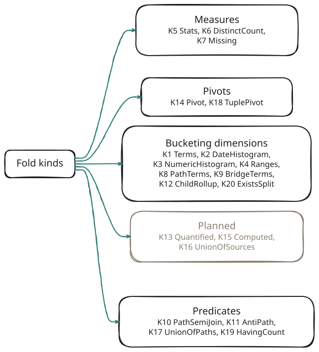

# Fold Kinds

A **fold** is the computation that turns an entity's rows into one facet result: count them per value, per date bucket, per numeric band, or reduce them to a single statistic. The faceting service names each kind with a number, K1 to K20. Seventeen kinds are built; three are planned.

Every kind has the same semantics on every engine. The Live engine, the Reference oracle and the ClickHouse store all compile the same plan, and the test suite checks that they return the same numbers.

## The Kinds at a Glance

<!-- bespoke diagram: edit diagrams/fold-taxonomy.mmd or .hints.json, then: npx pict-renderer-graph build modules/meadow/retold-faceting-service/docs -->


Kinds fall into four families:

- **Bucketing dimensions** split the rows into buckets and count each bucket. A bucket can usually be selected, and it carries the pict clause that selects it.
- **Measures** reduce the rows to one result: statistics, a distinct count, a missing count.
- **Predicates** are not facets on their own. They are filters (`Exists`, `NotExists`, `Any`, `HavingCount`) used in a named scope or a definition's `Where`, and they change which rows every facet counts.
- **Pivots** count two dimensions at once, or count a declared join of several entities.

| K | Kind | What it computes | How you ask for it | Count mode | Engines | Status |
|---|---|---|---|---|---|---|
| K1 | [Terms](#/page/fold_kinds/001-terms) | Rows per distinct value, top N | `Fold: 'Terms'`, or a `Terms` dimension | `Rows` | Live, ClickHouse | Built |
| K2 | [DateHistogram](#/page/fold_kinds/002-date-histogram) | Rows per calendar bucket | `Fold: 'DateHistogram'` and `Interval` | `Rows` | Live, ClickHouse | Built |
| K3 | [NumericHistogram](#/page/fold_kinds/003-numeric-histogram) | Rows per equal-width or declared numeric band | `Fold: 'NumericHistogram'`, `Buckets` or `Edges` | `Rows` | Live, ClickHouse | Built |
| K4 | [Ranges](#/page/fold_kinds/004-ranges) | Rows per named numeric range | `Fold: 'Ranges'` and `Ranges` | `Rows` | Live, ClickHouse | Built |
| K5 | [Stats](#/page/fold_kinds/005-stats) | Rows, non-null, min, max, sum, average | `Fold: 'Stats'` | `Rows` | Live, ClickHouse | Built |
| K6 | [DistinctCount](#/page/fold_kinds/006-distinct-count) | Number of distinct values | `Fold: 'DistinctCount'` | `Rows` | Live, ClickHouse | Built |
| K7 | [Missing](#/page/fold_kinds/007-missing) | Rows with no value | every bucketed fold's `MissingCount`, or `Fold: 'Missing'` | `Rows` | Live, ClickHouse | Built |
| K8 | [PathTerms](#/page/fold_kinds/008-path-terms) | Rows per value of a column reached through to-one hops | FacetID `Entity.Column>Target.Column`, or a dimension with a `>` path | `Rows` | Live, ClickHouse | Built |
| K9 | [BridgeTerms](#/page/fold_kinds/009-bridge-terms) | Rows per key reached through a to-many path; multi-valued | a `Terms` dimension with a `<` or `=` path and `KeyField` | `PivotDistinct` | Live, ClickHouse | Built |
| K10 | [PathSemiJoin](#/page/fold_kinds/010-path-semi-join) | Keep rows with a visible related row | `Exists` predicate; join clauses | (filter) | Live, ClickHouse | Built |
| K11 | [AntiPath](#/page/fold_kinds/011-anti-path) | Keep rows with no visible related row | `NotExists` predicate, optional `Correlate` | (filter) | Live, ClickHouse | Built |
| K12 | [ChildRollup](#/page/fold_kinds/012-child-rollup) | Rows per band of their child count | a `ChildRollup` dimension | `Rows` | Live, ClickHouse | Built |
| K13 | Quantified | Every related row matches | `All`, `AllNonEmpty` predicates | (filter) | — | **Planned** |
| K14 | [Pivot](#/page/fold_kinds/014-pivot) | Rows per pair of keys, with marginals | `Facet: [ id1, id2 ]` and `Fold: 'Pivot'`, or two dimensions | `Rows` | Live, ClickHouse | Built |
| K15 | Computed | Any bucketing kind over a computed expression | `Expr`, `Expressions` | — | — | **Planned** |
| K16 | UnionOfSources | Several pivots folded by one key | `Pivot: { Union }` | — | — | **Planned** |
| K17 | [UnionOfPaths](#/page/fold_kinds/017-union-of-paths) | Keep rows matching any of several predicates | `Any` predicate | (filter) | Live, ClickHouse | Built |
| K18 | [TuplePivot](#/page/fold_kinds/018-tuple-pivot) | Distinct key tuples of a declared join | `Pivot: { Tuple: { From, On, Key } }` | `KeyDistinct` | Live, ClickHouse | Built |
| K19 | [HavingCount](#/page/fold_kinds/019-having-count) | Keep rows whose related-row count passes a comparison | `HavingCount` predicate | (filter) | Live, ClickHouse | Built |
| K20 | [ExistsSplit](#/page/fold_kinds/020-exists-split) | Two buckets: has a visible related row, or not | an `ExistsSplit` dimension | `Rows` | Live, ClickHouse | Built |

"Live" means the Live engine executes the kind; it is tested on SQLite and PostgreSQL. MySQL and MSSQL shell templates exist for every kind and run on those hosts, but they are only checked against golden SQL and have never been run against a real server, so treat them as untested. "ClickHouse" means the store engine can answer the kind when every entity and column it reads is mirrored; each kind's page lists the refusals that apply, and a refused facet is answered Live in the same request.

## Three Ways to Ask for a Fold

**On an auto facet, by name.** Every facetable column has a list of folds. A request picks one with `Fold`, or gets the column's default:

<!-- docs-check: request Fixture=Bookstore Entity=BookStoreSale -->
```json
{
	"Facets":
	[
		{ "Key": "Amount", "Facet": "BookStoreSale.TotalAmount", "Fold": "Stats" },
		{ "Key": "ByMonth", "Facet": "BookStoreSale.SaleDate" }
	]
}
```

The request `Fold` values are `Terms`, `DateHistogram`, `NumericHistogram`, `Ranges`, `Stats`, `DistinctCount`, `Missing` and `Pivot`. `ChildRollup` and `ExistsSplit` are accepted only on a declared facet that lists them. `PathTerms`, `BridgeTerms` and `TuplePivot` are never named in a request: you ask for those facets by FacetID, and their fold is the bucketing kind they declare.

Naming a fold the column does not offer is a per-facet error: that facet's `Errors` entry is `FACET_UNKNOWN_FOLD` (status 400), its `Detail.Folds` lists the folds the column does offer, and the other facets are still answered. Only a fold name that does not exist at all fails the whole request.

**By FacetID, for a one-hop path.** `BookStoreSale.IDBookStore>BookStore.State` facets sales by their store's state without any definitions file (K8).

**In a definitions file.** Cross-entity dimensions (K8 with several hops, K9, K12, K20), declared pivots (K14, K18) and every predicate kind (K10, K11, K17, K19) are written in JSON definitions files. See [Definitions Files](#/page/Definitions) for the syntax; each kind's page shows a complete, working file.

## The Folds a Column Offers

The catalog derives every entity's auto facets from its Stricture model. The first fold listed is the default.

| Column | Folds |
|---|---|
| A foreign key (has a `Join`) | Terms, Missing, DistinctCount |
| `Boolean` | Terms, Missing |
| `DateTime` | DateHistogram, Stats, Missing |
| `Numeric` (integer) | NumericHistogram, Terms, Ranges, Stats, DistinctCount, Missing |
| `Decimal` | NumericHistogram, Ranges, Stats, Missing |
| `String` up to `Catalog.MaxTermsStringSize` (128) characters, not uniquely indexed | Terms, Missing, DistinctCount |
| Primary key, GUID, `Text`, `JSON`, longer strings | none (still filterable) |
| The delete column, `DeleteDate`, the audit user columns, the tenancy policy column | none (still filterable) |
| Sensitive columns: names matching `Password`, `Hash`, `Secret`, `Token`, `Salt`, `ApiKey`, `Email`, `Phone`, or ending in `Key` or `Code`, plus `Catalog.Sensitive` entries | none, and not filterable either |

`Catalog` options can include or exclude columns; see [Configuration](#/page/Configuration).

## Choosing a Kind

- A column with a handful of values (status, type, language, a foreign key): **K1 Terms**.
- A date: **K2 DateHistogram** for a timeline, **K5 Stats** for the first and last date.
- A number: **K3 NumericHistogram** to see the distribution, **K4 Ranges** for named bands such as "low / medium / high", **K5 Stats** for totals and averages.
- "How many different values?": **K6 DistinctCount**. "How many are blank?": **K7 Missing**.
- A column of a related row ("sales by store state"): **K8 PathTerms**.
- A many-to-many or child relation ("books by author", "projects by member"): **K9 BridgeTerms**. Expect buckets that sum to more than the total.
- "Has / has not" questions: **K20 ExistsSplit** as a facet, **K10** and **K11** as filters.
- "How many children?" as buckets: **K12 ChildRollup**. As a filter ("at least three"): **K19 HavingCount**.
- Two dimensions at once: **K14 Pivot**.
- Obligations implied by configuration ("forms each intake should have, minus the ones filed"): **K18 TuplePivot** with a K11 predicate.

## Planned Kinds

> **Planned.** K13 Quantified (`All` and `AllNonEmpty` predicates), K15 Computed (dimensions over an `Expr`) and K16 UnionOfSources (`Pivot: { Union }`).

A definitions file may already contain these constructs. The registry loads such an entry with `Supported: false` instead of disabling it, Describe lists it as unsupported, and a request that uses it gets `422 FACET_FOLD_UNSUPPORTED` with `Detail.Feature` set to `Quantified`, `Computed` or `UnionOfSources`. The same applies to a few options of the built kinds: the histogram `Mode: 'Log'`, measures other than a row count, `ChildRollup` aggregates other than `count`, and `Exclude: 'Group:…'`.

## Related

- [Concepts](#/page/Concepts): buckets, count modes, disjunctive faceting and Scoped Relations.
- [Definitions Files](#/page/Definitions): the syntax of dimensions, paths and predicates.
- [The Request Body](#/page/api/Request): every per-facet request option.
- [The Response Envelope](#/page/api/Envelope): every facet result and bucket field.
