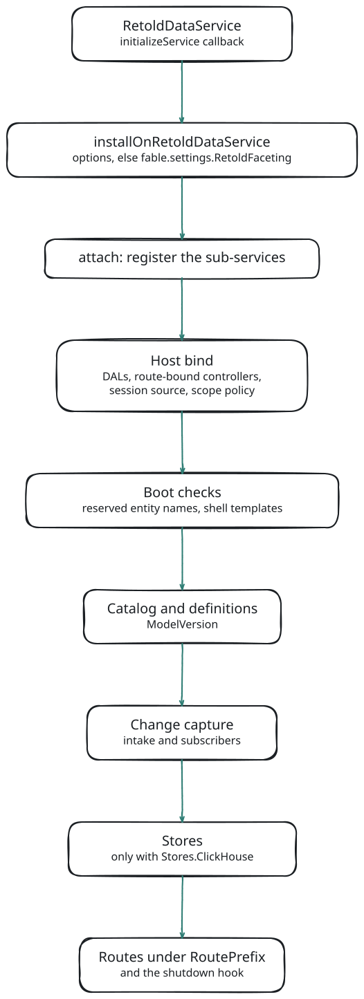

# Hosting

The faceting service runs **embedded** in the process that serves your data: it attaches to a [retold-data-service](#/doc/meadow/retold-data-service), reads through the same DALs and [meadow-endpoints](#/doc/meadow/meadow-endpoints) controllers the list routes use, and mounts its routes on the same [Orator](#/doc/orator/orator) server. There is no separate facet server to deploy, and no data leaves the process unless you configure the ClickHouse store.

This page covers installing it on a retold-data-service, what happens at attach, model reloads, graceful shutdown, running several processes, and installing it on a retold-application-foundation-server app.

## Installing on a retold-data-service

Install inside the `initializeService` callback, after the data service has its Orator server:

```javascript
const libRetoldFacetingService = require('retold-faceting-service');

_Fable.RetoldDataService.initializeService(
	(pError) =>
	{
		if (pError)
		{
			return console.error('The data service failed to start:', pError);
		}
		libRetoldFacetingService.installOnRetoldDataService(_Fable.RetoldDataService,
			{
				// Declared facets, named scopes and aliases (every *.json directly under the folder).
				Definitions: { Path: `${__dirname}/facets/` },
				// The tenancy policy the ScopeGuard checks on every hop.
				Scope: { Policy: { Column: 'IDCustomer', SessionField: 'CustomerID' }, Guard: 'Strict' }
			},
			(pInstallError, pFaceting) =>
			{
				if (pInstallError)
				{
					return console.error('Faceting did not mount:', pInstallError.message);
				}
				// Facets, Records, Count, Keys and Describe are served under /1.0/Facet/
			});
	});
```

The callback receives the attached `RetoldFacetingService`, which is also reachable as `_Fable.RetoldFacetingService`.

### Where Options Come From

`installOnRetoldDataService(pRetoldDataService, pOptions, fCallback)` uses `pOptions` when it is an object. Otherwise it reads `fable.settings.RetoldFaceting`, so the options can live in your settings file:

```javascript
let _Fable = new libFable(
	{
		Product: 'MyApp',
		APIServerPort: 8086,
		RetoldFaceting:
			{
				Definitions: { Path: false },
				Cache: { Enabled: true }
			}
	});

// … later, inside the initializeService callback:
libRetoldFacetingService.installOnRetoldDataService(_Fable.RetoldDataService, null, fAttached);
```

Options are partial: anything you leave out keeps its default, and nested objects merge key by key (arrays replace). Every option and its default is in [Configuration](#/page/Configuration).

## What Attach Does

<!-- bespoke diagram: edit diagrams/install-embedded.mmd or .hints.json, then: npx pict-renderer-graph build modules/meadow/retold-faceting-service/docs -->


1. **Register.** The service registers its sub-services on fable (`fable.RetoldFacetingCatalog`, `fable.RetoldFacetingEngineLive`, and so on), each with the resolved options.
2. **Bind the host.** The data-service host adapter keeps references to `fable.DAL` and `fable.MeadowEndpoints`, records each entity's **route-bound controller** (the controller the list routes are bound to), wraps the data service's model loader, checks the scope configuration, and refuses header-asserted sessions unless `Scope.AllowHeaderSession` is set.
3. **Boot checks.** An entity named `Facet`, `Describe`, `Agent`, `Admin`, `Changes` or `Status` would shadow a facet route, so attach refuses it. Every SQL shell template is checked on every dialect. A configured limit that this version does not enforce yet is logged as a warning.
4. **Catalog and definitions.** The model graph and the catalog of facetable columns are built from the compiled Stricture model, then the definitions files are loaded and validated against them; an invalid entry is disabled and logged, never half-loaded. `ModelVersion` covers the model, the definitions and the scope policy.
5. **Change capture.** The change intake wraps each facetable entity's route-bound controller (see [Caching and Invalidation](#/page/Caching_And_Invalidation)).
6. **Stores.** Only with `Stores.ClickHouse`: the store engine is registered and the materializer starts in the background. A store that is down never fails attach (see [The ClickHouse Store](#/page/ClickHouse_Store)).
7. **Routes and shutdown.** The facet routes are mounted under `RoutePrefix` (`/1.0/Facet`), the change feed when it is enabled, the admin routes when `Admin.Routes` is `true`, and the shutdown hook is installed.

### When Install Refuses

The callback gets an error, and nothing is mounted, when:

- the argument is not a retold-data-service, or it has no Orator service server (installing before `initializeService` finished only logs a warning);
- `Role` is not `'Embedded'` (the only role this version runs);
- the faceting service is already attached on this fable;
- the scope configuration is invalid (for example `Guard: 'Off'` with a policy, or a policy column that is not a plain identifier);
- the data service trusts header-asserted sessions and `Scope.AllowHeaderSession` is not set;
- an entity is named like a facet route segment;
- `Host` is set to a host kind other than `'Auto'` or `'DataService'`.

These are boot errors on purpose: a faceting service that silently mounted with a weaker scope would be worse than none.

## What the Host Adapter Provides

Every engine, the catalog and the security services reach your application only through a **host adapter**. On a retold-data-service it provides:

| Piece | Where it comes from |
|---|---|
| the model | `RetoldDataService.fullModel`, and every model the data service loads later |
| DALs | `fable.DAL[Entity]`; statements run on the same connection as the lists |
| behaviors | each entity's route-bound meadow-endpoints controller, captured at bind |
| the principal | the controller's session marshaler (`initializeRequestState(pRequest, 'Reads').SessionData`), exactly what the list routes see |
| the dialect | the DAL's provider name |
| the scope policy | `RetoldFaceting.Scope`, normalized and validated at bind |
| the service server | `fable.OratorServiceServer` |

The Live engine is tested end to end on **SQLite** and **PostgreSQL**, including PostgreSQL with the production `meadow-connection-postgresql` schema.

On PostgreSQL the process does not have to run in UTC (the test suites set `TZ=UTC` for their own fixture comparisons). Facet keys are formatted in SQL and the ClickHouse materializer reads timestamps as text, so neither depends on the process time zone. `Records` are read through the entity's own list path, so their dates match what your list routes return. The one difference outside UTC: the store reconciler widens its sweep overlap by an hour.

> **Warning.** On **MySQL** and **MSSQL** the service installs, marks every entity facetable and runs its statements, but those statements are only checked against golden SQL in the tests. They have never run against a real server, so a facet there may fail or count wrongly. Treat these databases as unsupported: do not install the service on such a host, or keep its entities out with `Catalog.NeverFacet`, until execution is verified.

An entity added after attach (a later `loadModel`) gets its route-bound controller captured then. An entity that already had routes keeps the controller it had, because the data service does not reconnect routes for it.

## Calling the Service in Process

Server code can ask for facets without HTTP. In-process calls take a request object for the principal; a synthetic one carries the session the host resolves:

```javascript
_Fable.RetoldFacetingService.query('BookStoreSale',
	{ Facets: [ { Key: 'ByMethod', Facet: 'BookStoreSale.PaymentMethod' } ], Total: true },
	{ params: {}, headers: {}, query: {}, UserSession: { LoggedIn: true, UserID: 1 } },
	(pError, pEnvelope, pMeta) =>
	{
		// captured on the Bookstore fixture: pEnvelope.Total === 2918; pMeta.Statements === 1
	});
```

`pMeta` (in process only) reports the statements run, the cache status and, with a store, which engine answered each facet. The same pattern works for `records`, `count` and `keys`, and `describeRequest` answers Describe; see [JavaScript API](#/page/api/JavaScript_API).

## Model Reloads

When the data service loads a model after attach, the host adapter notices (it wraps the data service's model loader) and the service:

1. captures route-bound controllers for any new entities;
2. rebuilds the graph and the catalog, and reloads the definitions from the same sources;
3. wraps the new controllers with the change intake;
4. re-installs the store and recompiles each mirror (an additive column change is applied in place; anything else is rebuilt beside the old table);
5. clears the result cache (every key carries the old `ModelVersion`) and sends a `model` event on every open change stream, so pages refetch.

If the rebuild fails, the previous catalog stays in place and the error is logged. A request planned against the old model is never stored in the cache under the new one.

Verified on a data service started with no model: the service installed, Describe listed 0 entities, and a Query answered `404 FACET_UNKNOWN_ENTITY`. After `RetoldDataService.loadModel('Bookstore', …)` Describe listed 13 entities and the same Query answered `200` at once. `test/Facet-Host_tests.js` covers model reloads (new entities, kept controllers, notifications).

## Graceful Shutdown

At attach the service wraps the Orator service server's `close()` once. So `fable.RetoldDataService.stopService()` (which stops Orator) and `fable.Orator.stopWebServer()` run the faceting shutdown first:

1. the materializer drains for up to `Materializer.DrainOnStopMS` (5 seconds), flushes, records a clean shutdown for each entity that drained, and releases its lease;
2. open change streams end with a `closed` event (`Reason: 'Shutdown'`);
3. the notify settle timers and the cache's background-refresh bookkeeping are cleared;
4. the ClickHouse client's sockets are closed.

Then the server closes. Every timer the service starts is `unref()`'d, so nothing keeps the process alive. `RetoldFacetingService.shutdown(fCallback)` runs the same steps without closing the server; it is idempotent.

## Running Several Processes

Several application processes can each embed the faceting service over the same database. Facets stay correct, because every answer is computed from the database through each process's own Scoped Relations. Three things are per process:

- **The result cache and generations.** A process only sees writes made through its own routes or reported to its own `notify()`. Leave `Cache.Enabled` off unless every writer runs in one process.
- **The change feed.** A stream only signals the writes its own process saw. A page connected to process B is not told about a write that went through process A.
- **The ClickHouse store.** One process materializes a store (it holds a lease in the store's database); the others answer every facet Live until it stops.

## Hosting on retold-application-foundation-server

A `retold-application-foundation-server` (RAFS) app installs the service as two of its own boot steps. Nothing in RAFS changes: the service reads the app's tenancy, entitlements and sessions and runs every read through the app's own list behaviors.

### Adding the Installers

Add `retold-faceting-service` to the app's dependencies, then add one installer to each of the app's hook arrays:

```javascript
const libRetoldApplicationServer = require('retold-application-foundation-server');
const libRetoldFacetingService = require('retold-faceting-service');

class LabServer extends libRetoldApplicationServer
{
	hookInstallers()
	{
		// Runs after RAFS's tenancy, entitlements and membership steps.
		return super.hookInstallers().concat([ libRetoldFacetingService.foundationHookInstaller(this, this.options.Faceting) ]);
	}

	routeInstallers()
	{
		// LAST: after every route installer that mounts meadow-endpoints.
		return super.routeInstallers().concat([ libRetoldFacetingService.foundationRouteInstaller(this, this.options.Faceting) ]);
	}
}
```

The two phases do different work:

- **The hook installer** registers and binds the service on the app's fable. In-process queries work from that point. It also hooks the Orator server's close, so `fable.Orator.stopService` shuts the service down first even if the routes never mount.
- **The route installer** picks up endpoints mounted since the hook phase, along with any change in what tenancy guards, and mounts `/1.0/Facet/*` on the app's Orator server before it listens.

Each installer calls back exactly once, on a later tick. Any refusal fails the boot with `FACET_INTERNAL`, so a misconfigured install never boots as a silent no-op.

Keep the hook installer in `hookInstallers()`, never in `seedSteps()` or `preSchemaSteps()`: a bind that runs before RAFS installs tenancy or membership refuses the boot. Put the installer's return value in the array, not the installer function itself; the function on its own fails the step with a message saying so.

The package does not depend on RAFS. It recognizes the server object by its shape (`fable`, `DAL`, `Endpoints`, `MeadowModel.Tables`, `tenancyConfig()`).

### Options on RAFS

The installers take the first plain object of:

1. the explicit second argument;
2. `this.options.Faceting`;
3. the manifest's `Options.Faceting` (an app built with `fromManifest` reads `retold-app.json`);
4. `{}`.

That object is used whole; the sources are never merged. Pass the same object to both installers, or leave it out of the route installer. Route-installer options that differ from the running ones fail the boot and name the differing keys.

The shape is the same `RetoldFaceting` options as on a retold-data-service (see [Configuration](#/page/Configuration)). These keys behave differently on RAFS:

```javascript
Faceting:
{
	Role: 'Embedded',                        // the only role on RAFS
	InstanceID: 'labtrack',
	RoutePrefix: '/1.0/Facet',               // its first segment must not name an entity (boot refusal)
	Definitions: { Path: `${__dirname}/facets/` },
	Catalog:
		{
			// Tenancy-excluded and late-mounted tables are facetable only when listed here.
			// Listing a global root or identity table (Customer, User, ...) refuses the boot.
			GlobalEntities: [ 'LabFormType' ],
			NeverFacet: [ 'AuditLog' ]
		},
	Scope:
		{
			// The only value accepted while the app has tenancy.
			Guard: 'Strict',
			// No Policy: it is read from the app's own tenancyConfig(). A Policy object refuses the boot.
			UnsetValues: [ 0, '', null ]
		},
	Authorization:
		{
			// With entitlementsConfig(): '<Entity>.read' through Retold-Entitlements.
			// A (pEntity, pPrincipal) => boolean function can only narrow that check.
			Strategy: 'Auto',
			RequireAction: false,
			// 0 reads the action set on every request, as RAFS's own gate does.
			EntitlementCacheMS: 0
		},
	// Opt in only when every writer of the faceted tables runs in this process.
	Cache: { Enabled: false },
	// Entities whose DAL-direct writers call notify() themselves.
	ChangeCapture: { NotifyManaged: [] },
	// true mounts the store admin routes; without your own Admin.authorize only the
	// Membership platform principal passes.
	Admin: { Routes: false }
}
```

On RAFS, `SSE.RevalidateMS` defaults to 60 seconds. At that interval an open change stream re-reads its session and roles, and it ends only when they changed.

### Tenancy

Tenancy comes from the app's own behaviors; the service never re-implements it.

- **Every read runs the entity's own list behaviors.** Facets, Records, Count and Keys all run the entity's `Reads-QueryConfiguration` on its route-bound controller. RAFS's tenancy guard and its `PersonalScopes` owner scope apply exactly as they do on the list.
- **The ScopeGuard asserts the result.** After the behaviors run, the guard checks that the tenant predicate (and the owner predicate, on owner-scoped entities) was appended. A guard that was dropped or rewritten fails the facet. It is never answered unscoped and never filled in by faceting, which is why only `Strict` is accepted.
- **RAFS's fence is understood.** RAFS wraps the client's filter in an outer group before it appends the scope, and its fence has no `IS` operator. The capture recognizes the wrap, and it swaps faceting's SQLite NULL form (`IS` + null) for one the fence accepts while the guard runs, then restores it.
- **Unset tenants are refused early.** A tenant-0 session gets 401 on every facet route before any SQL runs. An owner-0 session (no persona) gets 401 on an owner-scoped entity, and that entity is denied as a hop or label target.

See [Security and Tenancy](#/page/Security_And_Tenancy) for the ScopeGuard itself.

### Which Entities Are Facetable

- **Guarded entities:** every entity RAFS installed tenancy on, including ones an app hook guards between the two installers.
- **Global entities:** tenancy-excluded entities and endpoints mounted after the tenancy step, only when listed in `Catalog.GlobalEntities`. An unguarded late mount that carries the tenancy column is never facetable and gets a boot warning.
- **Never facetable:**
  - tables in `NoAutoCRUDTables` (including the array form, which RAFS still mounts);
  - entities hidden by `DeniedPrefixes`, matched against the route meadow-endpoints actually mounted;
  - the root and identity tables while they are global: the table keyed by the tenancy column, `Customer`, `User`, and the Membership, Entitlements and Auth.Local tables.

Unknown, hidden and unreadable entities all answer the same 404, so a caller cannot probe for them.

### Sessions and Entitlements

- **The principal** is built from `pRequest.UserSession` using the app's own tenancy `getValue` functions.
- **With entitlements on,** the persona is the one RAFS's entitlements pre-handler writes. A session that no HTTP request enriched (an in-process caller) is enriched with RAFS's `Entitlements.resolveIDUser` first.
- **An app with authentication but no `tenancyConfig()`** has no pre-handler that resolves sessions. The facet routes then resolve the cookie or bearer session through RAFS's own `OratorAuthentication`, and a boot warning explains that RAFS's own lists are not gated in that shape.
- **Anonymous sessions** get 401 on any app that authenticates or has tenancy.
- **A tenant switch** through Retold-Membership re-scopes the next request.
- **Facets need `<Entity>.read`.** Entities in `ExcludeEntities` only need a logged-in session, and a `UserAction` deny wins. Without the grant, a root entity is 404, a declared facet's hop is 403, and label keys stay unlabeled.
- **Role changes take effect at once in this process.** Every write to a role table (RAFS's CRUD routes, `grantRole`, `provisionDefaultRoles`, app code) drops cached action sets for that tenant and re-checks its open change streams, so a revoked user's stream closes immediately.

### Change Capture

- **Writes through RAFS's CRUD routes** bump only their own tenant's generations and change streams.
- **Membership, Entitlements, Profile, RecordLevel and Comms** write their tables directly through the DAL. Answers that depend on those tables are never cached unless `ChangeCapture.NotifyManaged` names them.
- **Read-your-writes** is keyed by the principal's identity, so a user's own writes count even when their role set changes.

### When the Boot Refuses

The app does not start (`FACET_INTERNAL`) when:

- `Scope.Guard` is anything but `'Strict'` while the app has tenancy, or `Scope.Policy` is set;
- sessions come from request headers (`MeadowEndpointsSessionDataSource: 'Header'`);
- the entitlements config lacks `IdentityUserField`, `IdentityAccountField` or `TenantField`;
- `Authorization.Strategy` is `'None'` while entitlements are on;
- the first segment of `RoutePrefix` names an entity;
- `Catalog.GlobalEntities` lists a global root or identity table;
- the hook installer ran before tenancy or membership was installed;
- the route installer was given options that differ from the hook installer's.

### Known Limits

- **Other processes.** Role-table writes made by another process, or by raw SQL, are not seen. With the default `EntitlementCacheMS: 0` this only affects open change streams, which re-check within 60 seconds.
- **Logout** reaches an open change stream within 60 seconds, not instantly.
- **Apps without tenancy** can get facets that are stricter than their own lists, because RAFS's lists are not gated in that shape (warned at boot).
- **Two `getValue` functions on one owner column.** The first is used for both entities. If they disagree, the other entity's facets fail with 500; they never leak.

### Trying It

`test/Facet-Host-RAFS_tests.js` boots a real RAFS app in-process and logs users in through RAFS's own authentication. It runs the motivating queries as users of two tenants on SQLite, PostgreSQL and the ClickHouse store, and checks every answer against the Reference engine. The tests look for the RAFS checkout at `modules/private/retold-application-foundation-server`, or at `RFS_TEST_RAFS_PATH`, and show as one pending test when it is missing.

To see it over HTTP, run the smoke script. It prints Describe, E1 and E3A for two users on port 19194:

```bash
node debug/rafs-smoke.js
```

## Other Roles

`Role: 'Embedded'` is the only role this version runs.

> **Planned.** `Standalone` and `Agent` roles: a separate facet server in front of a data service, alone or with an Agent inside the data service.

> **Planned.** The `createStandaloneServer` and `mountFacetProxy` installers for those deployments.

> **Planned.** Verified MySQL and MSSQL support (tests against a real server).

## Related

- [Getting Started](#/page/Getting_Started): a first install, step by step
- [Configuration](#/page/Configuration): every option and its default
- [Security and Tenancy](#/page/Security_And_Tenancy): the principal, the gate and the ScopeGuard
- [JavaScript API](#/page/api/JavaScript_API): the in-process methods
- [Testing](#/page/Testing): booting a seeded host in tests
