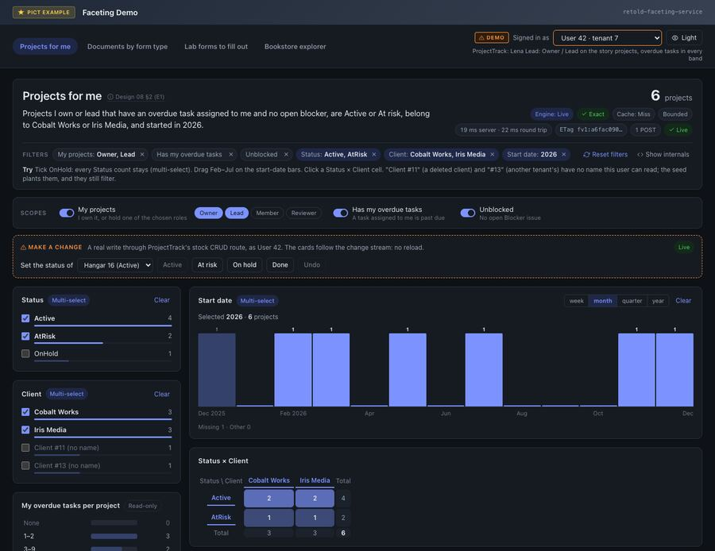
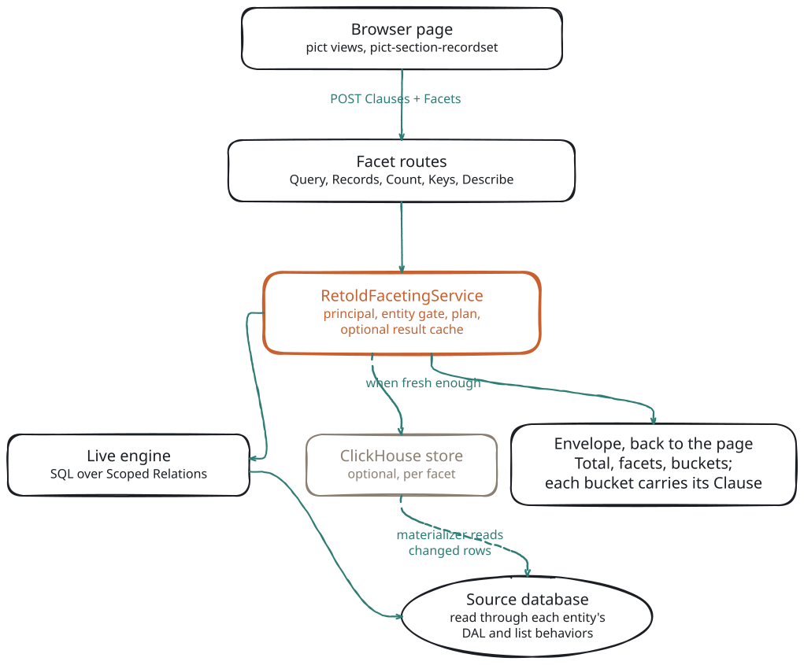

# Retold Faceting Service

> Facets for any retold-data-service: term counts, histograms, ranges, stats and pivots, computed next to the list endpoints and always agreeing with them.

The faceting service answers the question a list page asks next to its rows: "how many of these, by status, by month, by client?". It mounts a small set of routes on a [retold-data-service](#/doc/meadow/retold-data-service) and computes every count through the same list behaviors the entity's own list uses. A facet is never more permissive than the list it sits next to.



## What It Does

A facet request names an entity, the filter the list is showing (the same pict clause array a `pict-section-recordset` sends, or a meadow-filter string) and the facets to compute. The answer is one JSON envelope:

- **A `Total`** that equals the list's own count for the same filter.
- **One result per facet**, with its buckets and counts, a `MissingCount` and an `OtherCount`, and the filters the facet ignored.
- **A `Clause` on every bucket** that can be selected. Put it back into the request and the `Total`, the list and the other facets narrow to exactly that bucket.

Counts are **disjunctive**: a facet ignores its own selection, so ticking one checkbox never drives its sibling checkboxes to zero. Counts are **scoped**: every entity a request reads, including every related entity along a cross-entity path, is read as that entity's own list would read it for the same user, with tenancy, owner scopes and soft deletes applied.

## Features

- **Auto facets from the model.** Terms for strings and foreign keys (with labels from the target), DateHistogram for dates, NumericHistogram, Ranges and Stats for numbers, plus DistinctCount, Missing and 2-D Pivots. No configuration needed.
- **Declared facets and named scopes.** A JSON definitions file adds cross-entity folds (path terms, multi-valued terms through a child table, child-count bands, exists splits, tuple pivots) and named scopes with typed parameters.
- **One compiler for facets and lists.** `Records`, `Records/Count` and `Keys` run the same filter, so a `pict-section-recordset` can page through exactly the rows the facets count.
- **Describe.** `GET /1.0/Facet/Describe` lists what the current user may facet, so a UI can build itself.
- **Live on SQLite and PostgreSQL.** The Live engine renders SQL against the source database through each entity's DAL. MySQL and MSSQL entities are accepted and their statements run, but those statements are only checked against golden SQL and have never been run against a real server: treat them as untested.
- **Result cache and change feed.** Change capture sees every write through the stock CRUD routes and bumps generations; an opt-in result cache uses them to invalidate dependent answers, and a server-sent events stream (on by default when the host has a scope policy) tells pages when to refetch.
- **Optional ClickHouse store.** Entities can be mirrored into ClickHouse. A facet uses the store only when the store can answer it and the request's freshness mode allows it; anything else, or a store failure, is answered Live in the same request.

## Quick Start

The package has not been published to npm yet; install it from a checkout or from its git repository (`npm install git+https://github.com/fable-retold/retold-faceting-service.git`). After the first release, `npm install retold-faceting-service` works too.

Install it inside your retold-data-service's `initializeService` callback:

```javascript
const libRetoldFacetingService = require('retold-faceting-service');

_DataService.initializeService(
	(pInitError) =>
	{
		libRetoldFacetingService.installOnRetoldDataService(_DataService,
			{ Definitions: { Path: `${__dirname}/facets/` } },
			(pInstallError, pFacetingService) =>
			{
				// Query, Records, Count, Keys and Describe are now served under /1.0/Facet/
			});
	});
```

[Getting Started](#/page/Getting_Started) has the complete server, a playground with seeded data, and every request on this page.

## A Thirty-Second Example

The Bookstore model from the test fixtures has a `BookStoreSale` entity. This request asks for sales paid by credit card, counted by year and by payment method:

<!-- docs-check: request Fixture=Bookstore Entity=BookStoreSale -->
```json
{
	"Clauses":
	[
		{ "Type": "DistinctSelectedValueList", "FilterByColumn": "PaymentMethod", "Values": [ "Credit" ], "FilterKey": "PaymentMethod", "Hash": "Method" }
	],
	"Facets":
	[
		{ "Key": "ByYear", "Facet": "BookStoreSale.SaleDate", "Interval": "year" },
		{ "Key": "ByMethod", "Facet": "BookStoreSale.PaymentMethod" }
	],
	"Total": true
}
```

It is posted to `POST /1.0/Facet/BookStoreSale/Query` as JSON (the routes accept no other content type):

```bash
curl -s -X POST http://localhost:8086/1.0/Facet/BookStoreSale/Query -H 'Content-Type: application/json' -d @request.json
```

(`request.json` holds the body above.) 
This is the real answer, abridged: the per-facet freshness fields, display fields and the `Clause` and `Selection` of all but one bucket are left out.

```json
{
	"Entity": "BookStoreSale",
	"Version": "fv1:4dc4a32f072cd446",
	"Engine": "Live",
	"Exact": true,
	"Total": 1288,
	"Filter": { "Applied": [ { "Hash": "Method" } ], "Warnings": [] },
	"Facets":
	{
		"ByYear":
		{
			"Fold": "DateHistogram",
			"Interval": "year",
			"Excluded": [],
			"Total": 1288,
			"SumOfCounts": 1277,
			"MissingCount": 11,
			"Buckets":
			[
				{ "Key": "2021-01-01 00:00:00", "Label": "2021", "Count": 311 },
				{ "Key": "2022-01-01 00:00:00", "Label": "2022", "Count": 310 },
				{ "Key": "2023-01-01 00:00:00", "Label": "2023", "Count": 321 },
				{ "Key": "2024-01-01 00:00:00", "Label": "2024", "Count": 335 }
			]
		},
		"ByMethod":
		{
			"Fold": "Terms",
			"Excluded": [ "Method" ],
			"Total": 2918,
			"SumOfCounts": 2909,
			"MissingCount": 9,
			"Buckets":
			[
				{
					"Key": "Credit",
					"Label": "Credit",
					"Count": 1288,
					"Selected": true,
					"Clause": { "Type": "DistinctSelectedValueList", "FilterByColumn": "PaymentMethod", "Values": [ "Credit" ], "FilterKey": "PaymentMethod", "ClauseKey": "DistinctSelectedValueList" },
					"Selection": { "Facet": "BookStoreSale.PaymentMethod", "Key": "Credit" }
				},
				{ "Key": "Debit", "Label": "Debit", "Count": 744, "Selected": false },
				{ "Key": "Cash", "Label": "Cash", "Count": 476, "Selected": false },
				{ "Key": "Online", "Label": "Online", "Count": 384, "Selected": false },
				{ "Key": "", "Label": "", "Count": 17, "Selected": false }
			]
		}
	}
}
```

Three things to notice:

- `ByYear` counts only credit sales (1,288), because the payment-method clause is not its own.
- `ByMethod` lists `Excluded: [ "Method" ]`. It ignores its own clause and counts all 2,918 sales, so `Debit`, `Cash` and `Online` keep their counts while `Credit` is marked `Selected`.
- `MissingCount` holds rows with no value (NULL), and an empty string is a real bucket (`""`, 17 sales) that can be selected like any other.

[Getting Started](#/page/Getting_Started) builds this step by step, from installing the service to selecting a bucket and paging through its rows.

## How It Fits Together

<!-- bespoke diagram: edit diagrams/overview.mmd or .hints.json, then: npx pict-renderer-graph build modules/meadow/retold-faceting-service/docs -->


The service runs inside the process that serves your data (the `Embedded` role). It is installed from a retold-data-service's `initializeService` callback, or as two boot steps of a `retold-application-foundation-server` app (see [Hosting](#/page/Hosting)). For each request it resolves the principal, checks that the principal may facet every entity the request reads, plans the facets, and runs them. The Live engine renders the facets as SQL over **Scoped Relations**: each entity's rows as its own list behaviors would return them. See [Architecture](#/page/Faceting_Architecture) for the full request lifecycle.

## What Is Planned

These parts of the design are not built yet. The pages that touch them mark them **Planned**.

- Selecting buckets that carry no list clause (`Clause: null`, for example a child-count band or a tuple pivot bucket).
- A reusable `pict-section-facet` view section. The demo's browser code is structured so it can be lifted into it.
- The `Standalone` and `Agent` roles: a faceting server in its own process that talks to the data service over HTTP.
- Solr and OpenSearch stores, and store-side denormalization for the ClickHouse store.
- Verified MySQL and MSSQL support (tests against a real server).
- The fold kinds K13 Quantified, K15 Computed and K16 UnionOfSources. Definitions that use them load as unsupported and answer `422 FACET_FOLD_UNSUPPORTED`.

## Documentation

**Getting started**

- [Getting Started](#/page/Getting_Started): install on a retold-data-service and run your first queries
- [Architecture](#/page/Faceting_Architecture): roles, the host seam, the request lifecycle, engines and Scoped Relations
- [Concepts](#/page/Concepts): facets and folds, buckets, disjunctive faceting, named scopes, the bucket clause round trip

**Defining facets**

- [Definitions Files](#/page/Definitions): declared facets, named scopes, aliases and the path grammar
- [Fold Kinds](#/page/Fold_Kinds): every kind of computation, from [K1 Terms](#/page/fold_kinds/001-terms) to [K20 ExistsSplit](#/page/fold_kinds/020-exists-split)
- [Configuration](#/page/Configuration): every `RetoldFaceting` option and its default

**API reference**

- [Overview](#/page/API_Reference), [Routes](#/page/api/Routes), [The Request Body](#/page/api/Request), [The Response Envelope](#/page/api/Envelope)
- [Describe](#/page/api/Describe), [Records, Count and Keys](#/page/api/Records_And_Keys), [The Change Feed](#/page/api/Change_Feed)
- [Errors and Limits](#/page/api/Errors_And_Limits), [JavaScript API](#/page/api/JavaScript_API)

**Operations**

- [Caching and Invalidation](#/page/Caching_And_Invalidation), [The ClickHouse Store](#/page/ClickHouse_Store)
- [Security and Tenancy](#/page/Security_And_Tenancy), [Hosting](#/page/Hosting), [Testing](#/page/Testing)
- [Troubleshooting](#/page/Troubleshooting): a count you do not trust, an entity that answers 404, a column that is missing

**Examples**

- [Examples overview](#/page/Examples) and [The Faceting Demo](#/page/examples/Faceting_Demo)
- [E1: Projects for Me](#/page/examples/E1_Projects_For_Me), [E2: Documents by Form Type](#/page/examples/E2_Documents_By_Form_Type), [E3: Lab Forms I Still Have to Fill Out](#/page/examples/E3_Lab_Forms_To_Fill_Out), [Bookstore Explorer](#/page/examples/Bookstore_Explorer)

**Internals**

- [Internals](#/page/Internals): the service's own components, for contributors

## Background

The idea was prototyped inside Sluice, where a faceting overlay on meadow-endpoints showed counts by month, status and owner next to a recordset list. This module generalizes it to any retold-data-service model.

## Related Modules

- [retold-data-service](#/doc/meadow/retold-data-service): the host the service is installed on
- [meadow-endpoints](#/doc/meadow/meadow-endpoints): the list routes and behaviors every count is computed through
- [meadow](#/doc/meadow/meadow) and [foxhound](#/doc/meadow/foxhound): data access and query building
- [stricture](#/doc/meadow/stricture): the schema the auto facets are derived from
- [pict-section-recordset](#/doc/pict/pict-section-recordset): the list view whose filter clauses the service accepts
- [fable](#/doc/fable/fable) and [orator](#/doc/orator/orator): services and the API server
