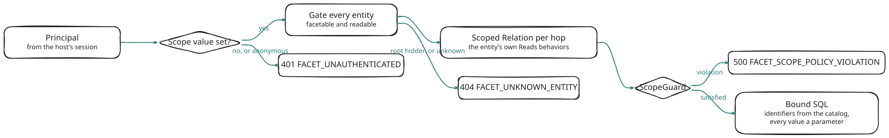

# Security and Tenancy

The faceting service makes one promise: **a facet is never more permissive than the list.** Every count is computed over the rows the entity's own list route would return to the same principal, with the same tenancy, owner scope, soft delete and application filters. A bucket's count can be smaller than what a user could list (a filter narrows it), never larger.

The service keeps that promise without trusting the client and without re-implementing your security rules. It runs your entities' own list behaviors, checks what they produced, and refuses when it cannot prove the result is scoped.

## The Path of a Request

<!-- bespoke diagram: edit diagrams/scope-enforcement.mmd or .hints.json, then: npx pict-renderer-graph build modules/meadow/retold-faceting-service/docs -->


1. **Principal.** The host resolves who is asking from the session. A missing scope value is a 401 before the route entity is even looked at.
2. **Gate.** Every entity the request names is checked before any of its fields are looked at. An entity the principal cannot facet looks exactly like one that does not exist.
3. **Scoped Relations.** Every entity the statement reads (the counted entity and every hop) becomes a Scoped Relation: its rows as its own list behaviors return them to this principal.
4. **ScopeGuard.** The scope each behavior produced is checked against your policy. A violation stops the request (`Strict`) or is repaired and flagged (`Repair`).
5. **SQL.** Identifiers come only from the catalog, and every value is a bound parameter.

The rest of this page goes through each step and through the places where answers are shared: the cache, the change feed and the ClickHouse store.

## The Scope Policy

The scope policy is the part of your tenancy rules the service can check. It lives in `RetoldFaceting.Scope`. This is the policy of the LabTrack test fixture:

```javascript
Scope:
	{
		Policy:
			{
				// The tenant column, on every entity that has it ...
				Column: 'IDCustomer',
				// ... equal to this session field.
				SessionField: 'CustomerID',
				// Entities that carry the column but are not tenant-scoped.
				Exclude: [ 'LabFormType' ],
				// Entities also scoped to one owner within the tenant.
				PersonalScopes: { LabForm: { Column: 'OwnerIDUser', SessionField: 'UserID' } }
			},
		Guard: 'Strict'
	},
// A policy host facets an unscoped entity only when it is listed here.
Catalog: { GlobalEntities: [ 'LabFormType' ] }
```

**The policy filters nothing by itself.** Your entities' own `Reads-QueryConfiguration` behaviors add the tenant filter, as they do for the list routes. The policy tells the ScopeGuard what each of those behaviors must have produced, so a behavior that forgets the filter is caught instead of trusted.

- `Scope.Required` adds further required columns per entity (a sub-tenant restriction such as a department): `{ Entity: [ { Column, From: '$CurrentUser.<Field>' | '$Scope.<Column>' } ] }`.
- `Scope.UnsetValues` (default `[ 0, '', null ]`) lists the values that mean "no tenant". `0`, `''`, `null` and `false` (and texts such as `'0'`) are always unset.
- `Scope.Behavior` names the behavior that scopes reads (`'Reads-QueryConfiguration'`); `Scope.BehaviorOverrides` changes it per entity.
- `Scope.Guard` is `Strict` (the default) or `Repair`. `Off` is legal only without a policy.

Without a policy (`Scope.Policy: 'Auto'` on a plain retold-data-service), the service still runs every entity's list behaviors, so facets still match the lists. It just cannot tell tenants apart: it logs a warning at boot, every write invalidates every principal's cached answers over the entity, and the change feed stays off unless you turn it on. Describe reports how each entity is protected in `ScopeAssurance`:

| Value | Meaning |
|---|---|
| `Guarded` | a policy applies and the ScopeGuard checks every relation |
| `Global` | a policy host's entity with no scope requirement (a shared lookup listed in `Catalog.GlobalEntities`) |
| `Unscoped` | the host has no scope policy |
| `Spoofable` | header-asserted sessions are allowed (see below) |

On the ProjectTrack fixture, captured from Describe: `ScopeAssurance` is `Guarded` for the host and for `Project`, and `Global` for the shared `FormType` lookup.

## Who Is Asking

The host adapter resolves the **principal** the same way the entity's list routes do. On a retold-data-service it asks a route-bound [meadow-endpoints](#/doc/meadow/meadow-endpoints) controller for the request's `SessionData`, so facets see exactly the session the lists see. The principal holds `IDUser`, `IDCustomer`, the scope values keyed by policy column, the whitelisted `UserRecord` fields (`Scope.UserRecordFields`), and whether the session is logged in.

Each principal field is read from a fixed session field:

| Principal field | Read from `SessionData` |
|---|---|
| logged in | `LoggedIn` must be exactly `true`; anything else is an anonymous principal |
| `IDUser` (`$CurrentUser.IDUser`) | `UserID`, else `IDUser` |
| `IDCustomer` (`$CurrentUser.IDCustomer`) | `CustomerID`, else `IDCustomer` |
| the policy column's value | `SessionData[Policy.SessionField]`; `SessionField` defaults to the column name |
| a personal scope column's value | `SessionData[PersonalScopes.<Entity>.SessionField]`, same default |

meadow-endpoints sessions carry `CustomerID` and `UserID`, not `IDCustomer` and `IDUser`. So `Policy: { Column: 'IDCustomer' }` alone reads `SessionData.IDCustomer`, finds nothing, and answers every request with `401`. Set `SessionField` explicitly. If every request is `401`, check this first: the server log names the unset column at `info` level, for example:

```text
RetoldFaceting request rfq-000001 unauthenticated: unset scope value(s) [IDCustomer]
```

On a host with a scope policy, a request is refused with `401` before the route entity is even looked at when:

- the session is not logged in (unless the entity is listed in the server-side allowlist `Catalog.AllowAnonymous`), or
- any policy column's value is unset for this principal.

Captured: a Query with no session on the ProjectTrack fixture.

<!-- docs-check: request Fixture=ProjectTrack Entity=Project Expect=FACET_UNAUTHENTICATED -->
```json
{
	"Facets": [ { "Key": "Status", "Facet": "Project.Status" } ],
	"Total": true
}
```

```text
401  {"Error":{"Code":"FACET_UNAUTHENTICATED","Status":401,"Message":"Authentication required."}}
```

The 401 carries no detail; the unset column names go to the server log only (the line shown above). A `$CurrentUser.*` value in a definition is read from the principal only, never from the request, and an unset one is also a 401, never a predicate that "matches nothing".

**Header-asserted sessions are refused.** A host whose `MeadowEndpointsSessionDataSource` is `'Header'` lets any caller assert any session. The service refuses to attach to it unless you set `Scope.AllowHeaderSession: true`, and then reports `ScopeAssurance: 'Spoofable'`.

## Turning On Tenancy

The faceting service adds no tenancy of its own, and meadow-endpoints does not filter reads by tenant on its own either: your application adds the tenant filter with a list behavior. These five steps turn tenancy on for facets, in the shape the ScopeGuard accepts.

**1. Add the tenant filter in a read behavior** on every tenant-scoped entity. It must be a top-level `AND` equality on the entity's own column; an `IN` list or an `OR` form is refused by the guard. Install the same function as `Count-QueryConfiguration` so the stock count route agrees:

```javascript
const TENANT_ENTITIES = [ 'Customer', 'BookStoreEmployee', 'BookStoreSale', 'BookStoreSaleItem', 'BookAuthorJoin' ];

let fTenancy = function (pRequest, pRequestState, fCallback)
{
	let tmpCustomer = (pRequestState.SessionData && pRequestState.SessionData.CustomerID) ? pRequestState.SessionData.CustomerID : 0;
	if (!tmpCustomer)
	{
		return fCallback(this.ErrorHandler.getError('Authentication required.', 401));
	}
	// A top-level AND equality on the entity's own column: the shape the ScopeGuard accepts.
	pRequestState.Query.addFilter('IDCustomer', tmpCustomer, '=', 'AND', 'Tenancy');
	return fCallback();
};

TENANT_ENTITIES.forEach(
	(pEntity) =>
	{
		let tmpInjection = _Fable.MeadowEndpoints[pEntity].controller.BehaviorInjection;
		tmpInjection.setBehavior('Reads-QueryConfiguration', fTenancy);
		tmpInjection.setBehavior('Count-QueryConfiguration', fTenancy);
	});
```

`setBehavior` holds one function per hash, so it replaces any behavior already there; combine them in one function if you have several. The function uses `function`, not an arrow, so `this` is the controller.

**2. Declare the policy**, naming the session field that holds the tenant (see *Who Is Asking* above):

```javascript
Scope: { Policy: { Column: 'IDCustomer', SessionField: 'CustomerID' }, Guard: 'Strict' }
```

**3. List the shared lookups.** On a policy host an entity without the tenant column is facetable only when `Catalog.GlobalEntities` lists it; otherwise it answers `404 FACET_UNKNOWN_ENTITY`. An entity that carries the column but is not tenant-scoped goes in `Policy.Exclude` (and `GlobalEntities`).

**4. Check Describe.** `GET /1.0/Facet/Describe`, as a signed-in user, must report `ScopeAssurance: 'Guarded'` for every tenant-scoped entity and `'Global'` for each lookup. The boot warning about `ScopeAssurance 'Unscoped'` is gone.

**5. Ask the same question as two tenants.** The totals must differ, and each must equal that tenant's own list count.

Captured on the Bookstore fixture with exactly these steps (`BookStore` listed in `GlobalEntities`):

| Request, as a signed-in user | Before step 1 | After step 1 |
|---|---|---|
| a `BookStoreSale` Query, tenant 1 | `500 FACET_SCOPE_POLICY_VIOLATION` | `200`, `Total` 13 |
| the same Query, tenant 2 | | `200`, `Total` 16 |
| `POST /1.0/Facet/BookStoreSale/Records/Count` and the stock `GET /1.0/BookStoreSales/Count`, tenant 1 | | both `{ "Count": 13 }` |
| a `Book` Query (no tenant column, not listed) | | `404 FACET_UNKNOWN_ENTITY` |
| a `BookStore` Query (listed in `GlobalEntities`) | | `200` |

Before step 1 the server log says why: `RetoldFaceting ScopeGuard (Strict) refused BookStoreSale: MissingPredicate(IDCustomer)`.

**Keep `Guard: 'Strict'` in production.** `'Repair'` adds a missing tenant predicate and answers, which hides a broken list behavior: the facets look right while the entity's own list route still leaks every tenant's rows. Use it only as a short stopgap, and watch the log for `ScopeGuard REPAIRED`.

## The Gate

Every entity a request reads is gated before anything about it is looked up: the route entity, every entity a named scope or a join clause reaches, every hop of a declared facet, and every label target. An entity passes when the host says it is facetable, the catalog lists it, and the principal may read it.

| Entity | Failure |
|---|---|
| the route entity | `404 FACET_UNKNOWN_ENTITY`, whole request |
| an entity a named scope or a join clause reaches | `403 FACET_FORBIDDEN`, whole request, no detail |
| an entity one facet reads (its definition's `Where`, a path hop) | `403 FACET_FORBIDDEN` for that facet only |
| a label target | the facet keeps its counts and loses its labels |

A hidden entity and a nonexistent one get the same answer, and authorization runs before field validation, so error codes never reveal the schema of an entity the principal cannot read. Captured on ProjectTrack as tenant 1:

```text
POST /1.0/Facet/Nope/Query  →  404  {"Error":{"Code":"FACET_UNKNOWN_ENTITY","Status":404,"Message":"Unknown entity."}}
```

On a plain retold-data-service an entity is facetable when it has a DAL on a supported dialect, a model table, and a route-bound controller whose read routes are connected; with a scope policy it must also be scoped, or listed in `Catalog.GlobalEntities`. Four entities are never facetable: `Account`, `ApiKey`, `LoginChallenge` and `RetoldFacetChangeLog`. Add your own with `Catalog.NeverFacet`.

## Scoped Relations

The Live engine never joins your tables directly. Each entity a statement reads becomes a **Scoped Relation**, built the way the entity's list is built:

1. a fresh query from the entity's own DAL;
2. the client's filter conjuncts inside a fenced group of parentheses, so nothing a client sends can escape into the behavior's predicates;
3. an explicit `Deleted = 0` outside that group (unless the request shows deleted rows on the counted entity);
4. the entity's `Reads-QueryConfiguration` behavior, run on the **route-bound** controller with this request's session, exactly as the list route runs it;
5. a **scope capture** of what the behavior added or changed, and the ScopeGuard's check of it.

The relations are then composed only by alias, as `EXISTS` / `NOT EXISTS` subqueries or derived tables, and each relation's SQL is spliced in only through the shell template's structural slots (never by string-editing another query), while every value inside it stays a bound parameter. So a hop through `Task` to `Project` sees only the tasks the principal could list, and only the projects the principal could list.

A behavior that rewrites a client operator (for example `LIKE` to `ILIKE`) is honored everywhere, including predicates the engine renders outside the entity's own relation.

## The ScopeGuard

After each behavior runs, the ScopeGuard checks the captured filter against the policy's required columns for that entity:

1. there is a top-level `AND` entry `<column> = <value>` on the entity's own table;
2. the value equals the principal's value for that column, and is not unset;
3. no top-level entry is joined with `OR` (it would widen the scope);
4. the client's fence is balanced.

With `Guard: 'Strict'` any violation stops the request with `500 FACET_SCOPE_POLICY_VIOLATION` and no SQL runs. With `Guard: 'Repair'`, a violation that is only a missing predicate is repaired: the service wraps the filter and appends the required predicate, logs an error, and answers with the header `X-Retold-Facet-Scope-Repaired: 1`. Every other violation is refused as in `Strict`.

### A Captured Example

The Bookstore-Tenant tests install a deliberately broken behavior on `BookStoreSale`: it runs after the tenancy behavior and removes the tenant predicate it just added. The list route now leaks every tenant's rows; the facet route does not.

| Run, as tenant 2 | Result |
|---|---|
| the list route `GET /1.0/BookStoreSales/0/0` | 3060 rows (tenant 2 owns 142 of them) |
| a facet Query with `Guard: 'Strict'` | `500 {"Error":{"Code":"FACET_SCOPE_POLICY_VIOLATION","Status":500,"Message":"The scope policy could not be verified."}}`, no ETag |
| the same Query with `Guard: 'Repair'` | `200`, `X-Retold-Facet-Scope-Repaired: 1`, `Total` 142 |

The response never names the column or the rule. They go to the server log.

## Opaque Scopes

Some behaviors cannot be checked. A capture is **Opaque** when the behavior adds a join, replaces the query (`queryOverride` or `queryBranches`), rewrites existing filter entries, or names a column or operator the service does not know. An Opaque capture is refused with `500 FACET_SCOPE_POLICY_VIOLATION`.

For an entity you trust, list it in `Scope.TrustedOpaque`. A trusted Opaque hop runs **Staged**: the hop's own scoped query (behaviors included) runs first as `SELECT DISTINCT` of its join keys, capped at `Limits.MaxStagedKeys` (50,000; more is `422 FACET_PATH_TOO_BROAD`), and the key set is bound into the main statement as one parameter. When the behavior replaced the query, its rendered SQL is checked first: it must render the filter exactly once, hold no `UNION` and no trailing `OR`, and show every required policy column bound to the principal's value. A staged answer is never cached.

### Read-Side Behaviors

The list routes also run `Read-PreOperation`, `Reads-PostOperation`, `ReadsLite-PostOperation`, `ReadDistinct-PostOperation` and `ReadSelectList-PostOperation`. A row filter or a redaction there is invisible to a scope capture, so an entity with any of them is Opaque for facets, Records, Count and Keys, unless you vouch for it:

- `Scope.TrustPostOperation: [ 'Entity' ]`: the behavior only decorates rows; it never drops one or changes a column.
- `Scope.PostOperationSafeColumns: { Entity: [ 'Status', … ] }`: the behavior never drops a row and never changes these columns. A relation that reads only these columns answers.

Describe reports such an entity with `Opaque: { Reason: 'PostOperation', SafeColumns }`.

## Relaxing a Personal Scope

Some questions need a tenant-wide view of an owner-scoped entity: "which forms has *anyone* in my lab already filled out". A path step in a definition can carry `"Scope": "TenantOnly"` (see [Definitions Files](#/page/Definitions)). The service then removes exactly one entry from the captured filter: the personal-scope column's top-level `=` entry with the principal's own value. It keeps the tenant predicate and every other entry.

The relaxation is refused (`500`) when the column appears anywhere else, under `OR`, or more than once, and when nothing would remain to scope the entity: a definition that would relax an entity's only policy column is disabled at load. A facet that used a relaxed hop reports `Relaxed: true`. It never crosses tenants.

## Sensitive Columns

The catalog is the whitelist of every column name that reaches SQL. A **Sensitive** column is not filterable and not facetable: a filter naming it is `400 FACET_UNKNOWN_FIELD`, exactly like a column that does not exist.

By default a column is Sensitive when its name matches `Password`, `Hash`, `Secret`, `Token`, `Salt`, `ApiKey`, a trailing `Key` or `Code`, `Email` or `Phone` (case-insensitive). An entity's primary key, delete column and policy columns are never Sensitive by name. `Catalog.Sensitive` adds entries (`'Entity.Column'` or `'Column'`); a per-entity `Catalog.<Entity>.IncludeSensitive` lets a matching name through.

## Injection Safety

- **No identifier comes from the client.** Every table and column name comes from the catalog, matches `^[A-Za-z_][A-Za-z0-9_]{0,63}$`, and is quoted by the dialect layer.
- **Every value is bound.** Filter values, bound `$` values and staged key sets are query parameters. In ClickHouse statements every value is a typed query parameter as well, and request reads run with `readonly = 2`.
- **JSON bodies only.** The facet routes read their own body and accept only a JSON content type, so an HTML form (and its CORS-free POST) can never trigger a query with a user's cookies. Bodies are counted as they stream and refused past `Limits.MaxBodyBytes` (256 KiB). Facet keys with control characters or an `Object.prototype` name such as `__proto__` are refused.
- **Errors never echo internals.** A `5xx` carries a generic message; details, bound values and session contents never reach a response or a log line.

## Sharing Without Leaking

### The Result Cache

A cache key never contains a session, a cookie or a header. It holds each dependent entity's **captured scope**, taken by running that entity's own behaviors as this principal, plus the bound values and the role set. So:

- Two principals share an entry only when all of those are equal.
- If a behavior appends a different scope during execution than it did for the key (a membership changed in between), the answer is never stored or shared.
- An entry another principal computed is served with `Cached: false` unless you set `Cache.ExposeStatus`.

See [Caching and Invalidation](#/page/Caching_And_Invalidation).

### The Change Feed

`GET /1.0/Facet/Changes` is mounted by default only on a host with a scope policy. It accepts only logged-in principals and same-origin pages (others through `SSE.AllowedOrigins`). What it sends is limited:

- Each `generation` event carries an entity name and an opaque token: no tenant, row, column or count.
- An event reaches a stream only when the principal may facet the entity and the write touched the principal's own tenant, or, for an owner-scoped entity, the principal's own rows.
- Writes to shared lookups (and writes whose tenant is unknown) are sent on a periodic timer (`SSE.GlobalTickMS`) instead of at once.
- Streams are limited per principal and per tenant, and each one ends at its revalidation time so the client re-authenticates.

See [The Change Feed (SSE)](#/page/api/Change_Feed).

The node-wide change sequence (`Seq`) would reveal other tenants' write volume, so on a policy host it is not sent by default (`Freshness.SeqHeader` and `SSE.IncludeSeq` are `'Auto'`).

### The ClickHouse Store

The materializer reads source rows with the DAL directly, without behaviors, because the mirror must hold every row. Request reads never use that access:

- Each store query carries the scope captured from the entity's own behaviors for this principal, and the statement compiler refuses (`ScopeMissing`) when a required policy column is absent.
- A row with an unset tenant is never mirrored.
- The store's lag is global across tenants, so on a policy host it is hidden from clients by default.

See [The ClickHouse Store](#/page/ClickHouse_Store).

## Tenant Isolation, Captured

The same Query on the ProjectTrack fixture, as the lead of each tenant:

| Principal | `Total` | `Status` buckets |
|---|---|---|
| Lead (tenant 1, user 1) | 57 | Active 29, Done 9, AtRisk 7, OnHold 7, `''` 4 |
| OtherLead (tenant 2, user 31) | 10 | Active 4, Done 3, AtRisk 1, Cancelled 1, OnHold 1 |

Tenant 2's `Cancelled` value never appears in tenant 1's buckets. The test suites check this for every hop of every fixture: a two-tenant fixture plants cross-tenant references, soft-deleted rows and dangling keys on both sides of every join, and the facets must equal what each tenant's own lists return.

## Limits as a Safety Net

Limits bound the work one request can cause: facets per request, buckets, date buckets, relations and behavior runs per request, staged keys, `Records` page size and offset, and an overall timeout. Each limit has a default and a specific error; see [Errors and Limits](#/page/api/Errors_And_Limits).

## Admin Routes

The store's admin routes (`/1.0/Facet/Admin/…`) are not mounted unless `Admin.Routes` is `true`, and every request must pass your `Admin.authorize(pRequest, pPrincipal)` function, which must return exactly `true`. In-process `storeAdmin()` is the supported trigger. See [The ClickHouse Store](#/page/ClickHouse_Store).

## Planned

> **Planned.** Standalone and Agent roles, with service-to-service authentication between processes.

> **Planned.** A ClickHouse row-policy backstop and settings constraints on the reader user.

> **Planned.** Per-tenant freshness for the ClickHouse store, so one tenant's writes never affect another's admission.

## Related

- [Concepts](#/page/Concepts): Scoped Relations and disjunctive faceting
- [Definitions Files](#/page/Definitions): `$CurrentUser` bindings, named scopes, `TenantOnly`
- [Configuration](#/page/Configuration): every `Scope`, `Catalog` and `SSE` option
- [Errors and Limits](#/page/api/Errors_And_Limits): every error code
- [Hosting](#/page/Hosting): the host adapter that resolves principals
