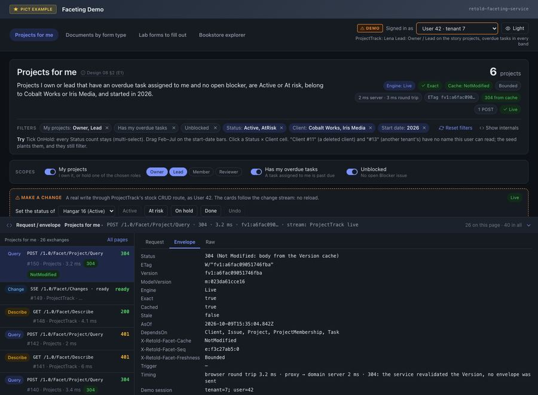

# The Response Envelope

A Query answers with one JSON object, the envelope: who computed it and how fresh it is, the `Total`, one facet result per requested facet, and the errors and warnings of the facets that could not be answered. Every field is always present unless this page says otherwise, so a client can read the envelope without guarding each key.



## An Example

This request filters Bookstore sales to credit-card payments and asks for three facets:

<!-- docs-check: request Fixture=Bookstore Entity=BookStoreSale -->
```json
{
	"Clauses": [ { "Type": "DistinctSelectedValueList", "FilterByColumn": "PaymentMethod", "Values": [ "Credit" ], "Hash": "Pay-Credit" } ],
	"Facets":
	[
		{ "Key": "ByPayment", "Facet": "BookStoreSale.PaymentMethod" },
		{ "Key": "ByYear", "Facet": "BookStoreSale.SaleDate", "Interval": "year" },
		{ "Key": "Amount", "Facet": "BookStoreSale.TotalAmount", "Fold": "Stats" }
	]
}
```

The answer, captured from the seeded Bookstore fixture. Three of the five `ByPayment` buckets (`Cash`, `Online` and the empty string) and two of the four `ByYear` buckets (2022 and 2023) are cut; nothing else is changed.

```json
{
	"ContractVersion": 1,
	"Entity": "BookStoreSale",
	"Version": "fv1:6e3dbc1113faa5eb",
	"ModelVersion": "m:20a069fdedea",
	"Engine": "Live",
	"Exact": true,
	"AsOf": "2026-10-10T15:28:26.730Z",
	"LagMS": 0,
	"Stale": false,
	"Cached": false,
	"ElapsedMS": 17,
	"Total": 1288,
	"TotalCountMode": "Rows",
	"IncludesDeleted": false,
	"Filter": { "Applied": [ { "Hash": "Pay-Credit" } ], "Warnings": [] },
	"Facets":
	{
		"ByPayment":
		{
			"Key": "ByPayment", "Facet": "BookStoreSale.PaymentMethod", "Field": "PaymentMethod", "Fold": "Terms",
			"DisplayName": "Payment Method", "DataType": "String", "Selectable": true,
			"ClauseType": "DistinctSelectedValueList", "FilterKey": "PaymentMethod",
			"Engine": "Live", "Exact": true, "AsOf": "2026-10-10T15:28:26.730Z", "LagMS": 0, "Stale": false, "Cached": false,
			"Disjunctive": "Exact", "Excluded": [ "Pay-Credit" ], "KeptMixed": [], "CountMode": "Rows",
			"Total": 2918, "SumOfCounts": 2909, "MissingCount": 9, "OtherCount": 0,
			"MultiValued": false, "Truncated": false, "TruncatedReason": null, "DistinctCount": 5, "Bounds": null,
			"Buckets":
			[
				{
					"Key": "Credit", "Label": "Credit", "Count": 1288, "Selected": true,
					"Clause": { "Type": "DistinctSelectedValueList", "FilterByColumn": "PaymentMethod", "Values": [ "Credit" ], "FilterKey": "PaymentMethod", "ClauseKey": "DistinctSelectedValueList" },
					"Selection": { "Facet": "BookStoreSale.PaymentMethod", "Key": "Credit" }
				},
				{
					"Key": "Debit", "Label": "Debit", "Count": 744, "Selected": false,
					"Clause": { "Type": "DistinctSelectedValueList", "FilterByColumn": "PaymentMethod", "Values": [ "Debit" ], "FilterKey": "PaymentMethod", "ClauseKey": "DistinctSelectedValueList" },
					"Selection": { "Facet": "BookStoreSale.PaymentMethod", "Key": "Debit" }
				}
			],
			"Stats": null, "Geometry": null, "Chart": null
		},
		"ByYear":
		{
			"Key": "ByYear", "Facet": "BookStoreSale.SaleDate", "Field": "SaleDate", "Fold": "DateHistogram",
			"DisplayName": "Sale Date", "DataType": "DateTime", "Selectable": true,
			"ClauseType": "DateRange", "FilterKey": "SaleDate",
			"Engine": "Live", "Exact": true, "AsOf": "2026-10-10T15:28:26.730Z", "LagMS": 0, "Stale": false, "Cached": false,
			"Disjunctive": "Exact", "Excluded": [], "KeptMixed": [], "CountMode": "Rows",
			"Total": 1288, "SumOfCounts": 1277, "MissingCount": 11, "OtherCount": 0,
			"MultiValued": false, "Truncated": false, "TruncatedReason": null, "DistinctCount": null,
			"Bounds": { "Lo": "2021-01-04 23:18:26", "Hi": "2024-12-28 22:26:42" },
			"Buckets":
			[
				{
					"Key": "2021-01-01 00:00:00", "Label": "2021", "Count": 311, "Selected": false,
					"Start": "2021-01-01 00:00:00", "End": "2022-01-01 00:00:00", "EndExclusive": true,
					"Clause": { "Type": "DateRange", "FilterByColumn": "SaleDate", "Values": { "Start": "2021-01-01 00:00:00", "End": "2022-01-01 00:00:00" }, "EndExclusive": true, "FilterKey": "SaleDate", "ClauseKey": "DateRange" },
					"Selection": { "Facet": "BookStoreSale.SaleDate", "Key": "2021-01-01 00:00:00" }
				},
				{
					"Key": "2024-01-01 00:00:00", "Label": "2024", "Count": 335, "Selected": false,
					"Start": "2024-01-01 00:00:00", "End": "2025-01-01 00:00:00", "EndExclusive": true,
					"Clause": { "Type": "DateRange", "FilterByColumn": "SaleDate", "Values": { "Start": "2024-01-01 00:00:00", "End": "2025-01-01 00:00:00" }, "EndExclusive": true, "FilterKey": "SaleDate", "ClauseKey": "DateRange" },
					"Selection": { "Facet": "BookStoreSale.SaleDate", "Key": "2024-01-01 00:00:00" }
				}
			],
			"Stats": null, "Geometry": null, "Chart": null,
			"Interval": "year", "TimeZone": "UTC"
		},
		"Amount":
		{
			"Key": "Amount", "Facet": "BookStoreSale.TotalAmount", "Field": "TotalAmount", "Fold": "Stats",
			"DisplayName": "Total Amount", "DataType": "Decimal", "Selectable": false,
			"ClauseType": null, "FilterKey": "TotalAmount",
			"Engine": "Live", "Exact": true, "AsOf": "2026-10-10T15:28:26.730Z", "LagMS": 0, "Stale": false, "Cached": false,
			"Disjunctive": "NotApplicable", "Excluded": [], "KeptMixed": [], "CountMode": "Rows",
			"Total": 1288, "SumOfCounts": 0, "MissingCount": 8, "OtherCount": 0,
			"MultiValued": false, "Truncated": false, "TruncatedReason": null, "DistinctCount": null, "Bounds": null,
			"Buckets": [],
			"Stats": { "Rows": 1288, "NonNull": 1280, "Min": "15.58", "Max": "4875.50", "Sum": "198186.59", "Avg": 154.833273 },
			"Geometry": null, "Chart": null
		}
	},
	"Errors": {},
	"Warnings": [],
	"DependsOn": [ "BookStoreSale" ]
}
```

Read it this way:

- `Total` is 1288: the sales the list shows with the `Pay-Credit` clause applied.
- `ByPayment` owns that clause, so it is counted without it (`Excluded: [ "Pay-Credit" ]`, its own `Total` 2918) and shows every payment method. `Credit` is `Selected`, and its count, 1288, equals the envelope `Total`.
- `ByYear` and `Amount` own no filter, so they count within the 1288. For every bucketed facet, `SumOfCounts + MissingCount + OtherCount = Total` (1277 + 11 + 0 = 1288).
- Sending a bucket's `Clause` back as a filter selects exactly its `Count` rows.

## Envelope Fields

| Field | Type | Meaning |
|---|---|---|
| `ContractVersion` | number | `1`. Also sent as the `X-Retold-Facet-Contract` header. |
| `Entity` | string | The route entity. |
| `Version` | string | `'fv1:'` + 16 hex digits; the weak `ETag`. Changes whenever the answer could differ. |
| `ModelVersion` | string | `'m:'` + 12 hex digits; changes when the model, the `Catalog` options, the scope policy, the set of facetable entities or the loaded definitions change. |
| `Engine` | string | The engine of the `Total`, else of the first facet: `'Live'` or `'ClickHouse'`. |
| `Exact` | boolean | `true` when every facet and the `Total` are exact (current as of `AsOf`). |
| `AsOf` | string | ISO timestamp the answer is current as of (the oldest of its facets'). |
| `LagMS` | number or `null` | The largest lag of any facet; `0` for Live and cache hits; `null` when a store's lag is unknown. |
| `Stale` | boolean | `true` when served from the result cache under `Bounded` or `Fast` freshness without being proven current. |
| `Cached` | boolean | `true` when served from the result cache. A fresh hit on an answer another principal computed says `false` unless `Cache.ExposeStatus` is on, so the flag never reveals what a colleague asked. |
| `ElapsedMS` | number | Time this request took on the server. |
| `Total` | number | Rows matching the full filter. Present only when `Total` was requested and computed. |
| `TotalCountMode` | string | `'Rows'`. Present with `Total`. |
| `IncludesDeleted` | boolean | `true` when the filter names the delete column (a `FilterString` or `RawFilter` showing deleted rows). |
| `Filter.Applied` | array | One entry per contributing input, in order: `{ Hash }` or `{ Hash: null, Index }` for each clause (an OR-merged group lists each of its clauses), a single `{ String: true }` for the filter string however many conjuncts it makes, `{ RawFilter: <Hash or index> }`, and `{ Scope: <name> }`. |
| `Filter.Warnings` | array | Filter warnings: `FACET_SORT_IGNORED`, `FACET_CLAUSE_EMPTY`. |
| `Facets` | object | Key → facet result, for every facet that was answered. |
| `Errors` | object | Key → error, for every facet that was not, and `#Total` when the `Total` failed. |
| `Warnings` | array | Request warnings: `FACET_TOP_CLAMPED`, `FACET_BUCKETS_CLAMPED`, `FACET_STORE_FALLBACK`. Each is `{ Code, Detail }`. |
| `DependsOn` | array | The sorted names of the entities the answer reads (facets, scopes, joins and readable label targets). A client refetches when the change feed reports one of them. |
| `Records`, `RecordShape`, `RecordsDropped` | array, string, number | Present when the request asked for `Records`: the page of rows, `'Entity'`, and how many keys did not read back. |
| `Store` | object | Present only when a store is configured. See *The Store Block*. |

## Facet Result Fields

Every facet result has these fields, whatever its fold:

| Field | Meaning |
|---|---|
| `Key` | The request's key for this facet. |
| `Facet` | The FacetID, or an array of two for a pivot. |
| `Field` | The column it buckets or measures (`null` for a pivot). |
| `Fold` | `Terms`, `DateHistogram`, `NumericHistogram`, `Ranges`, `Stats`, `DistinctCount`, `Missing`, `Pivot`, `ChildRollup` or `ExistsSplit`. |
| `DisplayName` | A label for the facet. |
| `DataType` | The column's data type (`null` for a pivot). |
| `Selectable` | Whether buckets carry `Selection`. |
| `ClauseType` | The clause type a bucket's `Clause` has, or `null`. |
| `FilterKey` | The clause `FilterKey` this facet owns. |
| `Engine`, `Exact`, `AsOf`, `LagMS`, `Stale`, `Cached` | As on the envelope, for this facet. |
| `Disjunctive` | `'Exact'` (counted without exactly the filters it owns), `'Partial'` (an owned filter had to be kept, see `KeptMixed`) or `'NotApplicable'` (the facet excludes nothing). |
| `Excluded` | The filters this facet was counted without: clause `Hash` values, else conjunct Ids (`c1`, `c2`, …). |
| `KeptMixed` | Conjunct Ids the facet would own but had to keep: a filter mixing its column with others, or a `RawFilter`. |
| `CountMode` | `'Rows'`, `'PivotDistinct'` (a multi-valued facet counts each row once per key) or `'KeyDistinct'` (a TuplePivot counts distinct tuples). |
| `Total` | Rows this facet was counted over (its own filter set). |
| `SumOfCounts` | The sum of the shown buckets' counts (`0` for scalar folds). |
| `MissingCount` | Rows with no value. `0` when the request set `Missing: false`. |
| `OtherCount` | Rows in no shown bucket (cut by `Top`, or outside every range). `null` for a multi-valued facet. |
| `MultiValued` | `true` when a row can land in several buckets. |
| `Truncated`, `TruncatedReason` | `true` and `'Top'` when keys were cut by `Top`. |
| `DistinctCount` | Terms: the number of distinct keys. DistinctCount: the answer. Otherwise `null`. |
| `Bounds` | Histograms: the smallest and largest value, `{ Lo, Hi }`. Otherwise `null`. |
| `Buckets` | The buckets, in display order. Empty for scalar folds and pivots. |
| `Stats` | Stats only: `{ Rows, NonNull, Min, Max, Sum, Avg }`. |
| `Geometry` | NumericHistogram only: `{ Mode, Lo, Hi, Width, N, Scale, Edges }`, plus `OpenEnded` in `Edges` mode. |
| `Chart` | With `Chart: true` in the request: `{ Labels, Datasets: [ { label, data } ] }`, ready for a chart library. |

For bucketed single-valued facets (`Terms`, `DateHistogram`, `NumericHistogram`, `Ranges`, `ChildRollup`, `ExistsSplit`), `SumOfCounts + MissingCount + OtherCount = Total` always holds.

### Fields Added per Fold

| Fold | Adds |
|---|---|
| `DateHistogram` | `Interval` and `TimeZone`. Gaps between the first and last bucket are filled with zero-count buckets unless `EmptyBuckets: false`. |
| `Stats` | `Stats`. Integer columns give numbers; `Decimal` values are strings with the column's scale (`"15.58"`); a `DateTime` column gives `Min` and `Max` and leaves `Sum` and `Avg` `null`. `Avg` is a number. |
| `Pivot` | `Dimensions` (per axis `{ Facet, Field, Fold, Interval }`), `RowKeys`, `ColumnKeys`, `Cells` (`[ { K1, K2, Count } ]`, only non-zero cells of kept keys) and `Marginals` (`{ Rows, Columns, Total }`). |
| Declared facets and path facets | `Declared`, `Definition` (`{ Facet, Version }`), `Path` (the step strings), `Relaxed` (a `TenantOnly` step is involved) and `Semantics` (`'NoVisibleMatch'` when the facet counts rows with no visible related row). Auto column facets do not carry them. |

A captured `Pivot` result (`Fold: 'Pivot'` over `PaymentMethod` and `SaleDate` by year, `Top: 3`, from the example on [The Request Body](#/page/api/Request)), with the identity fields cut:

```json
{
	"Fold": "Pivot",
	"Total": 1461, "SumOfCounts": 1257, "MissingCount": 5, "OtherCount": 199,
	"Truncated": true, "TruncatedReason": "Top",
	"Dimensions":
	[
		{ "Facet": "BookStoreSale.PaymentMethod", "Field": "PaymentMethod", "Fold": "Terms", "Interval": null },
		{ "Facet": "BookStoreSale.SaleDate", "Field": "SaleDate", "Fold": "DateHistogram", "Interval": "year" }
	],
	"RowKeys": [ "Credit", "Debit", "Cash" ],
	"ColumnKeys": [ "2023-01-01 00:00:00", "2024-01-01 00:00:00" ],
	"Cells":
	[
		{ "K1": "Credit", "K2": "2023-01-01 00:00:00", "Count": 321 },
		{ "K1": "Credit", "K2": "2024-01-01 00:00:00", "Count": 335 },
		{ "K1": "Debit", "K2": "2023-01-01 00:00:00", "Count": 186 },
		{ "K1": "Debit", "K2": "2024-01-01 00:00:00", "Count": 185 },
		{ "K1": "Cash", "K2": "2023-01-01 00:00:00", "Count": 116 },
		{ "K1": "Cash", "K2": "2024-01-01 00:00:00", "Count": 114 }
	],
	"Marginals":
	{
		"Rows": [ { "Key": "Credit", "Count": 656 }, { "Key": "Debit", "Count": 371 }, { "Key": "Cash", "Count": 230 } ],
		"Columns": [ { "Key": "2023-01-01 00:00:00", "Count": 736 }, { "Key": "2024-01-01 00:00:00", "Count": 720 } ],
		"Total": 1257
	}
}
```

A marginal counts every combination with that key, including those of keys `Top` cut from the other axis, so the column marginals here (736 and 720) are larger than the sums of the shown cells. `Marginals.Total` and `SumOfCounts` are the sum of the shown cells; `OtherCount` holds the rest.

## Bucket Fields

| Field | Meaning |
|---|---|
| `Key` | The bucket's key: the value for Terms (a number for numeric and foreign-key columns, else a string), the start of the period for a DateHistogram (`'YYYY-MM-DD HH:mm:ss'`), the bucket index for a NumericHistogram, the range `Key` for Ranges, the band number for a ChildRollup, `1` / `0` for an ExistsSplit. |
| `Label` | Display text. Foreign-key Terms buckets are labelled from the referenced row (read as the principal). |
| `LabelResolved` | Foreign-key Terms only: `false` when the referenced row is not visible to the principal (the label is then the key). |
| `Count` | Rows in the bucket. |
| `Selected` | `true` when the request's own filter selects this bucket. A selected Terms key is always returned, even past `Top` and even with a count of 0. |
| `Start`, `End`, `EndExclusive` | Histograms, ranges and bands: the bucket's span. A missing `Start` or `End` means unbounded. |
| `Clause` | The pict clause that selects exactly this bucket, or `null` when no single clause can (scalar folds, ChildRollup, ExistsSplit, TuplePivot, multi-hop paths, keys containing `~`). |
| `Selection` | `{ Facet, Key }`: a stable reference to the bucket, on every selectable fold. |

The clause types buckets write back:

| Facet | `Clause.Type` |
|---|---|
| Terms on a column | `DistinctSelectedValueList` |
| DateHistogram | `DateRange` |
| NumericHistogram, Ranges | `NumericRange` |
| A one-step path facet (`Review.IDBook>Book.Language`) | `InternalJoinMatch`, or `InternalJoinSelectedValueList` when keyed by the target's key; `InternalJoinDateRange` / `InternalJoinNumericRange` for histograms |
| A bridge facet over exactly one join table, keyed by the far entity's key | `ExternalJoinSelectedValueList` |

## Errors in the Envelope

A facet that cannot be answered does not fail the request. Its key moves from `Facets` to `Errors`, with the same client-safe shape a whole-request error has:

```json
{
	"Errors":
	{
		"Oops": { "Code": "FACET_UNKNOWN_FACET", "Status": 400, "Message": "Unknown facet.", "Detail": { "Facet": "Book.Colour" } }
	}
}
```

The request fails as a whole only when **every** facet failed and the `Total` (if requested) failed too. It then answers with the first facet's error as the HTTP status and body (here `400` with `{ "Error": { "Code": "FACET_UNKNOWN_FACET", … } }`). Errors with a status of 500 or more carry only the code's standard message and no `Detail`; the specific cause goes to the server log. [Errors and Limits](#/page/api/Errors_And_Limits) lists every code.

## The Store Block

Only when a ClickHouse store is configured (`Stores.ClickHouse`), the envelope also carries:

```json
{
	"Store":
	{
		"Name": "ClickHouse",
		"Available": true,
		"Facets":
		{
			"ByMethod": { "Engine": "ClickHouse", "Reason": null },
			"ByYear": { "Engine": "ClickHouse", "Reason": null },
			"#Total": { "Engine": "ClickHouse", "Reason": null }
		},
		"Fallback": null
	}
}
```

`Facets` says which engine answered each facet (and the `#Total`) and, for a Live answer, why the store did not, for example `{ "Engine": "Live", "Reason": "Requested" }` for a request with `Engine: 'Live'`. The reason is its class only, or the full reason with `Stores.ClickHouse.ExposeReasons`. `Fallback` is `{ Reason }` when the store failed during the request and its facets were answered Live instead (the request also gets the warning `FACET_STORE_FALLBACK`). [The ClickHouse Store](#/page/ClickHouse_Store) explains the routing.

## Versions and Comparisons

`Version` is the answer's ETag. With the result cache off, it is a digest of the answer itself plus everything it depends on (the model version, the bound filter, the principal's scope values, the captured scopes), so it changes exactly when the representation could. With the cache on, it is derived from the data's generations and can be checked before any SQL runs. Either way, sending it back in `If-None-Match` gets a `304` when nothing changed; see [Routes](#/page/api/Routes).

`Version`, `AsOf`, `ElapsedMS`, `Engine`, `Cached`, `LagMS`, `Stale` and `Store` differ between two computations of the same answer. The contract module's `normalizeForComparison(pEnvelope)` (`source/contract/Facet-Contract-Envelope.js`) removes them, so two envelopes can be compared with a deep equal; the test suite compares the Live engine against its reference oracle that way.

## Related

- [The Request Body](#/page/api/Request)
- [Records, Count and Keys](#/page/api/Records_And_Keys)
- [Errors and Limits](#/page/api/Errors_And_Limits)
- [Concepts](#/page/Concepts): disjunctive faceting and the bucket clause round trip
- [Fold Kinds](#/page/Fold_Kinds)
