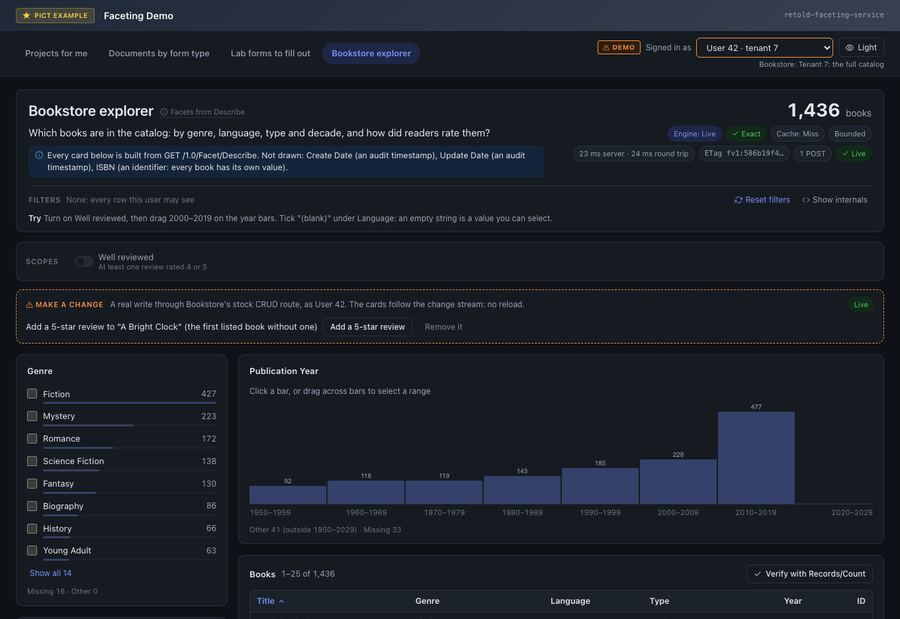

# Bookstore Explorer

> "Which books are in the catalog, by genre, language, type and decade, and how did readers rate them?"

The Bookstore explorer is the demo page that is not hand-built. It asks `GET /1.0/Facet/Describe` what the current user may facet, turns the answer into cards, and sends one Query for all of them. Auto facets from the model sit next to declared cross-entity facets from a small definitions file.



## The Domain

The demo runs the Bookstore model in its **Bookstore-Tenant** form: the fixture adds an `IDTenant` column to every table, with tenant 1 holding the base data and tenant 2 a small clone. The domain server is the module's test harness; with the definitions file the demo passes it (`server/Faceting-Demo-Domains.js`), it installs the service with these options:

```javascript
{
	Scope: { Policy: { Column: 'IDTenant', SessionField: 'IDTenant' }, Guard: 'Strict' },
	Definitions: { Path: false, Files: [ `${__dirname}/definitions/Bookstore-Demo-Definitions.json` ] }
}
```

The entities this page reads are `Book` (`Title`, `Type`, `Genre`, `ISBN`, `Language`, `PublicationYear` and the audit dates) and `Review` (`IDBook`, `Rating`).

## The Definitions

`example_applications/faceting_demo/server/definitions/Bookstore-Demo-Definitions.json` declares one scope and three facets that follow the `Book` to `Review` edge (shown with its top-level `Description` shortened). It loads with no disabled entries and no warnings:

<!-- docs-check: definitions Id=bookstore-demo Fixture=Bookstore-Tenant -->
```json
{
	"FormatVersion": 1,
	"Description": "Faceting demo: declared facets and a named scope over the Bookstore-Tenant fixture (Book <- Review), so the Bookstore explorer shows the cross-entity kinds next to the auto facets.",
	"Scopes":
	{
		"Book.WellReviewed":
		{
			"Entity": "Book",
			"Description": "Books with at least one review rated 4 or 5",
			"Where":
			[
				{ "Exists": { "Path": [ "<Review.IDBook" ], "Where": [ { "Field": "Rating", "Op": "GE", "Value": 4 } ] } }
			]
		}
	},
	"Facets":
	[
		{
			"Facet": "Book.ReviewRating",
			"Version": 1,
			"Title": "Review rating",
			"Description": "Books by the ratings their reviews gave (a book counts once per distinct rating it received, so the buckets can sum to more than the total).",
			"Dimensions": [ { "Kind": "Terms", "Path": [ "<Review.IDBook" ], "KeyField": "Rating", "Top": 10 } ],
			"CountMode": "PivotDistinct",
			"Exclude": "Self"
		},
		{
			"Facet": "Book.ReviewCount",
			"Version": 1,
			"Title": "Reviews per book",
			"Dimensions": [ { "Kind": "ChildRollup", "Child": { "Path": [ "<Review.IDBook" ], "Agg": "count" }, "Edges": [ 1, 3, 5, 10 ] } ],
			"Exclude": "None"
		},
		{
			"Facet": "Book.HasFiveStar",
			"Version": 1,
			"Title": "Five-star reviews",
			"Dimensions":
			[
				{ "Kind": "ExistsSplit", "Path": [ "<Review.IDBook" ], "Where": [ { "Field": "Rating", "Op": "EQ", "Value": 5 } ],
				  "Labels": { "true": "Has a 5-star review", "false": "No 5-star review" } }
			],
			"Exclude": "None"
		}
	]
}
```

| Entry | Kind | What it counts |
|---|---|---|
| `Book.WellReviewed` | Named scope, [K10 Exists](#/page/fold_kinds/010-path-semi-join) | Books with at least one review rated 4 or 5 |
| `Book.ReviewRating` | [K9 BridgeTerms](#/page/fold_kinds/009-bridge-terms), `PivotDistinct` | Books by the ratings their reviews gave; a book counts once per distinct rating |
| `Book.ReviewCount` | [K12 ChildRollup](#/page/fold_kinds/012-child-rollup) | Books by number of reviews, in bands cut at 1, 3, 5 and 10 |
| `Book.HasFiveStar` | [K20 ExistsSplit](#/page/fold_kinds/020-exists-split) | Books with and without a five-star review |

## What Describe Offers

As user 42 (tenant 7 in the demo; tenant 1 in the fixture), `GET /1.0/Facet/Describe` lists ten facets for `Book` and the one scope. This table summarizes the `Book` entry of the real answer:

| Facet | Auto or declared | `Folds` | `DefaultFold` |
|---|---|---|---|
| `Book.CreateDate`, `Book.UpdateDate` | Auto | DateHistogram, Stats, Missing | DateHistogram |
| `Book.Type`, `Book.Genre`, `Book.ISBN`, `Book.Language` | Auto | Terms, Missing, DistinctCount | Terms |
| `Book.PublicationYear` | Auto | NumericHistogram, Terms, Ranges, Stats, DistinctCount, Missing | NumericHistogram |
| `Book.ReviewRating` | Declared (`MultiValued: true`, `CountMode: "PivotDistinct"`) | Terms | Terms |
| `Book.ReviewCount` | Declared | ChildRollup | ChildRollup |
| `Book.HasFiveStar` | Declared | ExistsSplit | ExistsSplit |

A declared facet's descriptor carries its `Title`, `Description`, `Path`, `CountMode` and `Params`, and says whether it is `Supported` for this principal. The scope arrives as `{ "Scope": "Book.WellReviewed", "Description": "Books with at least one review rated 4 or 5", "Params": {}, "Relaxed": false }`. [Describe](#/page/api/Describe) documents every field.

## From Describe to Cards

The page lists rules, not facets. This is the `Describe` block of the Books group in `source/pages/FacetDemo-Pages.js`:

```javascript
Describe:
{
	// Cards in this order first, then anything else Describe offers (in Describe's order).
	Order: [ 'Book.Genre', 'Book.Language', 'Book.Type', 'Book.PublicationYear', 'Book.ReviewRating', 'Book.ReviewCount', 'Book.HasFiveStar' ],
	Skip: { 'Book.ISBN': 'an identifier: every book has its own value' },
	SkipAuditDates: true,
	Overrides:
	{
		'Book.Genre': { Top: 20, Display: 'Checklist', Collapse: 8 },
		'Book.Language': { Top: 12, Display: 'Chips' },
		'Book.Type': { Display: 'Chips' },
		// Edges, not Nice: the fixture has a -1750 outlier that would stretch Nice buckets to 200 years wide.
		// Years outside the edges land in OtherCount (the widget shows it).
		'Book.PublicationYear': { Key: 'Year', Spec: { Fold: 'NumericHistogram', Mode: 'Edges', Edges: [ 1950, 1960, 1970, 1980, 1990, 2000, 2010, 2020, 2030 ] } },
		// An ordinal scale reads top-down: 5 stars first.
		'Book.ReviewRating': { SortBy: 'KeyDesc' }
	}
}
```

`describedFacets()` in the same file walks Describe's facets in that order. It skips what the rules exclude (and any facet Describe marks `Supported: false`), builds a facet spec of `{ Key, Facet }` plus the override, and picks a widget from the fold it will use: Terms becomes chips, a checklist or bars (bars for a multi-valued facet), ChildRollup becomes bars, ExistsSplit a split bar, and the histogram folds a histogram. The page head names what it skipped: Create Date and Update Date (audit timestamps) and ISBN.

## The Request

The facet specs the rules produce, plus the first records page:

<!-- docs-check: request Fixture=Bookstore-Tenant Entity=Book Definitions=bookstore-demo User=1 Tenant=1 -->
```json
{
	"Clauses": [],
	"Facets":
	[
		{ "Key": "Genre", "Facet": "Book.Genre", "Top": 20 },
		{ "Key": "Language", "Facet": "Book.Language", "Top": 12 },
		{ "Key": "Type", "Facet": "Book.Type" },
		{ "Key": "Year", "Facet": "Book.PublicationYear", "Fold": "NumericHistogram", "Mode": "Edges", "Edges": [ 1950, 1960, 1970, 1980, 1990, 2000, 2010, 2020, 2030 ] },
		{ "Key": "ReviewRating", "Facet": "Book.ReviewRating" },
		{ "Key": "ReviewCount", "Facet": "Book.ReviewCount" },
		{ "Key": "FiveStar", "Facet": "Book.HasFiveStar" }
	],
	"Total": true,
	"Records": { "Begin": 0, "Cap": 25, "Sort": [ { "Field": "Title", "Dir": "ASC" } ] }
}
```

## The Answer

The real answer, abridged to each facet's totals and bucket counts. Freshness and display fields, every bucket's `Clause` and `Selection`, the smaller genres and languages, and the records are left out.

```json
{
	"Entity": "Book",
	"Version": "fv1:e96ae671c4212908",
	"Engine": "Live",
	"Exact": true,
	"Total": 1436,
	"DependsOn": [ "Book", "Review" ],
	"Facets":
	{
		"Genre":
		{
			"Fold": "Terms", "Total": 1436, "SumOfCounts": 1420, "MissingCount": 16, "DistinctCount": 14,
			"Buckets":
			[
				{ "Key": "Fiction", "Count": 427 },
				{ "Key": "Mystery", "Count": 223 },
				{ "Key": "Romance", "Count": 172 },
				{ "Key": "Sci~Fi", "Count": 3, "Clause": null }
			]
		},
		"Language":
		{
			"Fold": "Terms", "Total": 1436, "SumOfCounts": 1409, "MissingCount": 27, "DistinctCount": 10,
			"Buckets":
			[
				{ "Key": "eng", "Count": 862 },
				{ "Key": "en-US", "Count": 271 },
				{ "Key": "", "Count": 108 }
			]
		},
		"Type":
		{
			"Fold": "Terms", "Total": 1436, "SumOfCounts": 1436, "MissingCount": 0,
			"Buckets":
			[
				{ "Key": "Book", "Count": 1148 },
				{ "Key": "eBook", "Count": 182 },
				{ "Key": "Audiobook", "Count": 80 },
				{ "Key": "", "Count": 26 }
			]
		},
		"Year":
		{
			"Fold": "NumericHistogram", "Total": 1436, "SumOfCounts": 1362, "MissingCount": 33, "OtherCount": 41,
			"Geometry": { "Mode": "Edges", "Lo": 1950, "Hi": 2030, "Width": null, "N": 8, "Scale": 0, "Edges": [ 1950, 1960, 1970, 1980, 1990, 2000, 2010, 2020, 2030 ], "OpenEnded": false },
			"Buckets":
			[
				{ "Key": 0, "Label": "1950–1959", "Count": 92 },
				{ "Key": 1, "Label": "1960–1969", "Count": 118 },
				{ "Key": 2, "Label": "1970–1979", "Count": 119 },
				{ "Key": 3, "Label": "1980–1989", "Count": 143 },
				{ "Key": 4, "Label": "1990–1999", "Count": 185 },
				{ "Key": 5, "Label": "2000–2009", "Count": 228 },
				{ "Key": 6, "Label": "2010–2019", "Count": 477 },
				{ "Key": 7, "Label": "2020–2029", "Count": 0 }
			]
		},
		"ReviewRating":
		{
			"Fold": "Terms", "Declared": true, "CountMode": "PivotDistinct", "MultiValued": true, "Total": 1436, "SumOfCounts": 3308, "MissingCount": 65,
			"Buckets":
			[
				{ "Key": 4, "Count": 988, "Clause": null },
				{ "Key": 5, "Count": 931, "Clause": null },
				{ "Key": 3, "Count": 723, "Clause": null },
				{ "Key": 2, "Count": 427, "Clause": null },
				{ "Key": 1, "Count": 239, "Clause": null }
			]
		},
		"ReviewCount":
		{
			"Fold": "ChildRollup", "Declared": true, "Total": 1436,
			"Buckets":
			[
				{ "Key": 0, "Label": "None", "Count": 65, "Clause": null },
				{ "Key": 1, "Label": "1–2", "Count": 467, "Clause": null },
				{ "Key": 2, "Label": "3–4", "Count": 463, "Clause": null },
				{ "Key": 3, "Label": "5–9", "Count": 380, "Clause": null },
				{ "Key": 4, "Label": "10+", "Count": 61, "Clause": null }
			]
		},
		"FiveStar":
		{
			"Fold": "ExistsSplit", "Declared": true, "Total": 1436,
			"Buckets":
			[
				{ "Key": 1, "Label": "Has a 5-star review", "Count": 931, "Clause": null },
				{ "Key": 0, "Label": "No 5-star review", "Count": 505, "Clause": null }
			]
		}
	}
}
```

## Reading the Cards

**Year uses Edges.** The fixture plants a book published in the year -1750. Left to its default (`Mode: "Nice"`), the numeric histogram has to cover -1750 to 2017, so it picks 200-year buckets and most books fall into `1800–1999` (697) and `2000–2200` (705). With explicit `Edges`, the decades read naturally; the 41 books outside 1950 to 2030 are counted in `OtherCount`, and the 33 with no year in `MissingCount`. The card says so under the chart.

**Review rating can sum past the total.** A book with a 4-star and a 5-star review counts once in each bucket, so the buckets add up to 3,308 for 1,436 books. That is what `CountMode: "PivotDistinct"` and `MultiValued: true` announce, and the card carries an "Overlapping" badge. `MissingCount: 65` is the books with no review at all, the same 65 the `None` band of `ReviewCount` shows.

**Declared facets are read-only here.** Their buckets carry `Clause: null`: no list clause on `Book` selects "books with a 4-star review" or "books with three or four reviews". The cards show the counts without letting you click them.

> **Planned.** Selecting buckets that carry no list clause.

**A key with a tilde is not selectable.** The seed plants three books in the genre `Sci~Fi`. The `~` is the meadow-filter separator, so the service does not emit a clause for that key (`Clause: null`). The bucket is still counted and listed.

**The empty string is a value.** `Language` has 108 books with `""` (the demo shows "(blank)") and 27 with NULL (`MissingCount`). Only the first is a bucket you can select.

## Things to Try

Each of these is checked by the demo's smoke test against `Records/Count`:

- Turn on **Well reviewed**. The request gains `"Scopes": [ { "Scope": "Book.WellReviewed" } ]` and the total becomes 1,250.
- Then drag 2000 to 2019 on the year bars: 614 books.
- Instead, pick `(blank)` under Language and drag 2000 to 2019: 57 books.
- Switch the persona to user 81, in the other tenant: the same request answers 81 books.

Turning the scope on adds one request block, checked here on its own:

<!-- docs-check: request Fixture=Bookstore-Tenant Entity=Book Definitions=bookstore-demo User=1 Tenant=1 -->
```json
{
	"Scopes": [ { "Scope": "Book.WellReviewed" } ],
	"Facets":
	[
		{ "Key": "FiveStar", "Facet": "Book.HasFiveStar" },
		{ "Key": "ReviewCount", "Facet": "Book.ReviewCount" }
	],
	"Total": true
}
```

It answers `Total: 1250`. Inside the scope, `FiveStar` splits the 1,250 books into 931 with a five-star review and 319 without, and the `None` band of `ReviewCount` drops to 0: a well-reviewed book has at least one review.

## Related

- [Describe](#/page/api/Describe): the descriptor fields a UI can build from
- [K3 NumericHistogram](#/page/fold_kinds/003-numeric-histogram): `Nice` and `Edges`
- [K9 BridgeTerms](#/page/fold_kinds/009-bridge-terms): multi-valued terms and `PivotDistinct`
- [Definitions Files](#/page/Definitions): declaring facets over a child table
- [The Faceting Demo](#/page/examples/Faceting_Demo): the page shell and the client pattern
