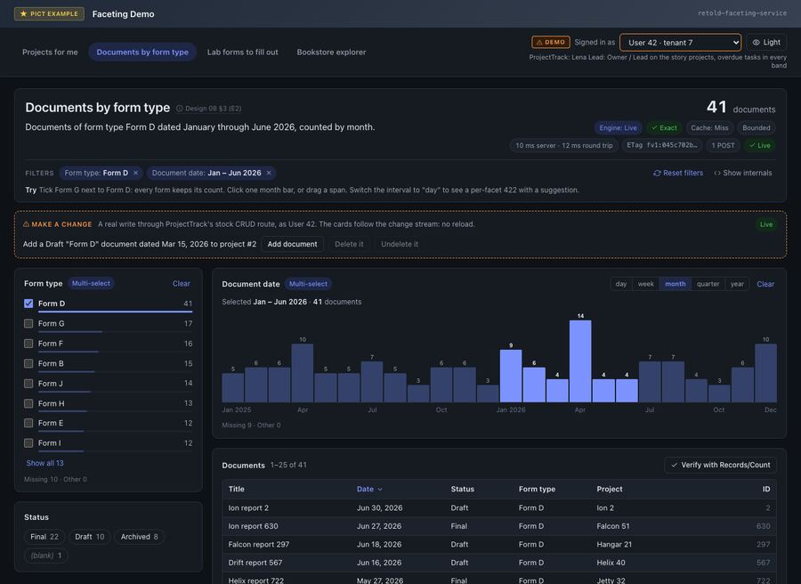

# E2: Documents by Form Type

> "Show me all the documents that are this form type, bucketed by month."

The second motivating question stays inside one entity, `Document`. What makes it worth a page is the interplay of two selections: a form-type checklist and a date window drawn on a histogram. Each facet ignores its own selection, so both stay usable while the list narrows.



## The Model

From the ProjectTrack fixture:

| Entity | Columns used here | Notes |
|---|---|---|
| `Document` | `IDDocument`, `Title`, `DocumentDate`, `Status`, `IDFormType`, `IDProject`, `IDCustomer` | Tenant-scoped, soft-deletable |
| `FormType` | `IDFormType`, `Name`, `Category` | A global lookup: no tenant column and no `Deleted` column |

Because `FormType` has no tenant column, the host lists it in `Scope.Policy.Exclude` and `Catalog.GlobalEntities` (the full options are on the [E1 page](#/page/examples/E1_Projects_For_Me)). Under a scope policy, an entity without the tenant column is facetable only when `Catalog.GlobalEntities` names it. [Security and Tenancy](#/page/Security_And_Tenancy) explains global entities.

No definitions are needed. Every facet on this page is an auto facet.

## The Request

`POST /1.0/Facet/Document/Query`, as the demo sends it on load: Form D (`IDFormType` 4) and the first half of 2026.

<!-- docs-check: request Fixture=ProjectTrack Entity=Document User=1 Tenant=1 -->
```json
{
	"Clauses":
	[
		{ "Type": "DistinctSelectedValueList", "FilterByColumn": "IDFormType", "Values": [ 4 ], "FilterKey": "IDFormType", "Hash": "Documents-ByForm" },
		{ "Type": "DateRange", "FilterByColumn": "DocumentDate", "Values": { "Start": "2026-01-01 00:00:00", "End": "2026-07-01 00:00:00" }, "EndExclusive": true, "FilterKey": "DocumentDate", "Hash": "Documents-ByMonth" }
	],
	"Facets":
	[
		{ "Key": "ByForm", "Facet": "Document.IDFormType", "Top": 20 },
		{ "Key": "ByMonth", "Facet": "Document.DocumentDate", "Interval": "month" },
		{ "Key": "Status", "Facet": "Document.Status" }
	],
	"Total": true,
	"Records": { "Begin": 0, "Cap": 25, "Sort": [ { "Field": "DocumentDate", "Dir": "DESC" } ] }
}
```

`EndExclusive: true` makes the window half-open: documents dated from 2026-01-01 00:00:00 up to, but not including, 2026-07-01. Every date bucket the service returns is half-open the same way, so a bucket's own clause never double-counts a boundary.

## The Answer

The real answer as the ProjectTrack lead (user 1 of tenant 1), abridged: freshness and display fields, every bucket's `Clause` and `Selection` except one, the eighteen month buckets outside the window, and all records after the third (and most of their columns) are left out.

```json
{
	"Entity": "Document",
	"Version": "fv1:dae7516bda3a3def",
	"Engine": "Live",
	"Exact": true,
	"Total": 41,
	"Filter": { "Applied": [ { "Hash": "Documents-ByForm" }, { "Hash": "Documents-ByMonth" } ], "Warnings": [] },
	"DependsOn": [ "Document", "FormType" ],
	"Facets":
	{
		"ByForm":
		{
			"Fold": "Terms", "Excluded": [ "Documents-ByForm" ], "Total": 194, "SumOfCounts": 184, "MissingCount": 10, "DistinctCount": 13,
			"Buckets":
			[
				{ "Key": 4, "Label": "Form D", "LabelResolved": true, "Count": 41, "Selected": true },
				{
					"Key": 7, "Label": "Form G", "LabelResolved": true, "Count": 17, "Selected": false,
					"Clause": { "Type": "DistinctSelectedValueList", "FilterByColumn": "IDFormType", "Values": [ 7 ], "FilterKey": "IDFormType", "ClauseKey": "DistinctSelectedValueList" }
				},
				{ "Key": 6, "Label": "Form F", "LabelResolved": true, "Count": 16, "Selected": false },
				{ "Key": 2, "Label": "Form B", "LabelResolved": true, "Count": 15, "Selected": false },
				{ "Key": 10, "Label": "Form J", "LabelResolved": true, "Count": 14, "Selected": false },
				{ "Key": 8, "Label": "Form H", "LabelResolved": true, "Count": 13, "Selected": false },
				{ "Key": 5, "Label": "Form E", "LabelResolved": true, "Count": 12, "Selected": false },
				{ "Key": 9, "Label": "Form I", "LabelResolved": true, "Count": 12, "Selected": false },
				{ "Key": 11, "Label": "Form K", "LabelResolved": true, "Count": 12, "Selected": false },
				{ "Key": 1, "Label": "Form A", "LabelResolved": true, "Count": 10, "Selected": false },
				{ "Key": 3, "Label": "Form C", "LabelResolved": true, "Count": 10, "Selected": false },
				{ "Key": 12, "Label": "Form L", "LabelResolved": true, "Count": 8, "Selected": false },
				{ "Key": 99, "Label": "99", "LabelResolved": false, "Count": 4, "Selected": false }
			]
		},
		"ByMonth":
		{
			"Fold": "DateHistogram", "Interval": "month", "Excluded": [ "Documents-ByMonth" ], "Total": 154, "SumOfCounts": 145, "MissingCount": 9,
			"Buckets":
			[
				{ "Key": "2026-01-01 00:00:00", "Label": "Jan 2026", "Count": 9, "Selected": true },
				{ "Key": "2026-02-01 00:00:00", "Label": "Feb 2026", "Count": 6, "Selected": true },
				{ "Key": "2026-03-01 00:00:00", "Label": "Mar 2026", "Count": 4, "Selected": true },
				{ "Key": "2026-04-01 00:00:00", "Label": "Apr 2026", "Count": 14, "Selected": true },
				{ "Key": "2026-05-01 00:00:00", "Label": "May 2026", "Count": 4, "Selected": true },
				{ "Key": "2026-06-01 00:00:00", "Label": "Jun 2026", "Count": 4, "Selected": true }
			]
		},
		"Status":
		{
			"Fold": "Terms", "Excluded": [], "Total": 41, "SumOfCounts": 41, "MissingCount": 0,
			"Buckets":
			[
				{ "Key": "Final", "Label": "Final", "Count": 22, "Selected": false },
				{ "Key": "Draft", "Label": "Draft", "Count": 10, "Selected": false },
				{ "Key": "Archived", "Label": "Archived", "Count": 8, "Selected": false },
				{ "Key": "", "Label": "", "Count": 1, "Selected": false }
			]
		}
	},
	"Records":
	[
		{ "IDDocument": 2, "Title": "Ion report 2", "DocumentDate": "2026-06-30 23:59:59", "Status": "Draft", "IDFormType": 4 },
		{ "IDDocument": 630, "Title": "Ion report 630", "DocumentDate": "2026-06-27 07:45:15", "Status": "Final", "IDFormType": 4 },
		{ "IDDocument": 297, "Title": "Falcon report 297", "DocumentDate": "2026-06-18 13:33:13", "Status": "Draft", "IDFormType": 4 }
	],
	"RecordShape": "Entity",
	"RecordsDropped": 0
}
```

## Reading the Answer

Each facet answers a slightly different question, because each one drops its own clause:

| Facet | Excludes | So it counts | Total |
|---|---|---|---|
| `ByForm` | the form-type clause | documents dated January to June 2026, of any form type | 194 |
| `ByMonth` | the date window | Form D documents of any date (the seed spans 2025 and 2026: 24 months) | 154 |
| `Status` | nothing (no status clause) | exactly the list: Form D, January to June 2026 | 41 |

That is why the form-type checklist keeps every count when Form D is ticked. Ticking Form G as well writes `Values: [ 4, 7 ]` into the same clause, and the total becomes 58 (41 plus 17), while `ByForm` itself still shows every form's count.

A few details in the buckets:

- **`99`** is a dangling key: four documents point at a form type that does not exist. The bucket keeps its key, says `LabelResolved: false`, and can still be selected. `MissingCount: 10` counts documents whose `IDFormType` is NULL.
- **The empty string** is a real status (`""`, one document), not a missing one.
- **Labels** for `IDFormType` come from `FormType.Name`, read through the `FormType` entity, which is why `DependsOn` lists `FormType`.

## Changing the Interval

The histogram's interval is part of the facet spec, not the filter. Switching `ByMonth` to `"Interval": "week"` leaves the date window clause alone, so the `Total` stays 41. The week buckets do not line up with the window: the first week starts on Monday 2025-12-29 and the last on Monday 2026-06-29. Those two weeks are only partly inside January to June, so the service does not mark them `Selected`:

```json
[
	{ "Key": "2025-12-29 00:00:00", "Label": "Week of 2025-12-29", "Count": 3, "Selected": false },
	{ "Key": "2026-01-05 00:00:00", "Label": "Week of 2026-01-05", "Count": 5, "Selected": true },
	{ "Key": "2026-06-22 00:00:00", "Label": "Week of 2026-06-22", "Count": 1, "Selected": true },
	{ "Key": "2026-06-29 00:00:00", "Label": "Week of 2026-06-29", "Count": 2, "Selected": false }
]
```

(Four of the 104 week buckets, abridged.) A bucket is `Selected` only when it lies entirely inside the selected range. The 25 selected weeks hold 38 of the 41 documents; the other three sit in the two edge weeks. The demo draws those edge weeks hatched and keeps reporting the window's own `Total`, never a sum of highlighted bars.

## When the Interval Is Too Fine

Ask for days and the histogram would need more buckets than `MaxDateBuckets` (400, reported by Describe). That facet fails on its own, with a suggestion, and the rest of the answer is still `200`:

<!-- docs-check: request Fixture=ProjectTrack Entity=Document User=1 Tenant=1 Expect=FACET_INTERVAL_TOO_FINE -->
```json
{
	"Clauses":
	[
		{ "Type": "DistinctSelectedValueList", "FilterByColumn": "IDFormType", "Values": [ 4 ], "FilterKey": "IDFormType", "Hash": "Documents-ByForm" },
		{ "Type": "DateRange", "FilterByColumn": "DocumentDate", "Values": { "Start": "2026-01-01 00:00:00", "End": "2026-07-01 00:00:00" }, "EndExclusive": true, "FilterKey": "DocumentDate", "Hash": "Documents-ByMonth" }
	],
	"Facets":
	[
		{ "Key": "ByForm", "Facet": "Document.IDFormType", "Top": 20 },
		{ "Key": "ByMonth", "Facet": "Document.DocumentDate", "Interval": "day" },
		{ "Key": "Status", "Facet": "Document.Status" }
	],
	"Total": true
}
```

The envelope has `Total: 41`, the `ByForm` and `Status` facets as before, and no `ByMonth` facet. Instead:

```json
{
	"Errors":
	{
		"ByMonth": { "Code": "FACET_INTERVAL_TOO_FINE", "Status": 422, "Message": "The interval produces too many buckets.", "Detail": { "Interval": "day", "MaxDateBuckets": 400, "Suggest": { "Interval": "week" } } }
	}
}
```

The demo turns `Detail.Suggest.Interval` into a "Use week" button on the card. [Errors and Limits](#/page/api/Errors_And_Limits) lists every per-facet and whole-request error.

## The List Agrees

The first page of 25 records arrived in the envelope, sorted by date, newest first. The next page is `POST /1.0/Facet/Document/Records/25/25` with the same `Clauses`; the demo's footer says which route each page came from. `POST /1.0/Facet/Document/Records/Count` with the same clauses answers `{ "Count": 41 }`.

## Related

- [K1 Terms](#/page/fold_kinds/001-terms) and [K2 DateHistogram](#/page/fold_kinds/002-date-histogram)
- [Concepts](#/page/Concepts): disjunctive faceting and half-open buckets
- [The Request Body](#/page/api/Request): `Interval`, `Top` and the clause types
- [E3: Lab Forms I Still Have to Fill Out](#/page/examples/E3_Lab_Forms_To_Fill_Out), the next question
