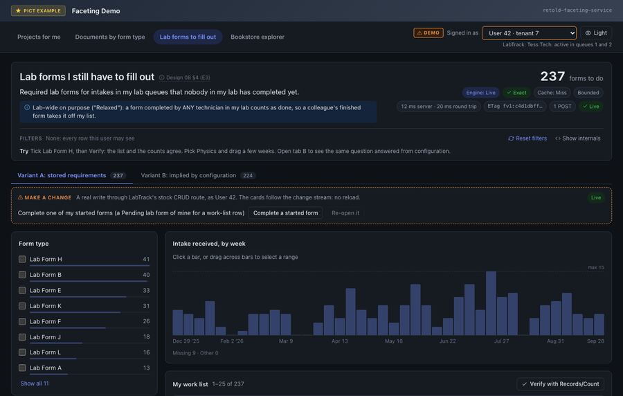
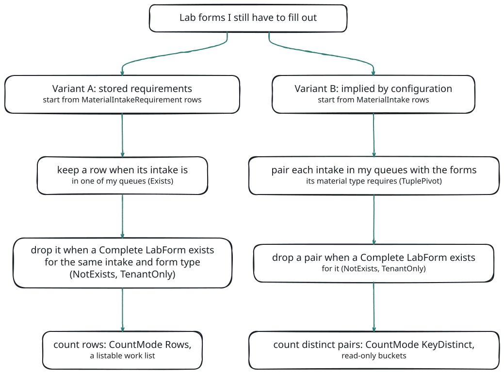

# E3: Lab Forms I Still Have to Fill Out

> "Show me all the lab forms that I have to fill out for my material lab queue intakes."

The third motivating question asks for work that is *missing*: forms required for intakes in my queues that nobody in my lab has completed yet. It needs an anti-join on a composite key (same intake **and** same form type), a hop that is deliberately lab-wide rather than personal, and a work list that agrees with the counts. The demo answers it two ways and compares them.



## The Question

Technicians are members of lab queues. Material intakes arrive in a queue, and every intake needs certain lab forms filled out. A required form is done when **anyone in my lab** has completed it for that intake; a form I only started still counts as to do.

Which forms does an intake need? The LabTrack domain stores the answer twice, and the two can disagree:

- **Variant A, stored requirements.** One `MaterialIntakeRequirement` row per (intake, form type).
- **Variant B, implied by configuration.** `MaterialTypeFormRequirement` says which forms a material type requires; an intake needs every form its material type requires.

<!-- bespoke diagram: edit diagrams/e3-variants.mmd or .hints.json, then: npx pict-renderer-graph build modules/meadow/retold-faceting-service/docs -->


## The Model

From the LabTrack fixture (`test/fixtures/LabTrack-Model.json`). Every entity except `LabFormType` carries the tenant column `IDCustomer` and a `Deleted` column.

| Entity | Columns used here | Notes |
|---|---|---|
| `LabQueue` | `IDLabQueue`, `Name` | |
| `LabQueueMember` | `IDLabQueue`, `IDUser`, `Active` | Who works which queue |
| `MaterialIntake` | `IDMaterialIntake`, `ReceivedDate`, `Status`, `IDLabQueue`, `IDMaterialType` | |
| `MaterialIntakeRequirement` | `IDMaterialIntake`, `IDLabFormType` | Variant A's stored requirements |
| `MaterialTypeFormRequirement` | `IDMaterialType`, `IDLabFormType`, `Required` | Variant B's configuration |
| `LabForm` | `IDMaterialIntake`, `IDLabFormType`, `Status`, `OwnerIDUser` | **Owner-scoped**: a user's list shows only their own forms |
| `LabFormType` | `IDLabFormType`, `Name`, `Discipline` | A global lookup |

The harness installs the service with the tenancy policy and a personal scope on `LabForm`:

```javascript
{
	Scope:
		{
			Policy:
				{
					Column: 'IDCustomer',
					SessionField: 'CustomerID',
					Exclude: [ 'LabFormType' ],
					PersonalScopes: { LabForm: { Column: 'OwnerIDUser', SessionField: 'UserID' } }
				},
			Guard: 'Strict'
		},
	Catalog: { GlobalEntities: [ 'LabFormType' ] },
	Definitions: { Path: false, Files: [ DEFINITIONS_PATH ] }
}
```

`DEFINITIONS_PATH` is `test/fixtures/LabTrack-Definitions.json`.

## The Definitions

The part of the domain's definitions file that E3 uses. (The file also declares a coverage facet for the test suite.)

<!-- docs-check: definitions Id=e3-labtrack-excerpt Fixture=LabTrack -->
```json
{
	"FormatVersion": 1,
	"Aliases":
	{
		"QueueMembers": [ ">MaterialIntake.IDLabQueue", "<LabQueueMember.IDLabQueue" ]
	},
	"Scopes":
	{
		"MaterialIntake.InMyQueues":
		{
			"Entity": "MaterialIntake",
			"Description": "Intakes in lab queues where I am an active member",
			"Where":
			[
				{ "Exists": { "Path": [ "@QueueMembers" ],
				              "Where": [ { "Field": "IDUser", "Op": "EQ", "Value": "$CurrentUser.IDUser" },
				                         { "Field": "Active", "Op": "EQ", "Value": 1 } ] } },
				{ "Field": "Status", "Op": "IN", "Value": [ "Received", "InProgress" ] }
			]
		},
		"MaterialIntakeRequirement.ToDoForMe":
		{
			"Entity": "MaterialIntakeRequirement",
			"Description": "Required lab forms for intakes in my queues that nobody in my lab has completed yet",
			"Where":
			[
				{ "Exists": { "Path": [ ">MaterialIntakeRequirement.IDMaterialIntake" ], "Where": [ { "Scope": "MaterialIntake.InMyQueues" } ] } },
				{ "NotExists": { "Path": [ { "Step": "=LabForm.IDMaterialIntake", "Scope": "TenantOnly",
				                             "ScopeReason": "A form completed by any technician in my lab satisfies the requirement." } ],
				                 "Where": [ { "Field": "Status", "Op": "EQ", "Value": "Complete" } ],
				                 "Correlate": [ [ "IDLabFormType", "IDLabFormType" ] ] } }
			]
		}
	},
	"Facets":
	[
		{
			"Facet": "MaterialIntakeRequirement.MyFormsToDo",
			"Version": 1,
			"Title": "Lab forms I still need to complete",
			"Pivot": "MaterialIntakeRequirement",
			"Where": [ { "Scope": "MaterialIntakeRequirement.ToDoForMe" } ],
			"Dimensions": [ { "Kind": "Terms", "Field": "IDLabFormType", "Labels": { "Path": [ ">MaterialIntakeRequirement.IDLabFormType" ], "Field": "Name" } } ],
			"Siblings":
			{
				"ByQueue": { "Kind": "Terms", "Path": [ ">MaterialIntakeRequirement.IDMaterialIntake", ">MaterialIntake.IDLabQueue" ], "Field": "IDLabQueue", "LabelField": "Name" },
				"ByDiscipline": { "Kind": "Terms", "Path": [ ">MaterialIntakeRequirement.IDLabFormType" ], "Field": "Discipline" },
				"ByWeek": { "Kind": "DateHistogram", "Path": [ ">MaterialIntakeRequirement.IDMaterialIntake" ], "Field": "ReceivedDate", "Interval": "week" },
				"Started": { "Kind": "ExistsSplit", "Path": [ "=LabForm.IDMaterialIntake" ], "Correlate": [ [ "IDLabFormType", "IDLabFormType" ] ],
				             "Where": [ { "Field": "Status", "Op": "NE", "Value": "Complete" } ], "Labels": { "true": "Started", "false": "Not started" } }
			},
			"CountMode": "Rows",
			"Exclude": "Self"
		},
		{
			"Facet": "MaterialIntake.FormsToDo",
			"Version": 1,
			"Title": "Lab forms I still need to complete (implied by material type)",
			"Home": "MaterialIntake",
			"Pivot":
			{
				"Tuple":
				{
					"From":
					[
						{ "As": "i", "Entity": "MaterialIntake", "Where": [ { "Scope": "MaterialIntake.InMyQueues" } ] },
						{ "As": "r", "Entity": "MaterialTypeFormRequirement", "Where": [ { "Field": "Required", "Op": "EQ", "Value": 1 } ] }
					],
					"On": [ [ "i.IDMaterialType", "r.IDMaterialType" ] ],
					"Key": [ "i.IDMaterialIntake", "r.IDLabFormType" ]
				}
			},
			"Where":
			[
				{ "NotExists": { "From": "i", "Path": [ { "Step": "<LabForm.IDMaterialIntake", "Scope": "TenantOnly", "ScopeReason": "Any technician's completed form satisfies the requirement." } ],
				                 "Where": [ { "Field": "Status", "Op": "EQ", "Value": "Complete" } ],
				                 "Correlate": [ [ "r.IDLabFormType", "IDLabFormType" ] ] } }
			],
			"Dimensions": [ { "Kind": "Terms", "Field": "r.IDLabFormType", "Labels": { "Path": [ ">MaterialTypeFormRequirement.IDLabFormType" ], "Field": "Name" } } ],
			"Siblings":
			{
				"ByQueue": { "Kind": "Terms", "Field": "i.IDLabQueue" },
				"ByWeek": { "Kind": "DateHistogram", "Field": "i.ReceivedDate", "Interval": "week" }
			},
			"CountMode": "Rows",
			"Records": { "Project": [ "i.IDMaterialIntake", "r.IDLabFormType", "i.ReceivedDate", "i.IDLabQueue" ] }
		}
	]
}
```

The new pieces, one at a time:

- **`@QueueMembers`** is an alias for a two-step path: from the intake to its queue (`>`, to-one), then to the queue's members (`<`, to-many). `InMyQueues` keeps intakes in a queue where I am an active member, still open (`Received` or `InProgress`).
- **`=LabForm.IDMaterialIntake`** is a **co-reference** step: from a requirement to the lab forms that point at the *same intake* the requirement points at. Neither entity references the other directly; both reference `MaterialIntake`.
- **`Correlate: [ [ "IDLabFormType", "IDLabFormType" ] ]`** adds the second half of the composite key: the form must also be of the requirement's form type. `NotExists` then keeps the requirement only when no such completed form exists ([K11 AntiPath](#/page/fold_kinds/011-anti-path)).
- **`"Scope": "TenantOnly"`** on that step relaxes `LabForm`'s personal scope for this one hop. A user's list of forms shows only their own, but here a colleague's completed form must count. The step keeps the tenant filter and drops exactly the owner column, and the answer reports `Relaxed: true`. A definition that tried to relax an entity's only policy column would be disabled at load.
- **`MyFormsToDo`** is a declared facet with **siblings**. Each sibling is a facet of its own (`MaterialIntakeRequirement.MyFormsToDo/ByQueue` and so on) that shares the parent's pivot and `Where`. The siblings read across paths: `ByQueue` crosses two to-one hops, `ByWeek` buckets the intake's received date ([K8 PathTerms](#/page/fold_kinds/008-path-terms)), and `Started` splits the rows by whether a form I started (not yet complete) exists ([K20 ExistsSplit](#/page/fold_kinds/020-exists-split)). `Started` has no `TenantOnly`, so only my own forms count as started.
- **`FormsToDo`** is a [K18 TuplePivot](#/page/fold_kinds/018-tuple-pivot): it counts distinct `(intake, form type)` tuples built by joining intakes in my queues to the required configuration rows, minus the tuples with a completed form.

The registry loads `FormsToDo` with two warnings and no disabled entries: `Ignored:Records` (this version does not list TuplePivot records) and `CountModeCanonicalized` (a TuplePivot counts distinct keys, so its count mode becomes `KeyDistinct`).

## Variant A: Stored Requirements

The demo posts variant A to the **route scope** form, so the named scope is the list's base filter:

```text
POST /1.0/Facet/MaterialIntakeRequirement/Scope/MaterialIntakeRequirement.ToDoForMe/Query
```

<!-- docs-check: request Fixture=LabTrack Entity=MaterialIntakeRequirement Scope=MaterialIntakeRequirement.ToDoForMe User=1 Tenant=1 -->
```json
{
	"Clauses": [],
	"Facets":
	[
		{ "Key": "ToDo", "Facet": "MaterialIntakeRequirement.MyFormsToDo", "Top": 20 },
		{ "Key": "Queue", "Facet": "MaterialIntakeRequirement.MyFormsToDo/ByQueue" },
		{ "Key": "Week", "Facet": "MaterialIntakeRequirement.MyFormsToDo/ByWeek" },
		{ "Key": "Discipline", "Facet": "MaterialIntakeRequirement.MyFormsToDo/ByDiscipline" },
		{ "Key": "Started", "Facet": "MaterialIntakeRequirement.MyFormsToDo/Started" }
	],
	"Total": true,
	"Records": { "Begin": 0, "Cap": 25, "Sort": [ { "Field": "IDMaterialIntake", "Dir": "ASC" } ] }
}
```

The real answer as the LabTrack technician (user 1 of tenant 1; user 42 of tenant 7 in the demo), abridged: freshness and display fields, each bucket's `Selected`, `LabelResolved` and `Selection`, the `Clause` of all but three of the buckets that have one, 37 of the 40 week buckets and the records are left out.

```json
{
	"Entity": "MaterialIntakeRequirement",
	"Version": "fv1:5b122730a7f4db84",
	"Engine": "Live",
	"Exact": true,
	"Total": 237,
	"Filter": { "Applied": [ { "Scope": "MaterialIntakeRequirement.ToDoForMe" } ], "Warnings": [] },
	"DependsOn": [ "LabForm", "LabFormType", "LabQueue", "LabQueueMember", "MaterialIntake", "MaterialIntakeRequirement" ],
	"Facets":
	{
		"ToDo":
		{
			"Fold": "Terms", "Declared": true, "Relaxed": true, "Semantics": "NoVisibleMatch", "CountMode": "Rows", "Total": 237,
			"Buckets":
			[
				{
					"Key": 8, "Label": "Lab Form H", "Count": 41,
					"Clause": { "Type": "DistinctSelectedValueList", "FilterByColumn": "IDLabFormType", "Values": [ 8 ], "FilterKey": "IDLabFormType", "ClauseKey": "DistinctSelectedValueList" }
				},
				{ "Key": 2, "Label": "Lab Form B", "Count": 40 },
				{ "Key": 5, "Label": "Lab Form E", "Count": 33 },
				{ "Key": 11, "Label": "Lab Form K", "Count": 31 },
				{ "Key": 6, "Label": "Lab Form F", "Count": 26 },
				{ "Key": 10, "Label": "Lab Form J", "Count": 18 },
				{ "Key": 12, "Label": "Lab Form L", "Count": 16 },
				{ "Key": 1, "Label": "Lab Form A", "Count": 13 },
				{ "Key": 7, "Label": "Lab Form G", "Count": 9 },
				{ "Key": 4, "Label": "Lab Form D", "Count": 6 },
				{ "Key": 3, "Label": "Lab Form C", "Count": 4 }
			]
		},
		"Queue":
		{
			"Fold": "Terms", "Path": [ ">MaterialIntakeRequirement.IDMaterialIntake", ">MaterialIntake.IDLabQueue" ], "Total": 237,
			"Buckets":
			[
				{ "Key": 1, "Label": "Receiving", "Count": 136, "Clause": null },
				{ "Key": 2, "Label": "Wet Lab", "Count": 101, "Clause": null }
			]
		},
		"Week":
		{
			"Fold": "DateHistogram", "Interval": "week", "Path": [ ">MaterialIntakeRequirement.IDMaterialIntake" ], "Total": 237, "SumOfCounts": 228, "MissingCount": 9,
			"Buckets":
			[
				{
					"Key": "2025-12-29 00:00:00", "Label": "Week of 2025-12-29", "Count": 6,
					"Clause": { "Type": "InternalJoinDateRange", "RemoteTable": "MaterialIntake", "JoinInternalConnectionColumn": "IDMaterialIntake", "JoinExternalConnectionColumn": "IDMaterialIntake", "ExternalFilterByColumns": [ "ReceivedDate" ], "Values": { "Start": "2025-12-29 00:00:00", "End": "2026-01-05 00:00:00" }, "EndExclusive": true, "FilterKey": "MaterialIntakeRequirement.MyFormsToDo/ByWeek", "ClauseKey": "InternalJoinDateRange" }
				},
				{ "Key": "2026-01-05 00:00:00", "Label": "Week of 2026-01-05", "Count": 5 },
				{ "Key": "2026-01-12 00:00:00", "Label": "Week of 2026-01-12", "Count": 4 }
			]
		},
		"Discipline":
		{
			"Fold": "Terms", "Path": [ ">MaterialIntakeRequirement.IDLabFormType" ], "Total": 237,
			"Buckets":
			[
				{
					"Key": "Physics", "Label": "Physics", "Count": 84,
					"Clause": { "Type": "InternalJoinMatch", "RemoteTable": "LabFormType", "JoinInternalConnectionColumn": "IDLabFormType", "JoinExternalConnectionColumn": "IDLabFormType", "ExternalFilterByColumns": [ "Discipline" ], "ExactMatch": true, "Values": [ "Physics" ], "FilterKey": "MaterialIntakeRequirement.MyFormsToDo/ByDiscipline", "ClauseKey": "InternalJoinMatch" }
				},
				{ "Key": "Chemistry", "Label": "Chemistry", "Count": 47 },
				{ "Key": "Biology", "Label": "Biology", "Count": 46 },
				{ "Key": "Materials", "Label": "Materials", "Count": 44 },
				{ "Key": "", "Label": "", "Count": 16 }
			]
		},
		"Started":
		{
			"Fold": "ExistsSplit", "Path": [ "=LabForm.IDMaterialIntake" ], "Total": 237,
			"Buckets":
			[
				{ "Key": 1, "Label": "Started", "Count": 47, "Clause": null },
				{ "Key": 0, "Label": "Not started", "Count": 190, "Clause": null }
			]
		}
	},
	"RecordShape": "Entity",
	"RecordsDropped": 0
}
```

What the answer shows:

- **237 forms to do**, with every facet totalling 237 too. Each bucket of every facet is a set of those requirement rows.
- **Path facets still filter the list.** The `Discipline` bucket's clause is an `InternalJoinMatch` into `LabFormType`; the `Week` bucket's clause is an `InternalJoinDateRange` on the intake's received date. Both are ordinary pict clauses a recordset can carry. Picking Physics gives 84, and Physics plus the first five weeks gives 8; `Records/Count` agrees each time.
- **Some buckets have no clause.** `Queue` crosses two hops, and `Started` is an existence test; no single list clause selects exactly those rows, so the demo shows both cards read-only.

> **Planned.** Selecting buckets that carry no list clause.

### Why the Route Scope

The facet's own `Where` already names the `ToDoForMe` scope, so `ToDo` counts 237 under any filter. Post the same facets to the plain route, without the scope, and the envelope `Total` counts every requirement row this user can see, 1,022, while `ToDo` still says 237. A declared facet's `Where` is part of its definition and never excluded. Putting the scope in the route makes it the base of the whole request, so `Total`, every facet and the list are the same 237 rows.

### The Work List

The list is a [pict-section-recordset](#/doc/pict/pict-section-recordset) pointed at the same route scope:

<!-- docs-check: skip pict-section-recordset configuration -->
```json
{
	"RecordSet": "MaterialIntakeRequirement",
	"RecordSetType": "MeadowEndpoint",
	"FilterEndpointOverride": "Facet/MaterialIntakeRequirement/Scope/MaterialIntakeRequirement.ToDoForMe/Records"
}
```

It posts `{ Clauses, Experience }` to `…/Records/<Offset>/<PageSize>` for each page, and to `…/Records/Count` for the count:

<!-- docs-check: request Fixture=LabTrack Entity=MaterialIntakeRequirement Route=Records/Count Scope=MaterialIntakeRequirement.ToDoForMe User=1 Tenant=1 -->
```json
{
	"Clauses": [],
	"Experience": {}
}
```

The count is `{ "Count": 237 }`. The first page of five, from `…/Records/0/5`, abridged to three columns:

```json
[
	{ "IDMaterialIntakeRequirement": 19, "IDMaterialIntake": 7, "IDLabFormType": 1 },
	{ "IDMaterialIntakeRequirement": 22, "IDMaterialIntake": 8, "IDLabFormType": 1 },
	{ "IDMaterialIntakeRequirement": 23, "IDMaterialIntake": 8, "IDLabFormType": 2 },
	{ "IDMaterialIntakeRequirement": 24, "IDMaterialIntake": 8, "IDLabFormType": 5 },
	{ "IDMaterialIntakeRequirement": 26, "IDMaterialIntake": 9, "IDLabFormType": 10 }
]
```

The demo fills the list's other columns (material, received date, queue, discipline, started) by reading the related rows through the faceting `Records` route of each related entity, under the same tenancy and personal scopes.

## Variant B: Implied by Configuration

`POST /1.0/Facet/MaterialIntake/Query`:

<!-- docs-check: request Fixture=LabTrack Entity=MaterialIntake User=1 Tenant=1 -->
```json
{
	"Clauses": [],
	"Facets":
	[
		{ "Key": "ToDo", "Facet": "MaterialIntake.FormsToDo", "Top": 20 },
		{ "Key": "Queue", "Facet": "MaterialIntake.FormsToDo/ByQueue" },
		{ "Key": "Week", "Facet": "MaterialIntake.FormsToDo/ByWeek" }
	],
	"Total": false
}
```

The answer, abridged in the same way (and to the first two form types):

```json
{
	"Entity": "MaterialIntake",
	"Version": "fv1:65120b364d1bbb7e",
	"Engine": "Live",
	"Exact": true,
	"Filter": { "Applied": [], "Warnings": [] },
	"DependsOn": [ "LabForm", "LabFormType", "LabQueue", "LabQueueMember", "MaterialIntake", "MaterialTypeFormRequirement" ],
	"Facets":
	{
		"ToDo":
		{
			"Fold": "Terms", "Declared": true, "Disjunctive": "NotApplicable", "CountMode": "KeyDistinct", "Relaxed": true, "Semantics": "NoVisibleMatch", "Total": 224,
			"Buckets":
			[
				{ "Key": 2, "Label": "Lab Form B", "LabelResolved": true, "Count": 40, "Selected": false, "Clause": null },
				{ "Key": 8, "Label": "Lab Form H", "LabelResolved": true, "Count": 38, "Selected": false, "Clause": null }
			]
		},
		"Queue":
		{
			"Fold": "Terms", "CountMode": "KeyDistinct", "Total": 224,
			"Buckets":
			[
				{ "Key": 1, "Label": "Receiving", "Count": 125, "Clause": null },
				{ "Key": 2, "Label": "Wet Lab", "Count": 99, "Clause": null }
			]
		}
	}
}
```

Variant B's request asks for no envelope `Total`, so the answer has none; the forms-to-do count is the `ToDo` facet's `Total`. None of its buckets carries a clause. The demo shows tab B read-only, with no work list.

## Why the Variants Differ

As this user, variant A finds 237 forms to do and variant B finds 224. The demo's compare panel matches them pair by pair:

| | Count |
|---|---|
| In both variants | 219 |
| Stored only (A) | 18 |
| Configured only (B) | 5 |

So 237 − 18 = 224 − 5 = 219. The differences are planted by the seed. A has 18 stored requirements that no `Required` configuration row asks for: the seed gives intakes whose material type requires fewer than three forms some extra forms. B has 5 configured pairs whose stored requirement row was soft-deleted. Only two of the eleven form types (C and D) match exactly.

Neither variant is "right". A answers from what the system recorded; B answers from what the configuration implies. The test suite checks each variant against its own hand-written oracle; the demo puts them side by side so the difference is visible.

## Other Users

The body never names a user, so the same requests answer each principal differently:

| Principal | Variant A | Variant B |
|---|---|---|
| Technician, queues 1 and 2 (user 1, tenant 1) | 237 | 224 |
| Colleague, queues 1 and 6 (user 2, tenant 1) | 172 | 157 |
| Newcomer in no queue (user 3, tenant 1) | 0 | 0 |
| The other tenant's technician | 60 | 34 |

In the demo, completing one of my started forms through "Make a change" takes variant A from 237 to 236, and the row leaves the work list; re-opening it brings it back.

## Related

- [K11 AntiPath](#/page/fold_kinds/011-anti-path), [K18 TuplePivot](#/page/fold_kinds/018-tuple-pivot), [K20 ExistsSplit](#/page/fold_kinds/020-exists-split) and [K8 PathTerms](#/page/fold_kinds/008-path-terms)
- [Definitions Files](#/page/Definitions): co-reference steps, `Correlate`, siblings and tuple pivots
- [Security and Tenancy](#/page/Security_And_Tenancy): personal scopes and `TenantOnly`
- [Records, Count and Keys](#/page/api/Records_And_Keys): the `/Scope/:Scope/` route forms
- [Bookstore Explorer](#/page/examples/Bookstore_Explorer), the last example
