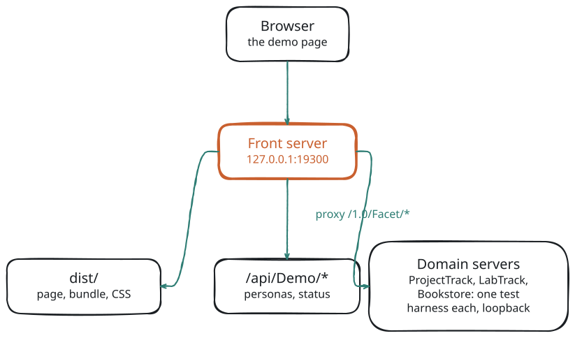

# The Faceting Demo

The faceting demo is a pict single-page application over three seeded domains. Each of its four pages asks one question, shows the facets beside the list they agree with, and lets you inspect every request and envelope. It lives in `example_applications/faceting_demo`.


## Run It

The demo needs its Node host: the pages talk to real faceting routes. Inside the retold monorepo it has no install step of its own, because its dependencies resolve from the umbrella `node_modules`.

Outside the monorepo (a standalone clone of the module), install twice: once at the module root, for the test harness's development dependencies (retold-data-service, meadow-endpoints, meadow-connection-sqlite, pict and the rest), and once in the demo folder, for its own dependencies and build tools:

```bash
npm install                                   # at the module root
cd example_applications/faceting_demo
npm install
npm start
```

`DEMO_PG=1` and `DEMO_CLICKHOUSE=1` also need docker, for the throwaway database containers.

```bash
cd example_applications/faceting_demo
npm start                     # builds dist/ when needed, then serves http://127.0.0.1:19300/
DEMO_CLICKHOUSE=1 npm start   # also mirrors every domain into a ClickHouse store (needs docker)
npm test                      # end-to-end smoke through the demo's front server (port 19301)
npm run check:browser         # the built page in headless Chrome, every page's gestures (port 19302)
```

`npm run check:browser` writes its screenshots to the operating system's temp folder; `DEMO_UPDATE_SCREENSHOTS=1 npm run check:browser` refreshes the tracked `screenshots/` folder instead. `npm run example` at the module root (`npx quack examples`) serves only the static shell, so its pages report that the demo host is not answering.

| Variable | Default | Meaning |
|---|---|---|
| `DEMO_PORT` | `19300` | Front server port (19300 to 19310 accepted) |
| `DEMO_HOST` | `127.0.0.1` | Front server bind address. Leave it on loopback (see *Demo-Only Parts* below) |
| `DEMO_SCALE` | `Small` | Fixture scale, `Small` or `Medium` (four times the rows) |
| `DEMO_PG` | unset | `1` runs every domain on PostgreSQL in the throwaway `rfs-test-postgres` container; start with `TZ=UTC` |
| `DEMO_CLICKHOUSE` | unset | `1` mirrors every entity into the throwaway `rfs-test-clickhouse` container |
| `DEMO_SKIP_BUILD` | unset | `1` skips the build step of `npm start` |

## How It Is Put Together

<!-- bespoke diagram: edit diagrams/demo-topology.mmd or .hints.json, then: npx pict-renderer-graph build modules/meadow/retold-faceting-service/docs -->


The front server (`server/Faceting-Demo-Front.js`, plain `node:http`) answers these paths:

| Path | What it serves |
|---|---|
| `/` | `dist/`: the page, the bundle, `pict.min.js` and the CSS |
| `/api/Demo/Principals` | The demo persona table |
| `/api/Demo/Status` | Each domain's entities, counts and definitions |
| `/api/<Domain>/1.0/Facet/*` | Proxied to that domain's server on `127.0.0.1` and an ephemeral port: one run of the module's test harness (seeded in-memory SQLite, retold-data-service, faceting installed `Embedded`) |

`<Domain>` is `ProjectTrack`, `LabTrack` or `Bookstore`. Each domain server is one run of the module's test harness (`test/support/Facet-Test-Harness.js`), so everything the demo uses is exercised by the test suite. The Bookstore domain loads `server/definitions/Bookstore-Demo-Definitions.json` on top of the auto facets.

The browser code in `source/` is laid out so it can later become a reusable pict section:

| File | Role |
|---|---|
| `providers/Pict-Provider-Facet.js` | Describe, query, records, count and lookups; one POST per group per change; the Version cache; the change stream |
| `providers/Facet-Selection.js` | Pure: request bodies, bucket write-back, range coverage |
| `providers/Facet-Changes.js` | Pure: the server-sent events parser, which groups a change refetches, reconnect backoff |
| `providers/Facet-Display.js`, `providers/Facet-Lookup.js` | Pure display and related-row lookup helpers |
| `views/PictView-Facet-*.js` | The widgets: Scope, Terms, Histogram, Pivot, Records, Inspector |
| `pages/FacetDemo-Pages.js` | The four pages as data: groups, facets, initial selections and layout |

> **Planned.** A reusable `pict-section-facet` built from these providers and views.

## The Page Shell

Every page has the same parts, top to bottom.

- **The question.** The page head states its question in words and lists every active filter as a removable chip: scopes with their parameters, then each selection.
- **The summary strip.** The `Total`, the engine that answered (`Engine: Live`), `Exact`, server and round-trip times, the answer's ETag, and the cache status.
- **Facet cards.** Checklists, chips, bars, histograms and a pivot. Cards whose buckets carry a `Clause` are clickable, and a card that keeps several selections at once is badged "Multi-select". Cards whose buckets carry none (`Clause: null`, such as a child-count band) are badged "Read-only".
- **The list.** Page 1 arrives inside the Query envelope (its `Records`); later pages come from `POST …/Records/:Begin/:Cap`. "Verify with Records/Count" posts the same filter to `…/Records/Count` and compares the answer with the `Total` on screen.
- **The inspector.** The drawer at the bottom lists the page's exchanges (Query, Records, Count, Describe, lookups, change events and writes) with the request, the envelope and the raw JSON of each.

The **DEMO "Signed in as"** switcher in the header picks a persona, so the same request can be seen answering differently per user. With the initial filters, user 42 sees 6 projects and user 81, in the other tenant, sees 1.

## How the Client Talks to the Service

The client keeps one **group** per question: an entity, its facet specs, its scopes, its selections and an optional records page. Four rules make the list and the counts agree.

### Copy the Clause, Change Only Its Values

A widget never builds a filter clause. When you tick a term, it copies the `Clause` the server put on that bucket of the current envelope and sets `Values` to the selected keys. This is the demo's Terms write-back, from `providers/Facet-Selection.js`:

```javascript
const termsClause = (pTemplateClause, pSelectedKeys) =>
{
	if (!pTemplateClause || !Array.isArray(pTemplateClause.Values) || !Array.isArray(pSelectedKeys) || (pSelectedKeys.length < 1))
	{
		return null;
	}
	let tmpClause = cloneJSON(pTemplateClause);
	tmpClause.Values = pSelectedKeys.slice();
	delete tmpClause.Hash;
	return tmpClause;
};
```

The other gestures follow the same rule:

| Gesture | New selection |
|---|---|
| Tick or untick a term | The clicked bucket's `Clause` with `Values` set to the selected keys, in bucket order; nothing selected clears it |
| Click a histogram bar | That bucket's own `Clause` (`DateRange`, `NumericRange`, `InternalJoinDateRange`, …); clicking the only selected bar again clears it |
| Drag across bars | The first bucket's `Clause` with `Values` spanning the first bucket's `Start` to the last bucket's `End` |
| Click a pivot cell | The single-key bucket `Clause` of each of the two 1-D facets the pivot is drawn from, sent together in one request |

### Name Each Selection

When it builds the request, the client stamps each selection with `Hash: '<Group>-<FacetKey>'` (for example `Projects-Status`). The envelope then names it in `Filter.Applied` and in each facet's `Excluded`, so the page can show which facet ignored which selection.

### One Request per Change

Every refresh of a group within 10 ms is merged into one POST, so a pivot cell (two selections) or a scope toggle plus a parameter chip cost one Query. A newer request supersedes one in flight: the older fetch is aborted and its answer is never applied.

### Revalidate with the ETag

Answers are cached in the browser by request and principal. A repeated request sends `If-None-Match` with the cached ETag, and a `304` reuses the cached body. Errors are never cached. The inspector screenshot above shows such a 304.

## Live Changes

Every page has a dashed **Make a change** card. It makes one real write through the domain's stock CRUD routes as the current persona, for example setting a project's status or adding a document.


In the screenshot, "Add document" took the total from 41 to 42 by itself; the strip says "Live update: Document" and "Exact (MinSeq)".

The domains run with the result cache on (`Cache: { Enabled: true }`), so this is what happens:

1. The service's change intake sees the write on the entity's CRUD route and bumps the generations of what it touched.
2. The change feed (`GET /1.0/Facet/Changes`, proxied by the front server) sends each persona who can see that data a `generation` event naming the entity.
3. The page waits a random 0 to 150 ms, then refetches the groups whose envelope `DependsOn` names that entity. The refetch carries `If-None-Match` and the event's `Seq` as `Freshness.MinSeq`, so the server answers exact (or `304`).

Queries normally ask for `Freshness: { Mode: 'Bounded', MaxLagMS: 5000 }`. A persona who did not make the write can briefly get a cached answer marked `Stale`; the page then asks again by itself. Personas in another tenant receive no event at all. [Caching and Invalidation](#/page/Caching_And_Invalidation) and [The Change Feed](#/page/api/Change_Feed) describe the server side.

The demo turns on three switches a multi-tenant deployment should leave at their defaults: `Cache.ExposeStatus` (the `X-Retold-Facet-Cache` and `-Freshness` headers the inspector shows), `Freshness.SeqHeader` and `SSE.IncludeSeq` (the node-wide change counter on answers and events). By default a host with a scope policy keeps these from clients, because they reveal other tenants' activity.

## The ClickHouse Toggle

With `DEMO_CLICKHOUSE=1`, every domain also mirrors every entity into a ClickHouse store, and the result cache is turned off so it cannot hide the store's answers. The page then shows:

- **Which engine answered** each facet (`Engine: ClickHouse`, or a count per engine), and how far behind the store is when an answer is not exact.
- **An engine toggle**: `Auto` (the page's `Bounded` freshness lets the server use the store when it is at most 5 seconds behind), `Live` (`Engine: 'Live'` in the body) and `Store (Fast)` (`Freshness: { Mode: 'Fast' }`).
- **Live vs Store**, which asks the page's question both ways and compares the numbers.

After "Make a change", the refetch asks for an exact answer, so it is answered Live until the store has applied the write. [The ClickHouse Store](#/page/ClickHouse_Store) explains the routing.

## Things to Try

These numbers start from the demo's initial state on the `Small` seed, as user 42. The demo's smoke test checks each of them, and checks every count against `Records/Count`.

| Page | Gesture | Result |
|---|---|---|
| Projects for me | Tick `OnHold` | Total 6 becomes 7; the Status card's own counts do not move |
| Projects for me | Click the Active by Iris Media pivot cell | Total 2 |
| Documents by form type | Tick Form G next to Form D | Total 58; every form keeps its count |
| Documents by form type | Switch the interval to "day" | The month card shows `422 FACET_INTERVAL_TOO_FINE` with a "Use week" button |
| Lab forms (A) | Tick Lab Form H, then Verify | 41 = 41 |
| Lab forms (A) | Physics, then drag the first five weeks | Total 8 |
| Bookstore explorer | Turn on "Well reviewed", then drag 2000 to 2019 | Total 614 |
| Any page | Switch to the Anonymous persona | `401 FACET_UNAUTHENTICATED` |

Each example page walks through its question in detail: [E1](#/page/examples/E1_Projects_For_Me), [E2](#/page/examples/E2_Documents_By_Form_Type), [E3](#/page/examples/E3_Lab_Forms_To_Fill_Out) and the [Bookstore Explorer](#/page/examples/Bookstore_Explorer).

## Demo-Only Parts

The persona switcher is a demo device. Never deploy it. A real host resolves the principal from its own session; see [Security and Tenancy](#/page/Security_And_Tenancy).

- The switcher sends a persona key in the `X-Retold-Facet-Demo-Principal` header. The front server looks the key up in a fixed table (`server/Faceting-Demo-Personas.js`) and forwards the test harness's session headers. The browser never sends IDs, and test headers it sends are dropped.
- The front server binds `127.0.0.1` and answers only loopback host names. The domain servers listen on `127.0.0.1` only and refuse any non-loopback client before the first connection.
- The proxy forwards only `GET` and `POST` under `/1.0/Facet/`, plus an allowlist of seven write routes for "Make a change". Each domain also has write guards that refuse a write into another tenant's or another user's data.

`DEMO_HOST=0.0.0.0` exposes the switcher to the network. Do not use it.

## Related

- The example pages: [E1: Projects for Me](#/page/examples/E1_Projects_For_Me), [E2: Documents by Form Type](#/page/examples/E2_Documents_By_Form_Type), [E3: Lab Forms I Still Have to Fill Out](#/page/examples/E3_Lab_Forms_To_Fill_Out) and the [Bookstore Explorer](#/page/examples/Bookstore_Explorer)
- [Caching and Invalidation](#/page/Caching_And_Invalidation): the result cache and the change feed the demo turns on
- [The ClickHouse Store](#/page/ClickHouse_Store): what the ClickHouse toggle exercises
- [Security and Tenancy](#/page/Security_And_Tenancy): how a real host resolves the principal the persona switcher fakes
